# 量子手写数字识别 · Quantum MNIST


> 用参数化量子电路（VQC）做 MNIST 手写数字分类，并与同输入维度的经典 MLP 放在同一套训练配置下对照。**可复现、纯模拟、不接真机。**

本仓库只做一件事：量子机器学习版本的 MNIST 分类。姊妹仓库 [quantum-llm](https://github.com/quantum-machine-learning-code/quantum-llm) 做玩具级量子增强语言模型，两者代码各自自包含，可独立 clone 与运行。

## 快速结论（2026-11-06 五轮 5 seed 重跑）

真实 MNIST IDX、10 类、200 张固定测试集、**5 个 seed**，报告均值 ± 标准差。Python 3.13 / PennyLane 0.45.1 / torch 2.15 CPU。原始数据归档在 [`docs/multiseed_metrics.json`](docs/multiseed_metrics.json)、[`docs/ceiling_metrics.json`](docs/ceiling_metrics.json)、[`docs/readout_metrics.json`](docs/readout_metrics.json)、[`docs/info_metrics.json`](docs/info_metrics.json)、[`docs/push_metrics.json`](docs/push_metrics.json) 与 [`docs/budget_metrics.json`](docs/budget_metrics.json)，复现命令见[快速开始](#快速开始)。

> **口径**：第一~四轮用 600/200 的直接抽样；第五轮为了让「数据规模」组可比，改成从 3000 张训练池按类取嵌套子集、测试集固定。跨轮绝对数值不逐位可比（同配置的 40 维基线 0.7720 → 0.7690），**组内配对统计有效**。

| 模型 | 训练图 | 参数量 | 测试准确率（5 seed） | 单 seed 耗时 |
| --- | --- | --- | --- | --- |
| 原基线：Angle-4 + Linear 头 | 600 | 74 | 0.4320 ± 0.0375 | 16.1 s |
| 二轮：Amp10 + MLP×5（仅 Z 读出） | 600 | 742 | 0.6640 ± 0.0216 | 48.2 s |
| 四轮：Amp10 + 40 维读出 | 600 | 1702 | 0.7720 ± 0.0115 | 96.4 s |
| 五轮：Amp10 + 75 维读出（全部 ZZ 两体） | 600 | 2822 | 0.8250 ± 0.0127 | 155 s |
| **五轮：Amp10 + 165 维读出（ZZ+XX+YY）** | 600 | 5702 | **0.8450 ± 0.0100** | 556 s |
| **五轮：165 维 + 1800 张图 / 8 epochs** | 1800 | 5702 | **0.8660 ± 0.0185** | 530 s |
| 经典 MLP-784（600 张，同批次） | 600 | 25450 | 0.8580 ± 0.0130 | 0.8 s |
| 经典 PCA-165 + 同结构头（600 张） | 600 | 5642 | 0.8440 ± 0.0089 | 0.7 s |
| **经典 PCA-165 + 同结构头（1800 张，等数据 ≈ 等参数）** | 1800 | 5642 | **0.9030 ± 0.0097** | 0.7 s |

- **第五轮把 0.7690 推到 0.8450，再配合更多数据到 0.8660**：40 → 165 维读出配对 **+7.60 ± 2.38 pt**（CI [+4.64, +10.56]，5/5 seed 为正）；再加 1800 张真图为 **+2.10 ± 2.48 pt**（CI [−0.99, +5.19] 跨 0，不显著）。量子电路参数始终是 60 个，新增的只有观测量与分类头第一层。
- **诊断结论：不是量子层训不动，而是读得太少、看得太少**。165 维读出在**完全不训练**的随机酉下冻结上界已有 0.860；训练 24 epochs 后量子权重只移动 6.9%，梯度范数反而从 0.048 涨到 0.897（排除 barren plateau），上界也只到 0.890。40 维模型 train loss 已降到 0.167 而 test acc 0.775，是**过拟合**，继续加 epoch 没有空间。详见下方「第五轮：信息上界诊断」一节与 [REVIEW.md 第 10 节](docs/REVIEW.md)。
- **首次与同批次经典基线统计打平**：165 维量子模型 0.8450 对经典 MLP-784 0.8580 / PCA-165 0.8440 / 轻量 CNN 0.8550，三组配对差值 CI 全部跨 0；但**等数据 + 近似等参数预算**的 `PCA-165 + 同结构头（1800 张）` 是 **0.9030 ± 0.0097**，仍领先最佳量子组 3.7 pt，且单 seed 耗时相差两个数量级（约 530 s vs 0.7 s）。**不宣称量子优势**。
- **两个负结果**：分类头 hidden 32 → 128 只 +0.20 pt（不显著）；±1px 平移增强反而 −4.40 pt —— 振幅编码没有平移不变性，增强样本与测试分布不匹配。详见 [REVIEW.md 第 11 节](docs/REVIEW.md)。
- 第二轮量子模型相对原基线 **+23.20 ± 5.40 个百分点**（95% CI [+16.49, +29.91]，5 个 seed 全部为正），是输入表示、分类头、输出缩放、训练预算与量子参数量的**联合效果**；四轮把 40 维读出相对 0.6640 基线配对 **+10.80 ± 1.35 pt**，冻结探针从 0.679 升到 0.811，证明多出来的观测量真的带信息。
- 旧的「振幅编码比角度编码好 +15.5 pt」**已证伪**：严格受控（同 10 qubits / 同 170 参数 / 同分类头 / 初始权重逐元素相同）下，5 seed 配对差值 **−0.10 ± 8.68 pt**，95% CI [−10.88, +10.68] 跨 0，逐 seed 符号相反。
- **0.664 不是该领域的水平，也不是抄来的数字**：外部参考实现里，同样「小样本 10 类」的 quanvolution 对照报 0.6667 / 0.7000（50 张训练图），而带经典预训练前端 / 多局部读出的混合模型在 MNIST 10 类上报 91–99%，0/1 二分类普遍 95–99%。本仓库是**无预训练前端、单次编码**的纯端到端 VQC，即使扩到 165 维读出、把训练图加到 1800 张，也仍低于参考实现的最好结果。完整对照与可比性说明见 [REVIEW.md 第 7 节](docs/REVIEW.md)。
- **66% 的原因已实测定位并大部分解开**：冻结量子层后，10 维 `PauliZ` 读出的可分性上限只有 0.679（原始像素 0.855）；训练 / 数据预算翻倍只值 +1.3 / +4.0 pt，而加宽读出累计值 +18.4 pt（四轮 +10.8、五轮 +7.6）、换经典 CNN 特征前端到 0.863–0.934。见下方三节。

> **⚠ 方法学审查（2026-11-06）**：本仓库最初未对照任何参考实现，且 `train_amplitude.py` 有种子 bug（模型构造早于 `set_seed`），使早期单次运行的结论不可用。现已修复，并用 `train_multiseed.py` / `diagnose_ceiling.py` / `break_readout.py` 分别重跑三轮 5 seed 实验；下文[历史结果](#历史结果单次运行仅存档)只作存档，不用于下结论。完整问题清单、实测证据与参考链接见 [docs/REVIEW.md](docs/REVIEW.md)。

## 能做什么，不能做什么

- **默认配置是模拟预算，不是物理限制**：`default.qubit` 状态维度 2ⁿ。本机实测单 batch 前向+反向：4/8/12/16 qubits 约 0.06–1.2 s，20 qubits 就要 **63 s**。默认 `qubits=4` 只是为了让笔记本几分钟跑完一个 epoch。`--qubits` 与 `--layers` 都能往上调，量子参数量为 `layers × qubits × 3`（4 qubits × 2 层 = 24 只是这一个配置的数字，不存在「最多 24 个」的限制）。
- **压到 4 维是编码方式造成的，不是量子机器学习的要求**：`AngleEmbedding` 用一个 qubit 装一个旋转角，所以特征维必须等于 qubits 数。换成 `AmplitudeEmbedding`，n 个 qubits 的态空间可容纳 2ⁿ 个振幅 —— **10 个 qubits（1024 ≥ 784）就能无损装下完整图像，完全不用 PCA**。可跑对照见 [`experiments/train_amplitude.py`](experiments/train_amplitude.py)；`experiments/scan_capacity.py` 则把「输入维度」与「电路深度」两个因素分开扫。
- **但放大不是免费的**：qubits 与层数增加会放大 barren plateau（随机初始化下梯度方差随 n 指数衰减）、状态制备成本与 2ⁿ 模拟内存。而且**纠缠越强，经典模拟越难** —— 张量网络只在低纠缠时高效。所以「假设有很多强关联 qubits」恰恰是量子优势最可能出现、也最无法在笔记本上验证的区域。
- **读出端比 qubits 数更值得先动**：早期只测 n 个 `PauliZ` 期望，实测是硬信息瓶颈（冻结读出的可分性上限仅 0.679，原始像素 0.855）。`qml_lab/quantum.py` 现在支持单比特、相邻两体与**全部两体关联**（`zzall` / `xxall` / `yyall`）与数据重上传；10 → 40 维让 5 seed 准确率 0.6640 → 0.7720，再扩到 165 维到 **0.8450**（冻结上界 0.890），量子电路参数始终是 60 个。详见 [break_readout.py](experiments/break_readout.py) 与 [push_ceiling.py](experiments/push_ceiling.py)。
- **不宣称量子优势**：第五轮已把对照收紧到**近似等参数预算**（量子 5702 vs 经典 `PCA-165 + 同结构头` 5642）与**等数据预算**（同为 1800 张图 / 8 epochs）：经典 0.9030 > 量子最佳 0.8660；在同一批 600 张图上，165 维量子模型与三条经典基线的配对 CI 全部跨 0（统计打平，不是超越）。仍缺量子核第三条基线，`n=5` 未做多重比较校正，任何「更好」的结论都还需要更严格的统计检验与更多 seed。
- **不需要真机凭证**：纯模拟无需 IBM Quantum 等账号；只有切到真实量子硬件时才需要 token。

## 目录结构

```
quantum-mnist/
├── README.md
├── LICENSE                      # MIT
├── requirements.txt
├── qml_lab/
│   ├── utils.py                 # 随机种子、路径、JSON、参数量、终端表格
│   ├── data.py                  # load_mnist（PCA）/ load_mnist_raw（784 维）/ load_mnist_images（28×28 图像）
│   ├── quantum.py               # Angle / Amplitude 编码；make_rich_layer 支持单比特 / 相邻 / 全两体可观测量与数据重上传
│   ├── models.py                # VQC / AmplitudeVQC / RichVQC / MLP / HybridCNN / HybridRich / CNN
│   ├── train.py                 # 分类训练循环（支持量子层单独 lr）与分批准确率评估
│   └── viz.py                   # 指标图绘制
├── experiments/train_mnist.py   # 主实验：VQC vs MLP（历史单次运行）
├── experiments/train_amplitude.py  # 编码对照：振幅编码无需 PCA（历史单次运行）
├── experiments/scan_capacity.py    # 容量扫描：输入维度 vs 电路深度（历史单次运行）
├── experiments/train_multiseed.py  # 二轮：5 seed 受控对照 + 配对 CI（0.432 → 0.664）
├── experiments/diagnose_ceiling.py # 三轮：预算 / 架构 / 冻结读出信息探针
├── experiments/break_readout.py    # 四轮：多可观测量 / 重上传 / 单独 lr（0.664 → 0.772）
├── experiments/probe_information.py # **五轮诊断**：冻结读出信息上界 / 权重状态 / 数据规模分解
├── experiments/push_ceiling.py     # **五轮主结果**：9 组 × 5 seed，加宽读出 + 数据规模（0.769 → 0.866）
├── experiments/classical_budget.py # 等数据 / 等参数预算的经典对照（0.9030）
├── tests/smoke_test.py          # 离线冒烟测试（不联网、不下载 MNIST）
├── docs/DEV_NOTES.md            # 本机环境与离线数据准备备注
├── docs/REVIEW.md               # 方法学审查：问题清单、实测证据、参考实现对照
├── docs/multiseed_metrics.json  # 归档：二轮 5 seed 原始指标
├── docs/ceiling_metrics.json    # 归档：三轮 9 组 × 5 seed + 探针
├── docs/readout_metrics.json    # 归档：四轮 11 组 × 5 seed + 探针 + 配对 CI
├── docs/info_metrics.json       # 归档：五轮诊断（5 种读出 × 3 种权重状态 + 数据规模扫描）
├── docs/push_metrics.json       # 归档：五轮 9 组 × 5 seed + 配对 CI + 受控断言
├── docs/budget_metrics.json     # 归档：等数据预算经典对照（4 组 × 5 seed）
├── docs/figures/                # 实测对比图（multiseed_* / ceiling_* / readout_* / push_*）
├── data/                        # 本地数据缓存（gitignore）
└── results/                     # 运行产物（gitignore）
```

## 安装

要求 Python 3.11+，纯 CPU 即可运行默认配置。

```bash
python3 -m venv .venv
.venv/bin/python -m pip install -r requirements.txt
```

Windows 下把 `.venv/bin/python` 换成 `.venv\Scripts\python.exe`、路径改用反斜杠。

`torchvision` 用于自动下载真实 MNIST，与 `torch` 版本强绑定（已验证 `torch 2.15.0 + torchvision 0.29.2`）。**更稳的做法**是把 MNIST 的 4 个 IDX 文件放进 `data/MNIST/raw/`，用 `--data-source idx` 完全离线运行 —— 详见 [`docs/DEV_NOTES.md`](docs/DEV_NOTES.md)。

## 快速开始

```bash
.venv/bin/python tests/smoke_test.py
.venv/bin/python experiments/train_mnist.py --quick
```

`--quick` 把样本量、迭代数压到最小并强制使用 `synthetic` 数据（不联网），仅用于验证流程跑通，**不用于报告结论**；合成数据会在输出 JSON 的 `meta.note` 中明确标注。

**当前主结果（第五轮）**用下面三条重跑（纯 CPU；诊断约 3 分钟，正式对照 8 workers 约 29 分钟 / 串行约 3.3 小时，等预算对照约 1 分钟）：

```bash
# 1) 诊断：冻结读出上界 / 三种权重状态 / 数据规模扫描
.venv/bin/python experiments/probe_information.py --data-source idx \
    --out results --archive docs/info_metrics.json

# 2) 正式对照：9 组 × 5 seed（--workers 多进程；每个 worker 独立设种子，结果与串行等价）
.venv/bin/python experiments/push_ceiling.py --data-source idx --workers 8 \
    --torch-threads 2 --out results --archive docs/push_metrics.json \
    --fig-dir docs/figures

# 3) 等数据 / 近似等参数预算的经典对照
.venv/bin/python experiments/classical_budget.py --data-source idx \
    --archive docs/budget_metrics.json
```

产物：`docs/info_metrics.json`（5 种读出 × 3 种权重状态的冻结探针、量子梯度范数与权重漂移、像素数据规模扫描、同维度 PCA 参照）、`docs/push_metrics.json`（9 组逐 seed 曲线、配对 95% CI、受控断言）、`docs/budget_metrics.json`，以及 `docs/figures/push_ladder.png` / `push_width.png` / `push_curves.png`。三个脚本都支持 `--quick`（离线极小自检，不用于结论）。

**四轮结果**用下面这条重跑（11 组 × 5 seed × 24 epochs，纯 CPU 约 42 分钟）：

```bash
.venv/bin/python experiments/break_readout.py --data-source idx \
    --out results --archive docs/readout_metrics.json --fig-dir docs/figures
```

产物：`docs/readout_metrics.json`（逐 seed 曲线、11 组统计、冻结读出探针、配对 CI、受控性断言）、`docs/figures/readout_ladder.png`、`readout_info.png` 与 `readout_curves.png`。

**二轮受控对照**（10 组 × 5 seed，约 25 分钟，回答「0.432 → 0.664 怎么来的」）：

```bash
.venv/bin/python experiments/train_multiseed.py --data-source idx \
    --seeds 0,1,2,3,4 --epochs 24 --train-samples 600 --test-samples 200 \
    --out results --fig-dir docs/figures
```

产物：`results/multiseed_metrics.json`（自动归档到 `docs/multiseed_metrics.json`）、`docs/figures/multiseed_accuracy.png` 与 `multiseed_bars.png`。加 `--quick` 是离线极小自检，不用于结论。

**瓶颈分解实验**（9 组 × 5 seed，纯 CPU 约 30 分钟，回答「为什么只有 66%」）：

```bash
.venv/bin/python experiments/diagnose_ceiling.py --data-source idx \
    --out results --archive docs/ceiling_metrics.json --fig-dir docs/figures
```

产物：`docs/ceiling_metrics.json`（逐 seed 曲线、分组统计、读出探针）、`docs/figures/ceiling_ladder.png` 与 `ceiling_curves.png`。`--quick` 为离线自检。

历史主实验（单次运行，仅存档）的复现命令：

```bash
.venv/bin/python experiments/train_mnist.py --data-source idx \
    --qubits 4 --layers 2 --classes 10 --train-samples 1200 --test-samples 300 \
    --epochs 12 --batch-size 32 --lr 0.01 --seed 0
```

需要 `data/MNIST/raw/` 下放好 4 个 IDX 文件；没有就去掉 `--data-source idx`，让 `auto` 走在线下载回退链。全部产物写入 `results/`。

两个补充实验同样用离线 IDX 数据：

```bash
# 编码对照：10 qubits 的振幅编码吃下完整 784 维，不压 PCA
.venv/bin/python experiments/train_amplitude.py --data-source idx --out results

# 容量扫描：把输入维度与电路深度两个因素分开扫（默认含 16 qubits，耗时较长）
.venv/bin/python experiments/scan_capacity.py --data-source idx --out results
```

两者都支持 `--quick`（极小规模离线自检）。`--qubits 16` 以上的扫描在纯 CPU 上会明显变慢，可自行缩减 `--dims` / `--layer-sweep` 列表。

## 实验设计

- **主实验数据流**：MNIST 展平 → `PCA` 降到 `n_qubits` 维 → 缩放到 `[-π, π]` → 量子电路 → 测量 → `Linear` 分类头。
- **编码（两条路径）**：`AngleEmbedding(RY)` 一个 qubit 装一个特征，故 `特征维 = n_qubits`，必须降维；`AmplitudeEmbedding` 把输入当作 2ⁿ 维态的振幅，`2^n ≥ 784` 即可（n=10），**不降维**。后者见 `train_amplitude.py`。
- **Ansatz**：`StronglyEntanglingLayers`，每层每 qubit 3 个旋转角，量子参数量 = `layers × qubits × 3`。4 qubits × 2 层 = 24，10 qubits × 2 层 = 60，16 qubits × 16 层 = 768 —— 参数量完全可以放大，只是要付 2ⁿ 模拟成本。
- **测量（可扩展）**：基线只对每个 qubit 取 `PauliZ` 期望，得到 n 维实向量 —— 实测这是硬信息瓶颈。`make_rich_layer(observables="z+x+y+zz")` 把读出扩到 4n 维（单比特 Z/X/Y + 相邻 `Z_iZ_{i+1}`），`"z+x+y+zzall+xxall+yyall"` 再扩到 `3n + 3n(n−1)/2` 维（10 qubits = 165 维，全部 ZZ/XX/YY 两体关联）；`reupload=True` 让每层重新嵌入输入。两者都不增加量子电路参数量；5 seed 实测 0.6640 → 0.7720 → **0.8450**。真机上更多观测量需要额外的 X / Y 基测量设置（QWC 分组实测最多 3 组）与更多 shots，详见[限制说明](#把读出瓶颈解开多可观测量2026-11-06-四轮实验)。
- **分类头与输出缩放（审查后新增）**：量子读数恒在 `[-1,1]`，裸接 `Linear` + 交叉熵会压制梯度。`VQCClassifier(..., head="mlp", scale=5.0)` 可补上经典非线性与固定缩放，`scale="learnable"` 把系数本身变成可训练参数。默认 `head="linear", scale=1.0` 保持旧行为；5 seed 实测见[当前主结果](#当前主结果5-seed-受控对照2026-11-06-重跑)。
- **数据源回退**：`idx`（直接读本地 4 个 IDX 文件，完全离线）→ `torchvision` → `sklearn.fetch_openml` → `synthetic`。
- **Baseline**：同输入维度、同训练配置的经典 MLP；`--skip-baseline` 可跳过。
- **指标**：准确率曲线、参数量、训练耗时，写入 `results/mnist_metrics.json` 并出三张图。
- **采样与求导**：`--shots 0` 为解析模拟（默认）；正整数启用有限采样并自动切换到 `parameter-shift`；`--diff-method` 可显式指定。

## 参数速查

> 下表是**历史主实验 `train_mnist.py`** 的参数；当前主结果用
> `probe_information.py` / `push_ceiling.py` / `classical_budget.py`，各有
> `--seeds` / `--archive` / `--workers` 等参数，默认值以各自 `argparse` 为准。
> 若与脚本实现不一致，以脚本内 `argparse` 默认值为准。

| 参数 | 默认值 | 含义 |
| --- | --- | --- |
| `--qubits` | `4` | qubit 数，也等于 PCA 降维后的特征维 |
| `--layers` | `2` | `StronglyEntanglingLayers` 层数 |
| `--classes` | `10` | 分类类别数 |
| `--train-samples` | `2000` | 训练样本数 |
| `--test-samples` | `500` | 测试样本数 |
| `--epochs` | `20` | 训练轮数 |
| `--batch-size` | `32` | 批大小 |
| `--lr` | `0.01` | 学习率 |
| `--seed` | `0` | 随机种子 |
| `--data-source` | `auto` | `idx → torchvision → openml → synthetic` 回退 |
| `--data-dir` | `data` | 本地数据 / 缓存目录 |
| `--diff-method` | `backprop` | PennyLane 求导方式（解析模拟下） |
| `--shots` | `0` | `0` 解析模拟；正整数为有限采样 |
| `--out` | `results` | 指标与图片输出目录 |
| `--quick` / `--skip-baseline` | 关闭 | 极小规模验证 / 跳过经典基线 |

## 实测结果与复现

### 当前主结果：5 seed 受控对照（2026-11-06 重跑）

> **归档说明**：本节是第二轮结果，保留供追溯（标题保留以免破坏其它段落的站内链接）。项目当前的结论性数字见上方「快速结论」与下方「第五轮正式对照」。

配置：本地 IDX 真实 MNIST，600 训练 / 200 测试、10 类、24 epochs、batch 32、lr 0.01、解析模拟 `backprop`。**数据切分固定 `seed=0`**，5 个 seed 只改变模型初始化与 mini-batch shuffle；每次构造模型前重置种子，脚本断言同 qubits 各组初始权重逐元素相同（5/5 PASS），并额外断言 `Angle-10` 与 `Amplitude-10` 的分类头相同。完整原始数据（每个 seed 的曲线、受控断言、配对差值与 CI）：[`docs/multiseed_metrics.json`](docs/multiseed_metrics.json)。

| 模型 | 输入 / 编码 | 参数 | acc@8 | 最终 acc@24 | 单 seed 耗时 |
| --- | --- | --- | --- | --- | --- |
| Angle-4 / Linear（原基线） | PCA→4 | 74 | 0.3470 ± 0.0431 | 0.4320 ± 0.0375 | 16.1 s |
| Angle-4 / MLP | PCA→4 | 514 | 0.4770 ± 0.0517 | 0.4980 ± 0.0289 | 14.3 s |
| Angle-4 / MLP ×5 | PCA→4 | 514 | 0.4920 ± 0.0340 | 0.4790 ± 0.0108 | 14.4 s |
| Angle-10 / Linear | PCA→10 | 170 | 0.5060 ± 0.0263 | 0.5710 ± 0.0321 | 55.7 s |
| Amplitude-10 / Linear | 784（无压缩） | 170 | 0.4800 ± 0.0398 | 0.5700 ± 0.0583 | 48.0 s |
| Amplitude-10 / MLP | 784 | 742 | 0.5110 ± 0.0397 | 0.6320 ± 0.0305 | 49.0 s |
| **Amplitude-10 / MLP ×5** | 784 | 742 | **0.6180 ± 0.0256** | **0.6640 ± 0.0216** | 48.2 s |
| Amplitude-10 / MLP + 可学习缩放 | 784 | 743 | 0.5750 ± 0.0352 | 0.6620 ± 0.0399 | 48.0 s |
| MLP-4（经典，同 PCA-4 输入） | 4 | 490 | 0.5800 ± 0.0221 | 0.5880 ± 0.0168 | 0.5 s |
| MLP-784（经典，全维） | 784 | 25450 | 0.8550 ± 0.0100 | 0.8640 ± 0.0065 | 0.6 s |

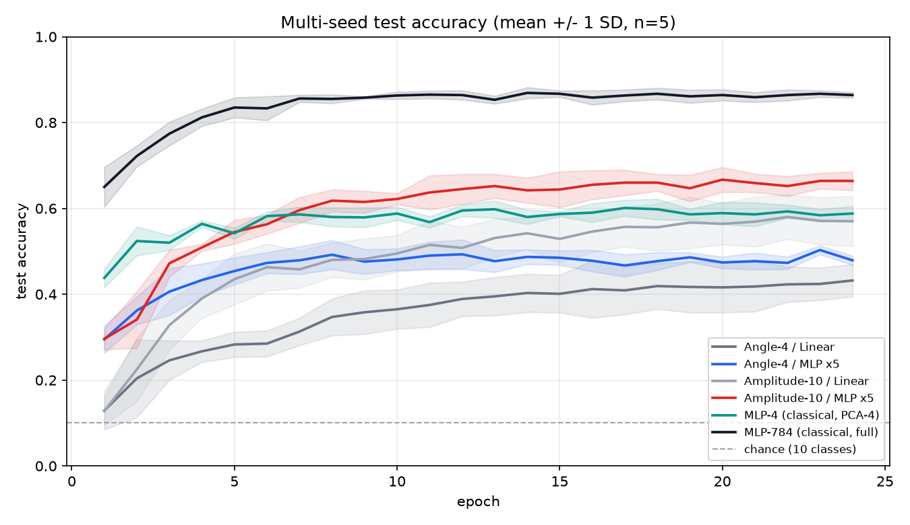

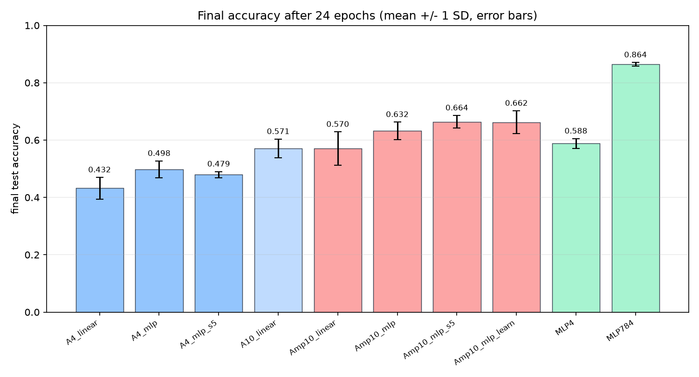

**怎么读这张表**：

1. **提升是真的，但不能归因给「量子变强」**：最佳配置相对原基线 +23.20 ± 5.40 pt（95% CI [+16.49, +29.91]，5 seed 全为正，逐 seed `+21 / +18 / +19 / +29 / +29`）。这是换输入表示、换分类头、加输出缩放、把训练从 8 拉到 24 epochs、量子参数从 24 增到 60 的**联合效果**。
2. **「不压缩」本身没有可测收益**：`Angle-10 / Linear` 与 `Amplitude-10 / Linear` 是严格受控对照（同 10 qubits、同 170 参数、同 `Linear` 头、初始权重逐元素相同、同一批图），5 seed 配对差值 **−0.10 ± 8.68 pt，CI [−10.88, +10.68]**，逐 seed `+12.5 / +1.5 / +2.0 / −7.0 / −9.5`。旧 README 的 +15.5 pt 是初始化运气。
3. **可分离的单项收益比早期诊断小得多**：MLP 头相对 Linear 头在 Angle-4 上 +6.60 pt（CI [+0.43, +12.77]，勉强显著）、在 Amplitude-10 上 +6.20 pt（CI 跨 0）；固定 ×5 缩放相对各自「仅 MLP 头」组为 −1.90 pt（Angle-4）/ +3.20 pt（Amplitude-10），可学习缩放相对固定 ×5 为 −0.20 pt，**均不显著**，可学习缩放与固定 ×5 实际等价。
4. **仍然没追上经典**：同 PCA-4 输入下 `MLP-4` 0.588 > 最佳 Angle-4 0.498；全维 `MLP-784` 0.864 > 最佳量子 0.664。这与「单次角度编码是 degree-1 傅里叶 / 振幅编码是输入二次型」的表达力上界一致，堆 qubits 补不上。
5. **口径限制**：固定数据集让方差只反映初始化与 shuffle；`n=5` 的 95% CI 用 t 分布、未做多重比较校正；参数预算不对等；仍是状态向量模拟，振幅编码在真机上需要 O(2ⁿ) 状态制备或 QRAM。

### 为什么只有 66%：瓶颈分解（2026-11-06 三轮实验）

`experiments/diagnose_ceiling.py`：真实 MNIST IDX、10 类、**5 seed**、数据切分固定 `seed=0`、每个模型构造前设种子。把训练预算、数据预算、架构三个候选瓶颈**分别单独加回去**，再加一个「冻结量子读出」的信息探针。原始数据（9 组逐 seed 曲线、探针、配对差值）：[`docs/ceiling_metrics.json`](docs/ceiling_metrics.json)。

| 组 | 相对 base 的改动 | 参数 | 最终准确率 |
| --- | --- | --- | --- |
| base（Amp10 / MLP ×5） | — | 742 | 0.6640 ± 0.0216 |
| 训练预算 ×2 | 只把 24 → 48 epochs | 742 | 0.6770 ± 0.0160 |
| 数据预算 ×2 | 只把训练样本 600 → 1200 | 742 | 0.7040 ± 0.0104 |
| 轻量 CNN，直接分类 | 换架构（自适应池化前端） | 3658 | **0.8630 ± 0.0428** |
| 轻量 CNN + VQC | 同前端，但接 8-qubit 量子头 | 4258 | 0.5400 ± 0.2693 |
| 强 CNN 前端 + VQC | 52k 参数前端 + 8-qubit 量子头 | 52674 | 0.9030 ± 0.0205 |
| 强 CNN，直接分类 | 同前端，无量子层 | 52138 | **0.9340 ± 0.0108** |

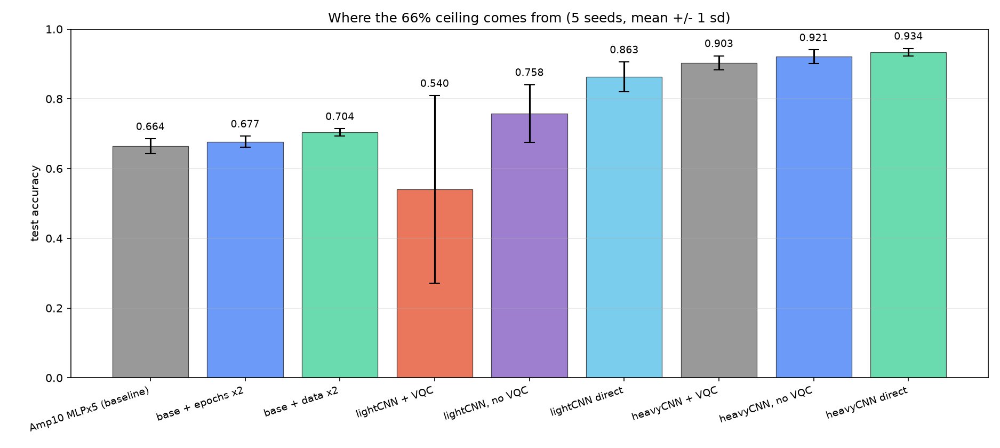

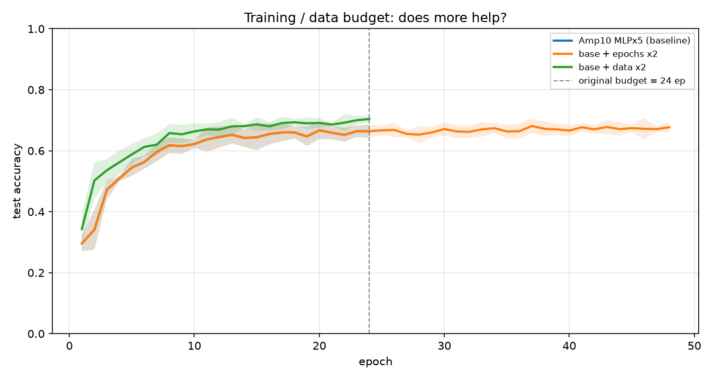

**结论：66% 几乎就是「量子读出里还剩多少信息」，不是没训够。**

1. **预算不是主因**：训练翻倍 **+1.30 ± 1.89 pt**（CI 跨 0）、数据翻倍 **+4.00 ± 1.77 pt**（CI [+1.80, +6.20]）。曲线约 10 epoch 就进平台；48 epoch 的 loss 从 0.68 降到 0.50，准确率却几乎不动——模型是在对已经丢失的信息继续拟合。
2. **读出是硬瓶颈**：冻结训练好的量子层，把 10 维 `PauliZ` 向量 z 交给经典强分类器（logreg / RBF-SVC / MLP），最高只有 **0.6790**，而端到端模型是 **0.6640** —— 分类头与优化器已经把 z 里的信息榨干，换更强的后处理也上不去。同样探针直接读原始 784 维像素可得 **0.8550**，量子链路丢掉了约 **17.6 pt** 的可分信息。`long` 组的 z 探针 0.6830 几乎没变，再次排除「训练不足」。
3. **换表示能补回来**：同样 600 张图 / 24 epochs，让经典 CNN 先提特征，轻量前端（3.7k 参数）到 **0.8630**（配对 +19.90 ± 6.17 pt，CI [+12.24, +27.56]），强前端到 0.9030（+23.90 ± 3.99 pt）。所以 **66% 是「让量子层直接端到端判别」这条设计路线的天花板，不是 QML 的上限**。
4. **但量子层在混合结构里也没有正贡献**：同一前端下，去掉量子层反而更高（轻量 0.758 vs 0.540；强前端 0.921 vs 0.903）。强前端配对差值 −1.80 ± 2.31 pt，4/5 seed 为负但 **CI 跨 0，不能宣称显著有害**；轻量前端有 1/5 seed 完全训练失败（acc 0.10、loss 2.30 ≈ ln10），标准差 0.269，说明「弱特征 + 8-qubit VQC」优化极不稳定。

**限制**：`data` 组测试集为 300（base 为 200），绝对数值不完全可比；强前端 52k 参数多于 `MLP-784` 的 25k，参数预算仍不对等；探针是冻结特征的可分性上界、不是端到端训练；n=5、未做多重比较校正。「量子层未单独调 lr」这一条已在下一轮实验里试过，结论见后。完整协议与配对 CI 见 [docs/REVIEW.md](docs/REVIEW.md) 第 8 节。

### 把读出瓶颈解开：多可观测量（2026-11-06 四轮实验）

`experiments/break_readout.py`：真实 MNIST IDX、600 训练 / 200 测试、10 类、**11 组 × 5 seed × 24 epochs**，数据切分固定 `seed=0`，每个模型构造前设种子，并断言同模型族在同一 seed 下量子初始权重逐元素相同（**5/5 seed、8/8 组 PASS**）。原始数据（逐 seed 曲线、探针、配对 CI）：[`docs/readout_metrics.json`](docs/readout_metrics.json)。

| 组 | 读出维度 | 参数 | 最终准确率 | 冻结读出探针上界 |
| --- | --- | --- | --- | --- |
| Amp10 / 仅 Z（同批次基线） | 10 | 742 | 0.6640 ± 0.0216 | 0.6790 |
| Amp10 / Z+X | 20 | 1062 | 0.7320 ± 0.0244 | 0.7970 |
| **Amp10 / Z+X+Y+ZZ** | 40 | 1702 | **0.7720 ± 0.0115** | **0.8110** |
| Angle10 / 仅 Z | 10 | 742 | 0.6320 ± 0.0385 | 0.6410 |
| Angle10 / 仅 Z + 数据重上传 | 10 | 742 | 0.5220 ± 0.0652 | 0.5570 |
| Angle10 / 40 维 + 重上传 | 40 | 1702 | 0.7330 ± 0.0251 | 0.7380 |
| 轻量 CNN + 8q 量子头（单独 lr） | 8 | 4258 | 0.5150 ± 0.1701 | — |
| 轻量 CNN + 8q 加宽读出（单独 lr） | 16 | 4514 | 0.6930 ± 0.1345 | 0.7340 |
| 轻量 CNN，跳过量子层 | 8 | 4210 | 0.7580 ± 0.0828 | — |
| 轻量 CNN 直接分类 | — | 3658 | 0.8630 ± 0.0428 | — |
| PCA-40 + 同结构 MLP 头（等分类头） | — | 1642 | 0.8520 ± 0.0104 | — |

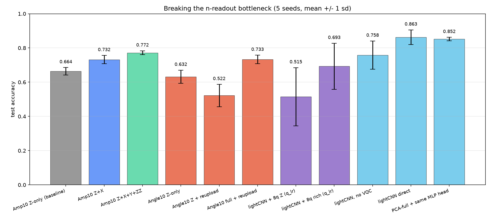

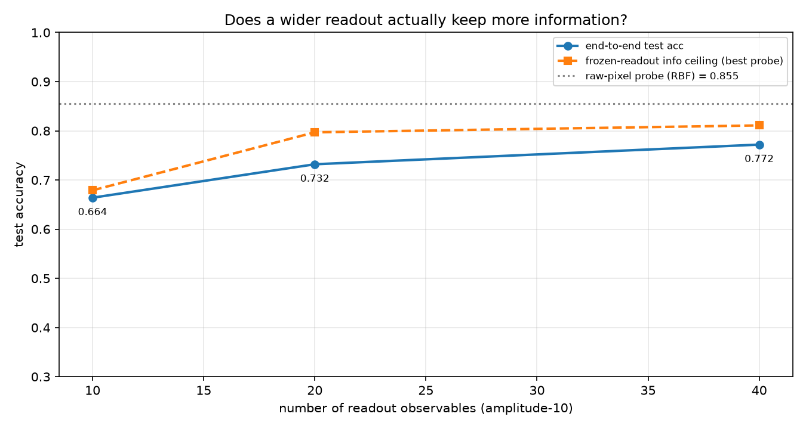

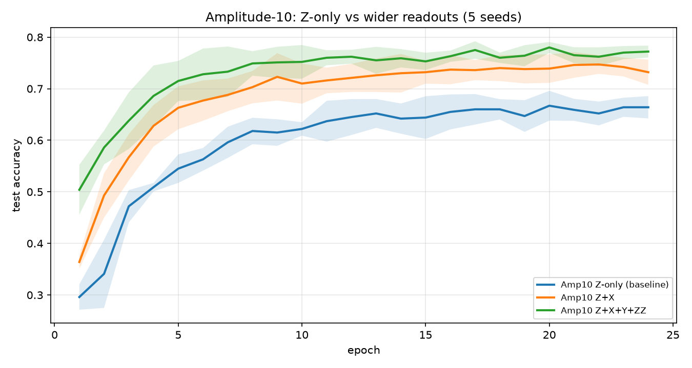

**结论：加宽读出真的把信息保住了，是目前最有效的单项改动。**

1. **单调且显著**：10 → 20 → 40 维读出，准确率 0.6640 → 0.7320 → 0.7720；配对差值分别 **+6.80 ± 0.84 pt**（CI [+5.76, +7.84]）、**+10.80 ± 1.35 pt**（CI [+9.12, +12.48]）、**+4.00 ± 1.73 pt**（CI [+1.85, +6.15]），三项 CI 都不跨 0、5/5 seed 为正。训练 loss 从 0.6785 降到 0.1496，曲线不再早早卡在平台上。
2. **不是「分类头参数变多」的假象**：冻结量子层后用经典强分类器测读出 z 的可分性上界，0.6790 → 0.7970 → **0.8110**（原始 784 维像素探针 0.8550）。上一轮丢掉的约 17.6 pt 里**回收了 13.2 pt**，剩余 gap 只剩 4.4 pt。端到端 acc 始终贴着探针上界（差 0.02–0.04），再次说明优化器不是瓶颈。等分类头预算的经典对照 `PCA-40 + 同结构 MLP 头` 为 0.8520，说明单靠多出来的头参数也换不到这 10.8 pt。
3. **量子电路参数一个没加**：三组都是 60 个量子权重（10 qubits × 2 层 × 3），额外参数全在分类头第一层。这与容量扫描「8→16 层几乎不动」的结论一致 —— 瓶颈在信息进出量子层的方式，不在量子层规模。
4. **朴素数据重上传在 Z-only 下反而有害**：`Angle10 + 重上传` 比不重上传 **−11.00 ± 8.09 pt**（CI [−21.04, −0.96]），且冻结探针从 0.6410 降到 0.5570 —— 不只是优化变差，读出里的信息确实更少。给它换成 40 维读出后回到 0.7330（**+21.10 ± 5.03 pt**）。**不能据此说 data re-uploading 无效**：这里用的是 `StronglyEntanglingLayers` 每层切片 + 全量 `AngleEmbedding` 重置，与 Pérez-Salinas 等「单 qubit 通用旋转逐层嵌入」的原始设计不同，也没有为它单独调 lr / 层数 / 编码缩放。
5. **单独学习率没解决混合架构的训练崩溃**：给量子层单独 `lr=0.001` 后，轻量 CNN + 8q 仍是 0.5150 ± 0.1701（逐 seed 0.305 / 0.610 / 0.570 / 0.715 / 0.375），加宽读出到 0.6930 ± 0.1345 但方差仍大。配对 `加宽读出 − Z-only` +17.80 ± 19.64 pt **CI 跨 0，不显著**；同前端跳过量子层 0.7580，纯 CNN 直接分类 0.8630（比加宽读出的混合模型高 **+17.00 ± 11.53 pt**，CI [+2.69, +31.31]）。**量子层在混合结构里仍没有可证实的正贡献** —— 上一轮把「单独调 lr」列为下一步，实测证明这个预期过于乐观。

**限制**：多可观测量在解析模拟器里几乎免费（单个 batch fwd+bwd 0.087 → 0.115 s）；真机上按 qubit-wise commuting 分组实测 10 / 20 / 40 / 75 / 165 维只需 **1 / 2 / 3 / 3 / 3 个测量设置**（Z / X / Y 基），并不是观测量越多就分组越多 —— 但每个设置内要同时估计的统计量变多，为达到同样精度仍需更多 shots；振幅编码另有 O(2ⁿ) 状态制备问题。`n=5` 未做多重比较校正；探针是冻结特征的可分性上界、不是端到端训练；`Angle10`（PCA-10）与 `Amp10`（全 784 维）输入表示不同，只做组内配对、不跨组逐位比较；混合组方差很大，其配对结论都不确定。完整协议见 [docs/REVIEW.md](docs/REVIEW.md) 第 9 节。

### 第五轮：信息上界诊断 —— 为什么卡在 0.772

`experiments/probe_information.py`：真实 IDX、600/200、10 类、固定 `seed=0`。先按四轮配置训练一个 40 维读出模型 24 epochs 拿到「训练后量子权重」，再对 **5 种读出宽度 × 3 种权重状态**提取冻结读出，交给 logreg / RBF-SVC / MLP 测可分性上界；另做像素探针随训练样本 600 → 3000 → 12000 的扫描、同维度 PCA 参照，并记录量子参数梯度范数与权重漂移。原始数据：[`docs/info_metrics.json`](docs/info_metrics.json)。

| 读出维度 | 随机权重（不训练） | 全零权重 | 训练后权重 | 训练净贡献 |
| --- | --- | --- | --- | --- |
| 10（`z`） | 0.445 | 0.380 | 0.630 | +18.50 pt |
| 20（`z+x`） | 0.650 | 0.655 | 0.730 | +8.00 pt |
| 40（`z+x+y+zz`） | 0.765 | 0.720 | **0.815** | +5.00 pt |
| 75（全部 `Z_iZ_j`） | 0.820 | 0.740 | **0.870** | +5.00 pt |
| 165（全部 ZZ + XX + YY） | **0.860** | 0.830 | **0.890** | +3.00 pt |

165 维训练后读出的完整探针：`logreg 0.840 / rbf 0.890 / mlp 0.855 / poly2 0.900 / poly3 0.895`；有效秩 140/165、第一主成分仅占 11.5% 方差、Fisher 比 18.34。对照：原始像素 RBF 探针 `0.850 → 0.925 → 0.950`（600 / 3000 / 12000 张训练图）；同维度 PCA 的 RBF 为 `0.860 / 0.930 / 0.920 / 0.870 / 0.845`（10/20/40/75/165 维，高维反而下降）。训练过程 loss `2.18 → 0.167`、acc `0.475 → 0.775`、量子梯度范数 `0.048 → 0.897`、`‖Δw‖/‖w‖ = 0.0689`。

**结论**：① 梯度在 24 epochs 里上升近 20 倍、权重只动 6.9%，165 维**不训练**的随机酉上界已有 0.860 —— 排除 barren plateau 与训练不足；40 维 train loss 0.167 / test 0.775 是过拟合，继续加 epoch 没有空间。② 读出宽度是最大剩余瓶颈：40 → 165 维把上界从 0.815 抬到 0.890（+7.5 pt），甚至超过 600 张图的原始像素上界 0.855，而当时端到端只用了 40 维。③ poly2 / poly3 与 RBF 同量级，说明先把二次统计量取全比提高傅里叶次数更划算。④ 像素探针随数据涨 +10 pt，但同样 600 张图的 CNN 已有 0.863 / 0.934，说明缺的还有归纳偏置。

> 口径：本节除 40 维训练组外是**单 seed 示意性诊断**；探针是冻结特征 + 经典分类器的可分性上界，不是端到端结果；`zero` 权重下 CNOT 仍在，不是恒等酉。完整限制见 [REVIEW.md 第 10 节](docs/REVIEW.md)。

### 第五轮正式对照：把 0.769 推到 0.866（9 组 × 5 seed）

`experiments/push_ceiling.py`：从 3000 张训练池按类取嵌套子集、200 张测试集对所有组固定；5 seed；每个模型构造前 `set_seed`，同 seed 下 6 个 amp 组的量子初始权重哈希逐元素相同（**5/5 seed、6/6 组 PASS**）。`b165_d1800` / `b165_aug` 固定总样本呈现次数 14400（1800×8 对 600×24），隔离「数据多样性」与「训练预算」。原始数据：[`docs/push_metrics.json`](docs/push_metrics.json)、[`docs/budget_metrics.json`](docs/budget_metrics.json)。

| 组 | 读出维度 | 训练图 / epochs | 参数 | 最终准确率 |
| --- | --- | --- | --- | --- |
| b40（40 维基线） | 40 | 600 / 24 | 1702 | 0.7690 ± 0.0263 |
| b75（全部 ZZ 两体） | 75 | 600 / 24 | 2822 | 0.8250 ± 0.0127 |
| **b165（全部 ZZ+XX+YY 两体）** | 165 | 600 / 24 | 5702 | **0.8450 ± 0.0100** |
| 165 维 + hidden 128 | 165 | 600 / 24 | 22598 | 0.8470 ± 0.0120 |
| **165 维 + 1800 张真图** | 165 | 1800 / 8 | 5702 | **0.8660 ± 0.0185** |
| 165 维 + 600 张 ×3 平移增强 | 165 | 1800 / 8 | 5702 | 0.8220 ± 0.0297 |
| 经典 MLP-784（同批次） | — | 600 / 24 | 25450 | 0.8580 ± 0.0130 |
| 经典 PCA-165 + 同结构头 | — | 600 / 24 | 5642 | 0.8440 ± 0.0089 |
| 轻量 CNN（同批次） | — | 600 / 24 | 3658 | 0.8550 ± 0.0197 |

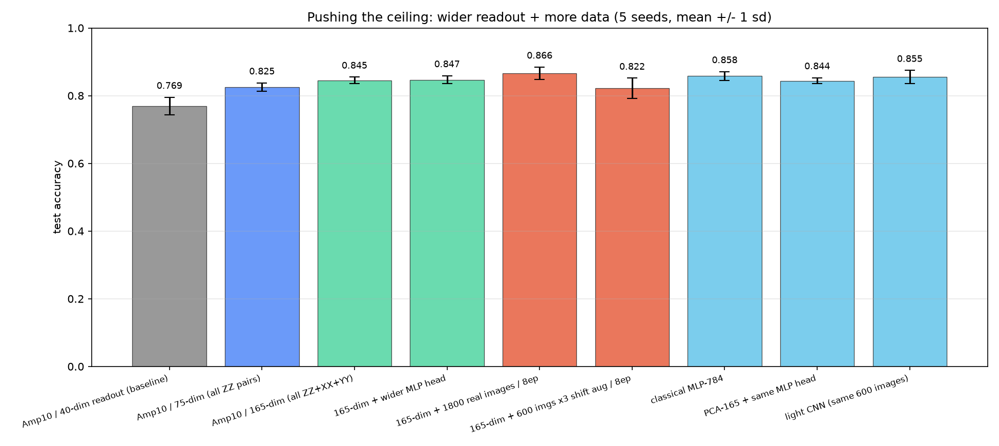

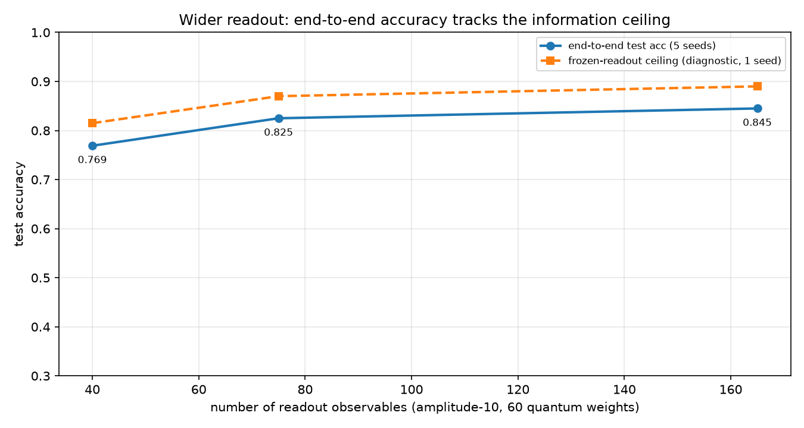

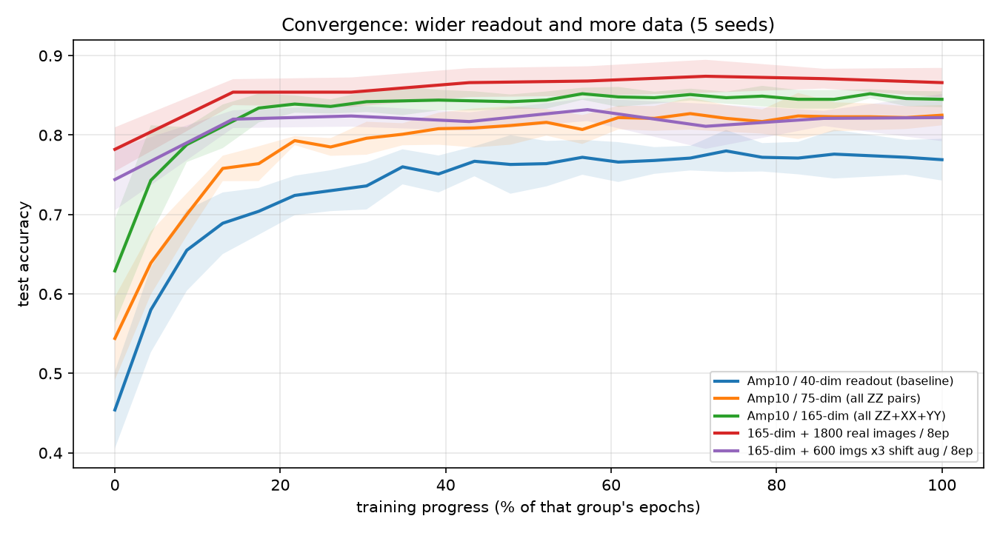

**配对差值（百分点，95% CI）**：`b75 − b40` **+5.60 ± 1.47**（CI [+3.77, +7.43]）、`b165 − b40` **+7.60 ± 2.38**（CI [+4.64, +10.56]）、`b165 − b75` **+2.00 ± 1.46**（CI [+0.19, +3.81]）—— 三项都显著且 5/5 seed 为正。`b165_h128 − b165` +0.20 ± 1.20、`b165_d1800 − b165` +2.10 ± 2.48（CI [−0.99, +5.19]）、`b165_aug − b165` −2.30 ± 3.29、`b165_aug − b165_d1800` −4.40 ± 3.68（CI [−8.97, +0.17]）—— **均不显著**。

**与经典对照（同批次）**：`MLP-784 − b165` +1.30 ± 1.57、`PCA-165 − b165` −0.10 ± 1.02、`CNN − b165` +1.00 ± 1.70，三组 CI 全跨 0 —— 这是本仓库**第一次让量子模型与同批次经典基线统计打平**（此前 0.772 明显落后）。

**但等数据预算后经典重新领先**：`experiments/classical_budget.py` 用与 `b165_d1800` 完全相同的 1800 张图 / 8 epochs / 5 seed 重跑经典基线 —— `PCA-165 + 同结构 MLP 头` **0.9030 ± 0.0097**（参数 5642 ≈ 量子 5702，近似等预算）、`MLP-784` 0.8770 ± 0.0220、轻量 CNN 0.8380 ± 0.0601、MLP-784 拉到 24 epochs 0.8760 ± 0.0156。**量子最佳 0.8660 仍落后 3.7 pt**，且单 seed 约 530 s 对 0.7 s。所以结论是「加宽读出确实补回了信息」，**不是**「量子更好」。

**两个负结果**：① 分类头 hidden 32 → 128（参数 5702 → 22598）只 +0.20 pt，瓶颈不在头的容量；② ±1px 平移增强反而比 1800 张真图低 4.40 pt（CI 上界 0.17，接近但未达显著）。振幅编码把整幅图当作一个态向量，没有卷积的平移不变性，平移变体在量子二次型特征里是「方向完全不同的点」，8 epochs 下反而挤占拟合原分布的容量 —— 与经典 CNN 上增强通常有益的经验相反。

**限制**：`b165_d1800` / `b165_aug` 与 24-epoch 组总步数相同但 epoch 数不同；第五轮数据切分与前四轮不同，跨轮绝对值不逐位可比；`n=5` 未做多重比较校正（10 个配对检验里 6 个不显著）；165 维模型 train loss 已到 0.0076，过拟合明显；探针有 `ConvergenceWarning`；多可观测量在真机按 QWC 分组只需 3 个测量设置，但 shots 预算与振幅编码状态制备成本仍在。完整协议见 [REVIEW.md 第 11 节](docs/REVIEW.md)。

### 历史结果（单次运行，仅存档）

> 以下三节是 2026-11-06 审查**之前**的 `seed=0` 单次实验，其中编码对照还受种子 bug 影响。数字保留供追溯，**不得用于下结论**；所有结论性表述请看上一节与 [REVIEW.md](docs/REVIEW.md)。

配置：本地 IDX 真实 MNIST、1200 训练 / 300 测试、PCA→4 维、4 qubits / 2 层、12 epochs、batch 32、lr 0.01、解析模拟 `backprop`。

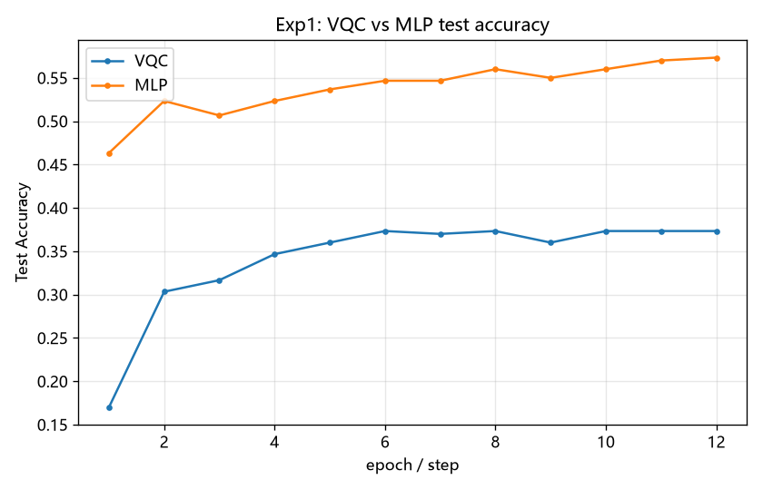

参数量与耗时对比见 [`docs/figures/mnist_params.png`](docs/figures/mnist_params.png) 与 [`docs/figures/mnist_time.png`](docs/figures/mnist_time.png)。

### 怎么读这些数字（历史单次实验）

- 量子版本**没赢过经典版本**，且慢约 42 倍。这反映的是**当前规模下量子模拟的性价比**，不能推广成「量子机器学习不行」。
- 低准确率来自几个**可以分别调整**的因素：角度编码强制把 784 维压到 4 维、电路只有 24 个量子参数、读出只有 4 个 `PauliZ` 期望、样本与 epoch 预算都很小。**审查后补充的一条**：量子输出恒在 `[-1,1]`，却裸接 `Linear` 头再喂交叉熵，logits 幅度太小导致梯度被压制（[EAAI 2026, arXiv:2606.22551](https://arxiv.org/abs/2606.22551)）。早期单次诊断里换成 MLP 头 + 缩放让 Amplitude-10 的 loss 从 1.998 降到 1.050、准确率 +8 pt，但那次**同时改了初始化、头、缩放三个变量**；5 seed 重跑后可分离的单项收益只有 +6.20 ± 5.44 pt（CI 跨 0）与 +3.20 ± 3.78 pt（不显著），见[当前主结果](#当前主结果5-seed-受控对照2026-11-06-重跑)。
- 但**表达力上界是真实存在的**：单次角度编码是 degree-1 三角多项式，振幅编码 + 酉 + PauliZ 等价于输入的二次型（Schuld 2021）。这部分差距堆参数补不上，需要 data re-uploading / 多可观测量 / 混合 CNN 前端。
- 多 `--seed` 重复与配对统计**已完成**（`train_multiseed.py`）。要公平比较还缺：相同参数预算、更好的编码、量子核方法等第三条基线。
- 准确的表述是：**在这组配置下，量子电路可被纳入 PyTorch 训练循环并正常收敛，但在这台机器上的精度与耗时都不占优。**

### 编码方式与「4 维限制」是不是必需

复现：`python experiments/train_amplitude.py --data-source idx`。真实 MNIST、600 训练 / 200 测试、8 epochs、seed=0、单次运行。

| 模型 | 输入维 | qubits | 量子参数 | 总参数 | 测试准确率 | 耗时 |
| --- | --- | --- | --- | --- | --- | --- |
| Angle-4 | 4（PCA） | 4 | 24 | 74 | 0.4200 | 17.6 s |
| Angle-10 | 10（PCA） | 10 | 60 | 170 | 0.3750 | 71.8 s |
| **Amplitude-10** | **784（无压缩）** | **10** | **60** | **170** | **0.5300** | 58.1 s |
| MLP-784（经典参照） | 784 | — | 0 | 25450 | 0.8450 | 0.8 s |

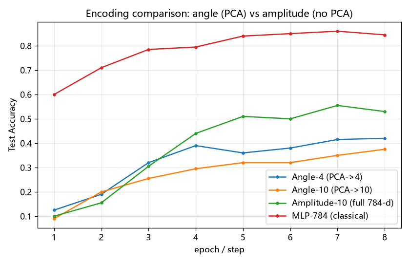

> **⚠ 该结论已撤回（2026-11-06）**：这一组实验的初始权重没有被控制 —— `train_amplitude.py` 原先在模型构造之后才 `set_seed`，四个模型的量子权重各不相同，且独立进程之间结果不可复现。把 `Angle-10` 与 `Amplitude-10` 的初始权重与分类头完全固定后（`results/diag_controlled.py`），两组不同初始权重给出 **−3.0 pt** 与 **+12.5 pt**，符号相反。因此上表的 0.3750 → 0.5300（+15.5 pt）**不能作为编码方式优劣的证据**，它主要反映初始化与单次运行的噪声。代码已修；**5 seed 重跑确认编码方式无显著收益**（−0.10 ± 8.68 pt，CI [−10.88, +10.68]），见[当前主结果](#当前主结果5-seed-受控对照2026-11-06-重跑)。详见 [REVIEW.md](docs/REVIEW.md)。

**原本声称的对照**：`Angle-10` 与 `Amplitude-10` 的 qubits 数、ansatz、量子参数量（60）和训练配置相同，编码方式与是否需要压到 10 维不同 —— 但实际上初始权重也不同，所以并非受控对照。「压维是编码方式造成的、可以解除」这一点仍然成立（振幅编码确实用 2^10 ≥ 784 装下完整图像），但**5 seed 受控重跑显示它不带来显著的准确率收益**（−0.10 ± 8.68 pt，CI 跨 0）。

经典 MLP 在同样的 784 维上到 0.8450，量子侧在电路设计、读出与优化上仍有明显差距，这一差距量级不太可能被噪声解释。但「`Angle-10` 比 `Angle-4` 差 = barren plateau」这个归因**证据不足**：两组初始权重未受控，差值完全可能来自初始化运气。`scan_capacity.py` 的深度饱和趋势（8→16 层几乎不动）才是更可靠的证据，因为该脚本在模型构造前就重置了种子。

**必须说清的代价**：状态向量模拟器里写入振幅初态是 O(1) 的，真实硬件上需要 O(2ⁿ) 深度的状态制备电路或尚不存在的 QRAM；振幅编码是线性映射，非线性只来自变分电路，读出仍只有 n 个 `PauliZ` 期望。这个实验证明的是「编码方式能解除压缩瓶颈」，**不是**「真机上能便宜地跑大图像」。耗时也与主实验不同配置、并发运行，仅供量级参考。

### 容量扫描：放大 qubits 和参数量到底有没有用

复现：`python experiments/scan_capacity.py --data-source idx`。真实 MNIST、600 训练 / 200 测试、8 epochs、seed=0、单次运行；固定其余超参，一次只扫一个因素。

**A. 输入维度（= qubits 数，固定 2 层）**

| n_features / qubits | 量子参数 | VQC 准确率 | MLP 准确率 | VQC 耗时 |
| --- | --- | --- | --- | --- |
| 4 | 24 | 0.3500 | 0.6050 | 11.3 s |
| 8 | 48 | 0.4000 | 0.6850 | 23.2 s |
| 12 | 72 | 0.3950 | 0.7250 | 73.7 s |
| 16 | 96 | 0.4400 | 0.7700 | 761.7 s |

**B. 电路深度（固定 4 qubits）**

| layers | 量子参数 | VQC 准确率 | MLP 准确率 | VQC 耗时 |
| --- | --- | --- | --- | --- |
| 2 | 24 | 0.3500 | 0.6050 | 10.6 s |
| 4 | 48 | 0.4550 | 0.5650 | 17.1 s |
| 8 | 96 | 0.4700 | 0.5650 | 30.1 s |
| 16 | 192 | 0.4800 | 0.5900 | 60.0 s |

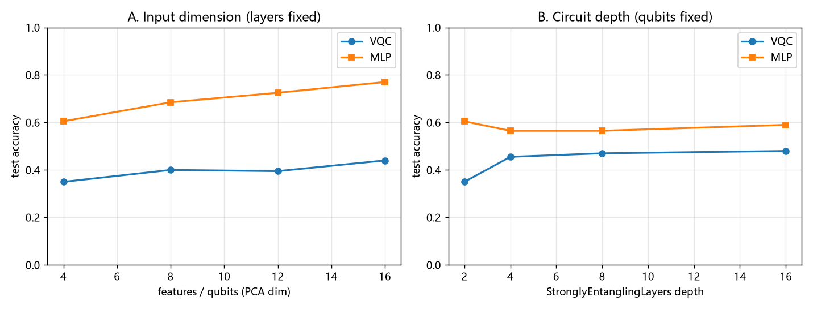

- **参数量确实可以放大**：24 → 192 没有任何代码或物理限制，只是 `--qubits` / `--layers` 的事；量子参数量恒为 `layers × qubits × 3`。
- **但收益递减且很快饱和**：深度 2→16 层（参数 ×8）只带来 +13 个百分点，8→16 层几乎不动。
- **输入信息确实在增加，VQC 却没吃满**：MLP 随维度从 0.605 涨到 0.770，VQC 只从 0.350 涨到 0.440，差距反而拉大。所以限制不只在「压维」，还在量子侧的读出（只有 n 个 `PauliZ` 期望）与优化 —— 这条推断后来被[四轮实验](#把读出瓶颈解开多可观测量2026-11-06-四轮实验)直接证实：加宽读出就能回收 13.2 pt 的可分信息。原先把低准确率单一归因于 PCA 是不完整的。
- **2ⁿ 是真墙**：16 qubits 比 4 qubits 慢约 **67 倍**（11 s → 762 s），20 qubits 在本机单 batch 就要 63 s。
- ~~「最有效的是换表示，+15.5 pt」~~ **该结论已撤回**：5 seed 受控对照显示编码方式差值为 −0.10 ± 8.68 pt、CI 跨 0（见[当前主结果](#当前主结果5-seed-受控对照2026-11-06-重跑)）。「堆参数收益递减」这一趋势本身仍由本表支持，但不能再拿编码对照当作「有效改动」的例子。

**数据口径提醒**：以上两表均为 `seed=0` 单次运行、无方差；`train_amplitude.py` 当时还有种子 bug，**绝对数值与结论均不可采用**。`scan_capacity.py` 在模型构造前设种子，组间趋势受控但同样没有方差。同一 Angle-4 配置在三个脚本里分别得到 0.330 / 0.350 / 0.420，波动约 9 pt，与多数「结论级」差异同量级 —— 这正是后来改用 5 seed 的原因。不同脚本配置不同，绝对数值不可跨表逐位比较；**结论性数字已被 `train_multiseed.py` / `diagnose_ceiling.py` / `break_readout.py` 的 5 seed 重跑结果替换**。详见 [REVIEW.md](docs/REVIEW.md)。

### 运行产物

`results/` 与 `data/` 被 `.gitignore` 忽略，以下均为运行后本地生成；`docs/figures/` 归档了实测对比图。为让 GitHub 上的数字可核对，**五轮 5 seed 实验的原始指标都已归档入库**：`docs/multiseed_metrics.json`、`docs/ceiling_metrics.json`、`docs/readout_metrics.json`、`docs/info_metrics.json`、`docs/push_metrics.json`、`docs/budget_metrics.json`。

| 文件 | 内容 |
| --- | --- |
| `docs/multiseed_metrics.json` | **归档的二轮 5 seed 原始数据**：每个 seed 的曲线 / loss / 耗时、受控性断言、汇总统计、配对差值与 95% CI |
| `results/multiseed_metrics.json` | 同上（运行产物，被忽略） |
| `docs/figures/multiseed_accuracy.png` / `multiseed_bars.png` | 均值 ± 1 标准差曲线 / 带误差棒的最终准确率 |
| `docs/ceiling_metrics.json` | **归档的三轮瓶颈分解原始数据**：9 组 × 5 seed 曲线、分组统计、量子读出探针、像素探针 |
| `docs/figures/ceiling_ladder.png` / `ceiling_curves.png` | 九组配置准确率阶梯 / 预算翻倍的收敛曲线 |
| `docs/readout_metrics.json` | **归档的四轮原始数据**：11 组 × 5 seed 曲线、7 组冻结读出探针、像素探针、配对 CI、逐 seed 受控性断言 |
| `docs/figures/readout_ladder.png` / `readout_info.png` / `readout_curves.png` | 11 组准确率阶梯 / 读出维度与信息上界 / 三种宽度的收敛曲线 |
| `docs/info_metrics.json` | **归档的五轮诊断**：5 种读出 × 3 种权重状态的冻结探针、poly 核、有效秩 / Fisher 比、像素数据规模扫描、PCA 参照、量子梯度与权重漂移 |
| `docs/push_metrics.json` | **归档的五轮主结果**：9 组 × 5 seed 曲线、配对 95% CI、逐 seed 初始权重哈希断言 |
| `docs/budget_metrics.json` | 归档的等数据 / 近似等参数预算经典对照：4 组 × 5 seed |
| `docs/figures/push_ladder.png` / `push_width.png` / `push_curves.png` | 9 组阶梯 / 读出宽度与上界 / 加宽读出与更多数据的曲线 |
| `results/mnist_metrics.json` | 历史主实验：准确率、参数量、耗时、配置与 `meta`（含数据源标注） |
| `results/mnist_accuracy.png` | 量子 vs 经典的测试准确率曲线 |
| `results/mnist_params.png` / `mnist_time.png` | 参数量 / 耗时对比柱状图 |
| `results/amplitude_metrics.json` | 编码对照：四组指标、配置与真机代价 caveat |
| `results/amplitude_accuracy.png` / `amplitude_bars.png` | 编码方式对照曲线 / 柱状图 |
| `results/capacity_scan.json` | 容量扫描：输入维度与电路深度两组原始指标 |
| `results/capacity_scan.png` | 两条容量曲线（准确率随维度 / 随层数变化） |

## 技术栈与下一步

**PennyLane**（可微分量子电路）+ **PyTorch**（混合训练），辅以 scikit-learn（PCA）/ NumPy / Matplotlib；默认 `default.qubit` 状态向量模拟。[Qiskit Machine Learning](https://qiskit.github.io/qiskit-machine-learning/) 是接 IBM 生态时的另一条路线。

**已实现**：amplitude encoding 无压缩对照（`train_amplitude.py`）、输入维度与电路深度分离的容量扫描（`scan_capacity.py`）、**5 seed 受控对照与配对差值置信区间**（`train_multiseed.py`）、带非线性的 MLP 分类头与固定 / 可学习输出缩放、**9 组 × 5 seed 的瓶颈分解与量子读出信息探针**（`diagnose_ceiling.py`）、轻量 / 强特征两种混合 CNN 前端、**11 组 × 5 seed 的多可观测量 / 数据重上传 / 单独 lr 对照**（`break_readout.py`）、**全两体可观测量（`zzall` / `xxall` / `yyall`）**、**信息上界分解诊断**（`probe_information.py`）、**9 组 × 5 seed 的加宽读出 + 数据规模正式对照**（`push_ceiling.py`，支持多进程）、**等数据 / 近似等参数预算经典对照**（`classical_budget.py`）。方法学审查见 [`docs/REVIEW.md`](docs/REVIEW.md)。

**已试过但不成立 / 未解决**：给量子层单独 `lr=0.001` 没有消除轻量混合前端的训练崩溃；朴素数据重上传在 Z-only 读出下反而掉 11 pt（实现与原始文献不同）；把分类头 hidden 32 → 128 只 +0.20 pt（不显著）；±1px 平移增强反而 −4.40 pt（振幅编码无平移不变性）。这四项不再列为待办。

下一步：**补上「归纳偏置」这一课** —— 等预算经典对照 `PCA-165 + MLP` 已到 0.9030，量子最佳 0.8660，剩余差距更像表示方式 / 局部性而非读出维度；可试量子卷积（局部 patch 编码 + 共享线路）或按 Pérez-Salinas 原始设计重做 data re-uploading。此外：量子核 QSVC 第三条基线、混合架构里量子层的初始化 / 深度 / lr 系统调参、扩大到 ≥20 seed 并做多重比较校正（本轮 10 个配对检验有 6 个不显著）、噪声模型与有限 `--shots`（多可观测量在真机按 QWC 分组需 3 个测量设置）、`lightning.gpu` 后端推到 20+ qubits。

## 相关仓库与许可

- 姊妹仓库：[quantum-llm](https://github.com/quantum-machine-learning-code/quantum-llm) · 玩具级量子增强语言模型
- 组织主页：[quantum-machine-learning-code](https://github.com/quantum-machine-learning-code)

本项目采用 [MIT License](LICENSE)。
