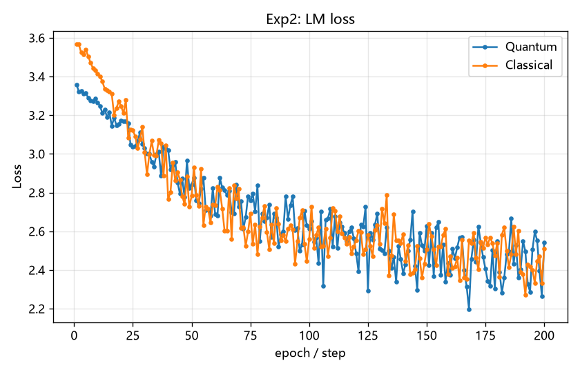

# qml_lab · 量子机器学习对照实验


> 用可复现的方式回答一个朴素问题：**把参数化量子电路塞进 PyTorch 训练循环，它和同规模经典层比，表现到底如何？**

这是一个从零搭建、纯经典模拟（不接真机）的量子机器学习实验仓库，技术栈为 **PennyLane + PyTorch**。包含两个方向：

| 方向 | 做法 | 对照 |
| --- | --- | --- |
| **量子手写数字识别** | MNIST 经 PCA 降维 → `AngleEmbedding(RY)` → `StronglyEntanglingLayers` → 测量 PauliZ 期望 → 线性分类头 | 同输入维度的经典 MLP |
| **量子 LLM**（玩具级） | 字符级自回归模型中，把参数化量子电路作为**一个可微分层**嵌在 Embedding 与输出头之间 | 同规模的 `Linear + Tanh` 层 |

仓库的目标是把量子模型和经典基线放在同一套训练配置、同一随机种子下跑出可核对的数字，**不是宣称量子优势**。所有实验都能在普通笔记本 CPU 上完成，不需要任何量子云平台账号。

---

## 快速结论（实跑结果）

Python 3.13 / PennyLane 0.45.1 / torch 2.15 CPU，`seed=0`，单次运行，真实 MNIST。复现命令见[快速开始](#快速开始)。

| 实验 | 量子模型 | 经典基线 | 结果 |
| --- | --- | --- | --- |
| MNIST 10 分类（1200/300 样本，4 qubits） | VQC：74 参数，**0.3733** 准确率，26.46 s | MLP：250 参数，**0.5733** 准确率，0.63 s | 量子落后，慢约 42× |
| 字符 LM（200 steps，4 qubits） | 291 参数，loss **2.5403** / ppl 12.68，5.37 s | 299 参数，loss **2.5083** / ppl 12.28，0.42 s | 量子略逊，慢约 13× |

**两项实验里量子版本都没有赢，而且明显更慢。** 这证明的是「量子层能被纳入 PyTorch 训练循环并正常收敛」，**不是**量子机器学习的能力上限 —— 这是一个刻意保持最小、未调优的对照。完整解读见[怎么读这些数字](#怎么读这些数字)。

---

## 能做什么，不能做什么

先把边界讲清楚，避免对结果产生不切实际的预期。

- **模拟器的内存墙**：`default.qubit` 是状态向量模拟器，状态维度 2ⁿ，每多一个 qubit 内存翻倍。4–12 qubits 在笔记本上是舒适区；20+ qubits 需要 GPU 模拟器（PennyLane Lightning / cuQuantum）或分布式方案。默认 `qubits=4` 就是为这个边界留余量。
- **「量子 LLM」不是能对话的大模型**：当前硬件与模拟器条件下不存在可行的十亿参数级量子 LLM。本项目的实验 2 只是一个字符级玩具模型加一层可微分量子电路，语料极小、词表是字符、生成短文本，用来验证「量子层能不能训练起来」。**它不能当作 LLM 使用。**
- **量子模型不保证优于经典模型**：在这个规模下打平甚至落后是常态。任何「更好」的结论都需要等参数预算、多次重复实验和统计检验支撑。
- **不需要真机凭证**：纯模拟无需 IBM Quantum 等平台 token；只有把后端切到真实量子硬件时才需要。

---

## 目录结构

```
quantum-mnist/
├── README.md                    # 本文件
├── requirements.txt
├── .gitignore
├── qml_lab/
│   ├── utils.py                 # 随机种子、路径、JSON、参数量、终端表格
│   ├── data.py                  # 数据加载与回退、PCA 降维与缩放、字符语料
│   ├── quantum.py               # PennyLane 设备、QNode、编码与 ansatz
│   ├── models.py                # VQC / MLP / TinyLM 模型定义
│   ├── train.py                 # 训练循环与评估
│   └── viz.py                   # 指标图绘制
├── experiments/
│   ├── 01_quantum_mnist.py      # 实验 1 入口
│   └── 02_quantum_llm.py        # 实验 2 入口
├── tests/
│   └── smoke_test.py            # 离线冒烟测试（不联网、不下载 MNIST）
├── docs/
│   ├── DEV_NOTES.md             # 本地开发环境与数据准备备注
│   └── figures/                 # 已归档的实测对比图
├── data/                        # 本地数据缓存（gitignore）
└── results/                     # 运行产物（gitignore）
```

---

## 安装

要求 Python 3.11+，纯 CPU 即可运行默认配置。

```bash
python3 -m venv .venv
.venv/bin/python -m pip install -r requirements.txt
```

Windows 下把 `.venv/bin/python` 换成 `.venv\Scripts\python.exe`、路径改用反斜杠即可。

`torchvision` 已列入依赖，用于自动下载真实 MNIST；它与 `torch` 版本强绑定，pip 会解析匹配版本（已在 Python 3.13 下验证 `torch 2.15.0 + torchvision 0.29.2`）。**更稳的做法**是把 MNIST 的 4 个 IDX 文件放进 `data/MNIST/raw/`，用 `--data-source idx` 完全离线运行 —— 详见 [`docs/DEV_NOTES.md`](docs/DEV_NOTES.md)。

---

## 快速开始

先跑冒烟测试确认依赖与导入正常，再用 `--quick` 验证整条流程，最后放大参数做正式对照。

```bash
.venv/bin/python tests/smoke_test.py
.venv/bin/python experiments/01_quantum_mnist.py --quick
.venv/bin/python experiments/02_quantum_llm.py --quick
```

`--quick` 会把样本量、迭代数和 qubit 数压到最小（实验 1 强制 `synthetic` 数据、不联网），仅用于验证流程跑通，**不用于报告结论**。合成数据会在输出 JSON 的 `meta.note` 中明确标注。

下面这组参数正是本 README 实测结果的复现命令（`seed=0`）：

```bash
.venv/bin/python experiments/01_quantum_mnist.py --data-source idx \
    --qubits 4 --layers 2 --classes 10 --train-samples 1200 --test-samples 300 \
    --epochs 12 --batch-size 32 --lr 0.01 --seed 0
.venv/bin/python experiments/02_quantum_llm.py \
    --qubits 4 --layers 1 --seq-len 16 --batch-size 8 --steps 200 --seed 0
```

第一条需要 `data/MNIST/raw/` 下放好 4 个 IDX 文件；没有就去掉 `--data-source idx`，让 `auto` 走在线下载回退链。全部产物写入 `results/`。

---

## 实验 1：量子手写数字识别

- **数据流**：MNIST 图像展平 → `PCA` 降到 `n_qubits` 维 → 线性缩放到 `[-π, π]` → 量子电路 → 测量得到经典向量 → `Linear` 分类头输出 logits。
- **编码**：`AngleEmbedding` 的 `RY` 旋转，每个降维特征作为一个 qubit 的旋转角，因此特征维必须等于 `n_qubits`。
- **Ansatz**：`StronglyEntanglingLayers`，层数由 `--layers` 控制，是可训练参数的主体（4 qubits × 2 层 = 24 个量子参数）。
- **测量**：对每个 qubit 取 `PauliZ` 期望，得到长度为 `n_qubits` 的实数向量。
- **数据源回退**：`idx`（直接读本地 4 个 IDX 文件，完全离线）→ `torchvision` → `sklearn.fetch_openml` → `synthetic`。`synthetic` 仅用于离线冒烟测试。`--data-dir` 指定缓存目录。
- **Baseline**：同输入维度、同训练配置的经典 MLP；`--skip-baseline` 可跳过。
- **指标**：准确率曲线、参数量、训练耗时，写入 `results/exp1_metrics.json` 并出三张图。
- **采样与求导**：`--shots 0` 为解析模拟（默认）；正整数启用有限采样并自动切换到 `parameter-shift`；`--diff-method` 可显式指定。

## 实验 2：玩具级量子增强语言模型

再次强调：这是字符级玩具模型 + 一个可微分量子层，**不是大语言模型**。

- **词表**：字符级 `char ↔ id`，基于 `--corpus`（默认内置 1668 字符示例语料）构建，实测词表 31。
- **序列**：固定长度 `seq-len` 的字符窗口，预测下一个字符，loss 为词表交叉熵。
- **量子层位置**：`Embedding(vocab, qubits)` → 量子层 → `Linear(qubits, vocab)`。对照组把中间换成 `Linear + Tanh`，其余结构与超参一致。
- **对比方式**：同一 `steps / lr / batch-size / seed` 下分别训练，对比 loss、困惑度（`exp(loss)`）和耗时。
- **生成样本**：训练后用贪心解码生成 120 个字符写入 `results/exp2_sample.txt`，仅用于直观检查是否学到字符分布。

---

## 参数速查

> 若与脚本实现不一致，以脚本内 `argparse` 默认值为准。`--quick`、`--skip-baseline` 为开关，默认关闭。

| 参数 | 实验 | 默认值 | 含义 |
| --- | --- | --- | --- |
| `--qubits` | 1 / 2 | `4` | qubit 数，也等于 PCA 特征维 / Embedding 输出维 |
| `--layers` | 1 / 2 | `2` / `1` | `StronglyEntanglingLayers` 层数 |
| `--classes` | 1 | `10` | 分类类别数 |
| `--train-samples` | 1 | `2000` | 训练样本数 |
| `--test-samples` | 1 | `500` | 测试样本数 |
| `--epochs` | 1 | `20` | 训练轮数 |
| `--seq-len` | 2 | `16` | 自回归窗口长度（字符数） |
| `--batch-size` | 1 / 2 | `32` / `8` | 批大小 |
| `--steps` | 2 | `200` | 训练步数 |
| `--lr` | 1 / 2 | `0.01` | 学习率 |
| `--seed` | 1 / 2 | `0` | 随机种子 |
| `--data-source` | 1 | `auto` | `idx → torchvision → openml → synthetic` 回退；`idx` 直接读本地文件 |
| `--data-dir` | 1 | `data` | 本地数据 / 缓存目录 |
| `--corpus` | 2 | 内置示例语料 | 自定义字符语料文本文件 |
| `--diff-method` | 1 / 2 | `backprop` | PennyLane 求导方式（解析模拟下） |
| `--shots` | 1 / 2 | `0` | `0` 解析模拟；正整数为有限采样，自动切 `parameter-shift` |
| `--out` | 1 / 2 | `results` | 指标、图片、生成文本的输出目录 |

---

## 实测结果与复现

### 实验 1 · 真实 MNIST 10 分类

配置：本地 IDX 真实 MNIST、1200 训练 / 300 测试、PCA→4 维、4 qubits / 2 层、12 epochs、batch 32、lr 0.01、解析模拟 `backprop`。

| 模型 | 参数量 | 测试准确率 | 训练耗时 |
| --- | --- | --- | --- |
| VQC（量子） | 74（量子线路参数 24） | 0.3733 | 26.46 s |
| 经典 MLP | 250 | 0.5733 | 0.63 s |


### 实验 2 · 玩具级量子增强字符 LM

配置：内置 1668 字符语料、词表 31、序列长 16、batch 8、200 steps、4 qubits / 1 层。

| 模型 | 参数量 | 最终 loss | 困惑度 | 训练耗时 |
| --- | --- | --- | --- | --- |
| 量子层 | 291 | 2.5403 | 12.68 | 5.37 s |
| 经典层（Linear + Tanh） | 299 | 2.5083 | 12.28 | 0.42 s |



生成样本是 `A qubit can hold the the the the ...` —— 200 步只学到局部字符模式，属预期。

### 怎么读这些数字

- 两个实验里量子版本都**没赢过经典版本**，且慢 13～42 倍。这反映的是**当前规模下量子模拟的性价比**，不能推广成「量子机器学习不行」。
- 主要原因是这个对照刻意保持最小、未调优：4 qubits + 2 层只有 24 个可训练量子参数；PCA 把 784 维图像压到 4 维丢掉了绝大部分信息；10 分类头容量有限；经典 MLP 参数更多、优化更成熟；量子层还要为每个样本跑一遍状态向量模拟。
- 要公平比较至少需要：相同参数预算、更好的编码（amplitude encoding、数据重上传）、多 `--seed` 重复取均值与方差，以及量子核方法等第三条基线。
- 准确的表述是：**在这组配置下，量子层可被纳入 PyTorch 训练循环并正常收敛，但在这台机器上的精度与耗时都不占优。**

### 运行产物

`results/` 与 `data/` 被 `.gitignore` 忽略，以下均为运行后本地生成、不提交；`docs/figures/` 里归档了本次实测的关键对比图。

| 文件 | 内容 |
| --- | --- |
| `results/exp1_metrics.json` | 实验 1 准确率、参数量、耗时、配置与 `meta`（含数据源标注） |
| `results/exp1_accuracy.png` / `exp1_params.png` / `exp1_time.png` | 准确率曲线、参数量、耗时对比 |
| `results/exp2_metrics.json` | 实验 2 的 loss / 困惑度 / 耗时、`config`、`vocab_size`、`caveat` |
| `results/exp2_loss.png` / `exp2_perplexity.png` / `exp2_time.png` | loss、困惑度、耗时对比 |
| `results/exp2_sample.txt` | 贪心解码生成的样本文本 |

---

## 技术栈与生态

- **PennyLane（Xanadu）**：本项目主栈，主打可微分编程与量子-经典混合模型，可直接接 PyTorch；自带的 **Lightning** 是高性能状态向量模拟器，也是将来上更多 qubits 的入口。
- **Qiskit Machine Learning（IBM）**：另一条主流路线，与 Qiskit 真机 / 模拟器生态结合更紧，适合后续接 IBM 后端时评估。
- **TFQ / Cirq**：较旧的栈，维护活跃度与生态已不如前两者，新项目一般不作为首选。
- **Python 3.13**：PennyLane / PyTorch / scikit-learn 均可安装使用；本项目要求 3.11+。

---

## 下一步可扩展方向

- **统计可靠性**：多个 `--seed` 重复实验，报告均值与方差，而不是用单次结果下结论。
- **更公平的对照**：等参数预算、量子核 / QSVC 作为第三条基线。
- **更好的编码**：amplitude encoding、数据重上传（data re-uploading）。
- **噪声与有限采样**：用正整数 `--shots` 或引入噪声模型，观察对准确率 / loss 的影响。
- **更大规模**：换 `lightning.qubit` / `lightning.gpu` 后端，把 qubits 推到 20+ 做规模测试。
- **接真机**：把后端切到真实量子硬件（此时才需要平台 token）。

---

## 开发备注

离线 MNIST 数据准备、pip 镜像问题、Windows / WSL 双环境同步等本机相关说明，见 [`docs/DEV_NOTES.md`](docs/DEV_NOTES.md)。
