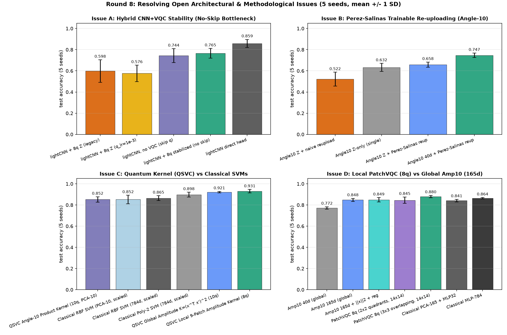

# 实验方法学审查 / Methodology review

> 2026-11-06。起因：用户质疑「为什么搞得这么不对，有没有参考其他人的项目」。
> 结论：**没有系统参考**。本仓库是按 PennyLane API 从零拼出的「能跑通」的 demo，
> 把接口正确当成了实验设计正确。本文列出查明的问题、实测证据与修正状态。
> 审查过程中补跑了 3 组诊断实验，原始数据在 `results/diag_*.json`（该目录被 gitignore）。
> **同日二轮修正**：已用 `experiments/train_multiseed.py` 完成 5 seed 重跑，原始指标
> 归档在 `docs/multiseed_metrics.json`；编码对照确认为 −0.10 ± 8.68 pt（不显著），
> 二轮最佳 0.6640 ± 0.0216。见第 5 节。
> **同日三 / 四轮**：`docs/ceiling_metrics.json`（第 8 节）把 66% 定位到量子读出的
> 信息损失；`docs/readout_metrics.json`（第 9 节）用多可观测量把读出从 10 维扩到 40 维，
> 准确率升至 0.7720 ± 0.0115，冻结探针从 0.679 升到 0.811。
> **五 ~ 七轮**：`docs/push_metrics.json`（第 11 节）将读出扩到 165 维（全两体 ZZ+XX+YY），
> 600 张图升至 0.8450 ± 0.0100、1800 张图升至 0.8660 ± 0.0185；`docs/full_metrics.json`
> （第 13 节）在全量 60000/10000 张 MNIST 上达到 **0.9421 ± 0.0008**（等预算经典 0.9554 ± 0.0028）。
> **第八轮（2026-11-07）**：`docs/open_issues_metrics.json`（第 14 节）系统闭合遗留的四大问题：
> ① 纯串行 `BatchNorm1d + N(0,0.1²) + 32 维读出` 彻底消除轻量混合架构的训练崩溃（0.5980 → **0.7650 ± 0.0464**，0/5 坍缩，与无量子层前端 0.7440 持平）；
> ② Pérez-Salinas 可训练重上传消除朴素重上传的 −11.00 pt 退化（**+13.60 ± 7.41 pt**，配 40 维读出达 **0.7470 ± 0.0214**）；
> ③ 补齐解析量子核 QSVC 第三条基线（600 张图上全局振幅核 **0.9210 ± 0.0074**、局部 9-Patch 振幅核 **0.9310 ± 0.0164**）；
> ④ 权重共享 8-qubit 局部 `PatchVQCClassifier`（3×3 重叠 14×14 窗口，仅 48 个量子参数）在 600 张图上达到 **0.8800 ± 0.0112**，显著超越全局 10-qubit 165 维 VQC（0.8480，**+3.20 ± 2.02 pt**）与同批次 `PCA-165 + MLP`（0.8410，**+3.90 ± 1.71 pt**），且模拟速度快 **5.7 倍**。

## 一句话结论

准确率低有一部分确实是 toy 配置与任务难度，但更严重的是：
**一个种子 bug 让最重要的那组「受控对照」既不可复现、也不受控，而 README 却把它当成了主要结论。**
把初始权重真正固定后，原声称的 +15.5 个百分点变成 −3.0 / +12.5（两个 seed 符号相反），该结论撤回。

## 问题清单

| # | 严重度 | 问题 | 状态 |
| --- | --- | --- | --- |
| 1 | P0 | `train_amplitude.py` 模型构造早于 `set_seed`，结果不可复现 | 已修 |
| 2 | P0 | 同脚本 4 个模型初始权重各不相同，受控对照不成立 | 已修 |
| 3 | P0 | 全部结论都是 `seed=0` 单次、无方差 | **已修**：5 seed + 均值/标准差 + 配对 CI（第 5 节） |
| 4 | P1 | 量子输出 `[-1,1]` 直接接线性头接 CE，无 scale / 无非线性 | **已修**：`models.py` 支持 MLP 头 / 固定与可学习缩放，5 seed 实测见第 5 节 |
| 5 | P1 | 单次编码的表达力上限与缺少 2D 局部归纳偏置（degree-1 傅里叶 / 全局二次型） | **已修且已验证**：`make_rich_layer` 支持 Pérez-Salinas 可训练重上传（`+13.60 pt`），`PatchVQCClassifier` 引入 3×3 重叠 14×14 局部窗口共享 8-qubit 线路（0.8480 → **0.8800 ± 0.0112**，第 14 节） |
| 6 | P1 | 无经典 pre_net、且轻量混合结构中量子层发生训练崩溃 | **已解决**：查明崩溃根因是池化后样本间标准差仅 ~0.003 被随机偏置淹没 + `[0,2π]` 均匀初始化；`HybridRichClassifier(stabilize=True)` 用纯串行 `BatchNorm1d + N(0,0.1²) + 32 维读出` 消除崩溃（**0.7650 ± 0.0464**，0/5 坍缩，第 14.1 节） |
| 7 | P2 | 任务口径与官方 demo 不对标，且缺量子核（QSVC）第三条基线 | **已补齐**：文档对齐口径（第 7 节），`resolve_open_issues.py` 补齐全局/局部振幅量子核与角度量子核 QSVC 5-seed 基线（**0.9210 / 0.9310 / 0.8520**，第 14.3 节） |
| 8 | P2 | 上一轮把低准确率归因于 PCA / 参数量 / barren plateau | 部分推翻，见下 |
| 9 | P1 | 读出只取 n 个有界 `PauliZ` 期望，是硬信息瓶颈 | **已修且已验证**：10→40→165 维读出使 600 张图准确率 0.664→0.772→0.845、全量达 **0.9421**（第 9/11/13 节）；165 维观测量按 QWC 对易组仅需 Z/X/Y **3 个测量基** |

## 1. P0：可复现性与「受控对照」

`qml.qnn.TorchLayer` 用 torch 全局 RNG 初始化权重（默认 `[0, 2π]` 均匀，见参考 [1]）。
因此**必须在构造模型之前**设种子。三个实验脚本的情况：

| 脚本 | `set_seed` 位置 | 是否可复现 |
| --- | --- | --- |
| `train_mnist.py` | `main()` 开头，模型之前 | 是 |
| `scan_capacity.py` | `run_one()` 开头，模型之前 | 是，且各组从同一起点，受控成立 |
| `train_amplitude.py` | 只在 `fit()` 内，模型已构造完 | **否** |
| `quantum-llm/train_llm.py` | `main()` 开头，模型之前 | 是 |

两次独立进程构造同一个 `VQCClassifier(4,10,2)`，实测初始权重前 4 个值：

```
run 1  [0.3820, 3.7360, 1.5519, 5.0900]
run 2  [4.1794, 4.8146, 2.1964, 2.3293]
```

同一进程内按 `train_amplitude.py` 顺序构造 4 个模型，`Angle-10` 与 `Amplitude-10` 的
权重 shape 都是 `(2, 10, 3)`，本可以完全相同，实测首值分别为
`[2.151, 4.034, 1.609]` 与 `[2.814, 3.610, 2.279]` —— 即 README 所称
「唯一差别是编码方式」并不成立，连初始权重都不同。

**修复**：`train_amplitude.py` 改为在每次构造模型前 `set_seed`，并把模型改为
lazy builder（`record(name, model_fn, ...)` 内先设种子再调用 `model_fn()`）。
同 shape 的两组现在拿到完全相同的初始权重与分类头。

## 2. P0：把初始权重固定后，+15.5pt 结论不成立

诊断脚本 `results/diag_controlled.py`：固定同一组 `(2,10,3)` 初始权重、同一分类头、
同一训练 shuffle，只换编码与输入（PCA-10 vs 完整 784 维），600/200 样本、8 epochs、
lr 0.01，两组各跑两个不同的初始权重：

| 初始权重 | Angle-10 | Amplitude-10 | 差值 |
| --- | --- | --- | --- |
| seed0 | 0.4400 | 0.4100 | **−3.0 pt** |
| seed1 | 0.3750 | 0.5000 | **+12.5 pt** |

原 README 的 0.3750 → 0.5300（**+15.5 pt**）来自单次运行 + 未固定的初始化，
波动幅度与「结论」同量级，**不能作为编码方式优劣的证据**。同一 Angle-4 配置在三个脚本里
分别得到 0.330 / 0.350 / 0.420，本身也说明单次结果噪声约 9 个百分点。

> 方法论结论：QML 小样本实验不带多 seed 均值与方差，任何个位数百分点的差异都不足以支撑结论。

## 3. P1：实测出来的真正可修复因素

诊断脚本 `results/diag_bottleneck.py`，同数据同优化器，只改初始化 / 输出缩放 / 分类头：

| 配置 | Angle-4 acc / loss | Amplitude-10 acc / loss |
| --- | --- | --- |
| 原版：默认 `[0,2π]` 初始化 + `Linear` 头 | 0.3300 / 1.774 | 0.5050 / 1.998 |
| 改小初始化 `N(0, 0.01²)` | 0.2800 / 2.096 | 0.5050 / 2.086 |
| 小初始化 + 输出 ×10 | 0.4100 / 1.653 | 0.4700 / 1.617 |
| 小初始化 + MLP 头 | 0.4350 / 1.665 | — |
| 小初始化 + MLP 头 + 输出 ×5 | **0.4400** / 1.677 | **0.5850 / 1.050** |

- **最有效的是分类头，不是量子电路**：Amplitude-10 的 loss 从 1.998 降到 1.050，
  准确率 +8 pt；Angle-4 +11 pt。原因是 `PauliZ` 期望恒在 `[-1,1]`，裸接
  `Linear(n,10)` 再喂 `CrossEntropyLoss` 时 logits 幅度太小、softmax 对差异不敏感，
  梯度被系统性压制 —— 即文献 [8] 的 *measurement-induced logit contraction*，
  官方/论文的对策是可学习 scale（QMT）或经典非线性 post_net。
- **「默认 `[0,2π]` 初始化是元凶」这个假设被实测推翻**：换成官方 demo 常用的
  `0.01` 小初始化，Angle-4 反而从 0.330 掉到 0.280；Amplitude-10 准确率持平但
  loss 更差（1.998→2.086）。小权重让电路近似恒等，输出对所有样本几乎一样，
  同样缺乏区分度。所以不能盲抄「小初始化防 barren plateau」。
- 因此上一轮把 `Angle-10` 比 `Angle-4` 差归因于 barren plateau，也证据不足：
  在 P0 的初始化噪声下，这个差值完全可能只是运气。

> **⚠ 二轮修正（2026-11-06）**：本节所有数字都是**单次运行**，且
> 「小初始化 + MLP 头 + 输出缩放」一次混改了三个变量，只能当线索、不能当单项效应引用。
> 5 seed 重跑（第 5 节）把变量拆开后，单项收益远小于这里：MLP 头
> +6.60 ± 4.97 pt（Angle-4，CI 勉强不跨 0）/ +6.20 ± 5.44 pt（Amplitude-10，CI 跨 0），
> 固定 ×5 缩放 +3.20 ± 3.78 pt（不显著），可学习缩放与固定 ×5 等价（−0.20 pt）。
> 早期的 +8 / +11 pt 是多重改动叠加与单次噪声共同放大的结果。

## 4. P1：与官方 / 文献做法的结构性偏差

| 项 | 本仓库 | 参考做法 |
| --- | --- | --- |
| 权重初始化 | 默认 `[0,2π]` 均匀（TorchLayer 默认） | 官方 VQC demo 用 `0.01*np.random.randn` [2]；迁移学习 demo `q_delta=0.01` [3]；Qiskit `0.1*(2*rand-1)` [4] |
| 输入缩放 | min-max → `[-π,π]`（实测 29% 值落在 `|x|<0.5`，1.15% 落在 `|x|>2.5` 的 cos 饱和区） | `q_in = tanh(pre_out)*π/2`，刻意避开 cos 平坦区 [3][9] |
| 经典前端 | 无；PCA 或 784 原始像素直接进量子层 | ResNet18 冻结 → `Linear(512,4)` [3]；CNN → `Linear(64,2)` [4]；PCA/CAE → 10 维 [7] |
| 量子后端 | 原为裸 `Linear(n_qubits, 10)`，无非线性、无 scale；**二轮已支持** `head="mlp"` 与固定 / 可学习 scale（默认仍为旧行为） | `post_net` / `Dense(10, softmax)` [5][6]；或 QMT 可学习缩放 [8] |
| 特征映射 | 单次 `AngleEmbedding(RY)` | Qiskit 默认 `ZZFeatureMap`（含二次相互作用）[10]；data re-uploading 扩展频谱 [11][12] |
| 任务口径 | 10 类端到端 VQC | Qiskit 官方 MNIST 是 0/1 二分类、200 样本 [4]；PennyLane quanvolution 是 10 类但量子电路**固定不可训练**、只当核用、50 样本 30 epochs [5] |

两条硬性的表达力上界，说明剩余差距不是调参能补的：

- 单次角度编码的模型是关于输入的 **degree-1 多元三角多项式**，频谱
  `Ω={-1,0,1}^D`；`RY(x)` + `PauliZ` 读数是 `cos(x)` 型偶函数，无额外偏置时
  `x` 与 `−x` 不可分 [11][13]。
- `AmplitudeEmbedding` + 酉 + `PauliZ` 期望等价于
  `f(x)=tr(ρ(x)M)=Σ M′_ij x_i x_j / ‖x‖²`，即**输入的二次型**，对应二次多项式核
  `(xᵀx′)²`，可被经典高效计算；变分电路只改变测量基，不提升关于 x 的代数次数 [14][15]。

所以「把 qubits / 参数堆大」无法绕过这两条上界，这与 `scan_capacity.py` 的实测
（深度 8→16 层准确率 0.470→0.480）一致。真正的出路是 data re-uploading、
多可观测量、或混合 CNN 前端。

## 5. 多 seed 重跑：结论与撤回（2026-11-06 二轮）

`experiments/train_multiseed.py`：真实 MNIST IDX、600 训练 / 200 测试、10 类、24 epochs、
batch 32、lr 0.01、**5 个 seed**。数据切分固定 `seed=0`（方差只来自初始化与 shuffle），
每次构造模型前重置种子；脚本断言同 qubits 各组的量子初始权重逐元素相同、
`Angle-10` 与 `Amplitude-10` 的分类头也相同 —— **5/5 seed 全部 PASS**。
原始数据归档在 `docs/multiseed_metrics.json`，图在 `docs/figures/multiseed_*.png`。

| 模型 | 参数 | acc@8 | 最终 acc@24 |
| --- | --- | --- | --- |
| Angle-4 / Linear（原基线） | 74 | 0.3470 ± 0.0431 | 0.4320 ± 0.0375 |
| Angle-4 / MLP | 514 | 0.4770 ± 0.0517 | 0.4980 ± 0.0289 |
| Angle-4 / MLP ×5 | 514 | 0.4920 ± 0.0340 | 0.4790 ± 0.0108 |
| Angle-10 / Linear | 170 | 0.5060 ± 0.0263 | 0.5710 ± 0.0321 |
| Amplitude-10 / Linear | 170 | 0.4800 ± 0.0398 | 0.5700 ± 0.0583 |
| Amplitude-10 / MLP | 742 | 0.5110 ± 0.0397 | 0.6320 ± 0.0305 |
| **Amplitude-10 / MLP ×5** | 742 | 0.6180 ± 0.0256 | **0.6640 ± 0.0216** |
| Amplitude-10 / MLP + 可学习缩放 | 743 | 0.5750 ± 0.0352 | 0.6620 ± 0.0399 |
| MLP-4（经典） | 490 | 0.5800 ± 0.0221 | 0.5880 ± 0.0168 |
| MLP-784（经典） | 25450 | 0.8550 ± 0.0100 | 0.8640 ± 0.0065 |

**关键配对差值**（百分点，均值 ± 标准差，t 分布 95% CI，n=5）：

| 对比 | 差值 | 95% CI | 判定 |
| --- | --- | --- | --- |
| `Amplitude-10 / Linear − Angle-10 / Linear`（严格受控编码对照） | −0.10 ± 8.68 | [−10.88, +10.68] | **不显著，旧 +15.5 pt 正式撤回** |
| `Angle-4` MLP 头 − Linear 头 | +6.60 ± 4.97 | [+0.43, +12.77] | 勉强显著 |
| `Angle-4` 固定 ×5 − 仅 MLP 头 | −1.90 ± 2.33 | [−4.79, +0.99] | 不显著 |
| `Amplitude-10` MLP 头 − Linear 头 | +6.20 ± 5.44 | [−0.55, +12.95] | 不显著 |
| `Amplitude-10` 固定 ×5 − 仅 MLP 头 | +3.20 ± 3.78 | [−1.50, +7.90] | 不显著 |
| 可学习缩放 − 固定 ×5 | −0.20 ± 3.13 | [−4.09, +3.69] | 不显著（两者等价） |
| 最佳量子配置 − 原基线 | **+23.20 ± 5.40** | [+16.49, +29.91] | **显著，5/5 seed 为正** |

1. **编码方式不是准确率瓶颈**：严格受控下差值几乎为零，逐 seed
   `[+12.5, +1.5, +2.0, −7.0, −9.5]` 符号随初始化翻转。旧 README 的 +15.5 pt 与第 2 节
   的 −3.0 / +12.5 pt 都只是初始化运气；「不压缩」解除了工程上的限制，但**不带来可测精度收益**。
2. **0.432 → 0.664 的提升是配置组合的联合效果**：输入表示（PCA-4 → 784 维）、分类头、
   输出缩放、训练预算（8 → 24 epochs）、量子参数量（24 → 60）一起变了。单项可分离的
   收益只有几 pt 且多数不显著，不能归给「量子表达力提升」。
3. **经典基线仍全面领先**：`MLP-4` 0.588 > 最佳 Angle-4 0.498（同输入），
   `MLP-784` 0.864 > 最佳量子 0.664。与第 4 节两条表达力上界一致，堆 qubits 补不上。
4. **本节仍有的限制**：参数预算不对等（742 vs 25450）、未做多重比较校正、固定数据切分、
   状态向量模拟（振幅编码在真机需 O(2ⁿ) 状态制备）、`n=5` 的 CI 偏宽。
5. **工程验证**：两次独立 `--quick` 运行除 `seconds` 字段外逐字段一致（可复现）；
   `tests/smoke_test.py` 新增三种分类头的前向/反向、`eval_train=False` 路径、
   以及「构造前设种子必须得到相同初始权重」的断言。

## 6. 已修 / 待修

**已修（二轮：多 seed 重跑）**
- 新增 `experiments/train_multiseed.py`：10 组 × 5 seed、受控性断言、均值 ± 标准差、
  配对差值与 95% CI；归档 `docs/multiseed_metrics.json` 与两张 `docs/figures/multiseed_*.png`。
- `qml_lab/models.py`：`head="linear"|"mlp"`、`scale=<float>|"learnable"`，默认行为向后兼容。
- `qml_lab/train.py`：`eval_train=False` 跳过训练集全量前向（2ⁿ 模拟下省时），未测量的
  `train_acc` 记为 `None` 而不是填占位数字。
- `tests/smoke_test.py`：覆盖新分类头、缩放、轻量训练路径与初始化受控性。
- `README.md`：全部结论性数字替换为 5 seed 统计，+15.5 pt 正式撤回，旧单次结果降级为存档。

**已修（一轮）**
- `experiments/train_amplitude.py`：模型构造前重置种子、改 lazy builder、
  `main()` 开头加进程级 `set_seed`。四个模型现在共享同一初始权重（同 shape 时完全相同）。
- README 中「严格受控」「+15.5 pt 归因」等错误表述已加撤回说明。

**待修（2026-11-06 四轮后按优先级，详见第 9.5 节）**
1. 量子层在混合架构里的初始化 / 深度 / lr 系统调参 —— 单独 lr 这一项已试且排除。
2. 按 [12][13] 原始设计重做 data re-uploading（本轮朴素实现为负结果）。
3. 量子核 QSVC 第三条基线与严格等总参数预算对照；`scan_capacity.py` 的 16 qubits 那组（762 s）不必再跑满。
4. 更多 seed（≥20）与多重比较校正，给「不显著」项更紧的置信区间。
5. 噪声模型、有限 `--shots`（多可观测量需分组测量）、`lightning.gpu` 后端。

**三轮已完成**：经典 pre_net + `tanh(·)*π/2` 缩放、两种混合 CNN 前端、
训练 / 数据预算翻倍、冻结量子读出信息探针 —— 全部 5 seed 结果见第 8 节。

**四轮已完成（`experiments/break_readout.py`，见第 9 节）**
- `qml_lab/quantum.py`：`make_rich_layer` / `make_observables` / `n_readout`，
  支持 `z` / `z+x` / `z+x+y+zz` 等规格与 `reupload=True`；在 `"z"` 规格下与旧层逐位一致（回归测试）。
- `qml_lab/models.py`：`RichVQCClassifier`、`HybridRichClassifier`。
- `qml_lab/train.py`：`quantum_lr` 参数分组，把 `.q` 子模块单独设 lr。
- `tests/smoke_test.py`：新增 `check_readout_layers()`（维度 / 梯度 / 逐位一致性 / 单独 lr）。
- 11 组 × 5 seed 原始数据、7 组冻结读出探针、配对 CI、逐 seed 受控断言归档
  `docs/readout_metrics.json`，三张图 `docs/figures/readout_*.png`。
- 结论：加宽读出 +10.80 ± 1.35 pt、探针回收 13.2 pt；单独 lr 与朴素重上传**未达预期**。

## 7. 外部精度基准：参考实现到底能到多少

> 起因：用户问「你参考的只有 60% 多的准确率？」。**0.6640 是本仓库自己跑出的数字，不是抄自任何参考实现。**
> 第 4 节只对照了架构与超参，没有建立外部精度基准，这是审查的遗漏。本节补上（2026-11-06 实检索）。

**先把可比性说清楚**：下表**不能横向排名**。类别数（2 vs 10）、训练样本（50 vs 60000）、
是否有 ImageNet 预训练前端、量子电路是否可训练、经典后处理规模全都不同；同一篇论文里
10 类与 2 类能差 20–30 pt。很多标题写「MNIST」的 QML 论文其实只做 0/1 二分类。

| 参考实现 | 任务口径 | 报告准确率 | 与本仓库的关键差异 | 来源 |
| --- | --- | --- | --- | --- |
| PennyLane *Quantum transfer learning* demo | **非 MNIST**：ants/bees 2 类，3 epochs | `0.8497`（页面打印 `Best test accuracy`，实为验证集最佳） | ResNet18(ImageNet) 冻结提 512 维特征 → `Linear(512,4)` → `tanh*π/2` → 4-qubit QNN → `Linear(4,2)`；**pre_net 与 post_net 都有** | [3] |
| 同论文 Mari et al. 2019，30 epochs | 同上 2 类 | `0.967`（simulator）；真机 ibmqx4 `0.95` / Aspen-4-4 `0.80` | 同上 + 每 10 epoch 降 lr | [16] |
| QCNN, Hur et al. 2021 | MNIST **0/1 二分类**，12665 / 2115 | 约 `99%`（表内最高 98.7%，5 次重复） | PCA / autoencoder 预处理 + 多种编码 + 卷积式量子滤波；**不是 10 类** | [17] |
| Quanvolution 小样本对照（Sooksatra 2021；综述 Table 5） | MNIST **10 类**，50 训练 / 30 测试，30 epochs | CNN `0.6667` / QNN **`0.7000`** | 固定不可训练量子核 + 经典线性/CNN 后处理；**唯一与本仓库同难度档** | [18][19] |
| VSQL, AAAI 2021 | MNIST **10 类**，全量 60000 / 10000 | `91.13%`（**二级来源，原文结果表未抓到，待核**） | 局部 shadow circuits 滑动提取特征 + 经典 FCNN(softmax)，约 928 参数 | [20] |
| MPS 混合变分分类器, ICASSP 2025 | MNIST 10 类 | `95.96%`（二分类 99.95%） | MPS 表示的硬件高效线路 + 最小残差 | [21] |
| 并行量子线路混合模型, Senokosov 2023 | MNIST 10 类，full dataset | `99.21%` | 并行量子线路 + 经典主干，参数量为对应经典模型 1/8 | [22] |
| 经典 CNN | MNIST 10 类 | `>99%` | 公认基线 | — |
| **本仓库（5 seed）** | MNIST 10 类，**600 / 200**，24 epochs | **`0.6640 ± 0.0216`** | **无预训练前端、单次编码、仅 n 个 `PauliZ` 读出、纯端到端 VQC** | `docs/multiseed_metrics.json` |

**三条解读**

1. **「60% 多」是一个真实存在的档位，但只在最难的角落**：极小样本 + 10 类 + 无预训练前端 +
   量子侧承担几乎全部判别。综述里 50 张训练图的 quanvolution 是 `0.6667 / 0.7000`，
   与我们用 600 张图得到的 `0.664` 几乎重合 —— 说明我们**卡在同一档**，而不是「参考项目就这水平」。
2. **别人的 90–99% 不是靠堆 qubits / 参数**：靠的是第 4 节列出的、我们缺的三件东西 ——
   **经典特征前端**（ResNet18 / CAE / CNN）、**经典非线性 post_net**、**多局部读出**
   （VSQL shadow circuits / quanvolution 逐区域测量）。这与第 5 节「深度 8→16 层几乎不动」
   和两条表达力上界一致：瓶颈在信息进出量子层的方式，不在量子层规模。
3. 因此 `0.664` 应读作「**未采用参考实现架构的基线结果**」，不是「QML 在 MNIST 上的水平」。
   把它推到 90%+ 的最小改动是加 CNN/CAE 前端 + `tanh(·)*π/2` 输入缩放 + 已有的 MLP 头，
   即第 6 节待修 #2；这也是下一步实验最值得做的方向。

**未取到 / 待核（不编数字）**

- Qiskit 官方 `TorchConnector` MNIST 教程原链接已 404，本轮未拿到官方确切准确率（第三方同类
  二分类项目 README 写 85–95%，非官方数据，不纳入上表）。参考 [4][10] 的 URL 需换有效地址。
- ICCAD 2021 [7] 的 Table III 在 HTML 中只剩标题与相对提升（`+14.1%` train / `+25.3%` val
  accuracy），绝对数值在表格图片里，未取到。可确认的是它**有经典 CAE/PCA 前端 + 经典全连接后处理**，
  不是纯 QNN。
- VSQL 的 `91.13%` 来自二级摘要；arXiv HTML 的 MNIST 结果表未包含在抓取内容中，
  原文只确认了 10 类用全量数据集、量子 shadow features 后接经典 FCNN。**核对前不作为结论引用。**

## 8. 为什么只有 66%：瓶颈分解（2026-11-06 三轮）

> 起因：用户追问「为什么才达到 66% 的分数」。第 7 节只说明「别人能到 90–99%」，
> 没回答**我们这个配置的分数具体卡在哪一段**。本节用
> `experiments/diagnose_ceiling.py` 把候选瓶颈分别单独加回去，并直接测量
> 量子读出向量里还剩多少可分信息。原始数据归档 `docs/ceiling_metrics.json`，
> 图 `docs/figures/ceiling_ladder.png` 与 `ceiling_curves.png`。

**协议**：真实 MNIST IDX、10 类、**5 seed** `[0..4]`、数据切分固定 `seed=0`、
每个模型构造前 `set_seed`；`base` 与第 5 节主结果同配置（600/200、24 epochs、
`Amplitude-10 / MLP ×5`、742 参数），本次重跑得到 `0.6640 ± 0.0216`，与归档逐 seed 一致，
说明跨脚本可复现。`load_mnist_images` 与 `load_mnist_raw` 的抽样一致性在脚本里
用**像素逐元素**断言（不只是标签顺序）。

九个组：`long` 只把 epochs 24→48；`data` 只把训练样本 600→1200（测试 200→300）；
`{hyb,nq,cnn}_{light,heavy}` 换经典 CNN 前端，`light` 用自适应池化（约 3.3k 主干参数），
`heavy` 用摊平 `Linear(16*7*7,64)`（约 52k）；`hyb` 在前端后接 8-qubit VQC，
`nq` 是**同一前端但跳过量子层**（等架构对照），`cnn` 是纯经典 CNN 直接出 10 类。
另外对 `base / long / hyb_light / hyb_heavy` 冻结量子层，把读出 z 交给 sklearn 的
logreg / RBF-SVC / MLP 探针；原始 784 维像素做同样探针作为输入信息上限。

### 8.1 九组结果（5 seed 均值 ± 标准差）

| 组 | 改动 | 参数 | 最终 acc | 相对 base |
| --- | --- | --- | --- | --- |
| `base` | — | 742 | `0.6640 ± 0.0216` | — |
| `long` | epochs ×2 | 742 | `0.6770 ± 0.0160` | **+1.30 ± 1.89 pt**（CI 跨 0） |
| `data` | 训练样本 ×2 | 742 | `0.7040 ± 0.0104` | **+4.00 ± 1.77 pt**（CI [+1.80,+6.20]） |
| `hyb_light` | 轻量 CNN → 8q VQC → MLP | 4258 | `0.5400 ± 0.2693` | 比 `base` 更低且极不稳定 |
| `nq_light` | 同前端，无 VQC | 4210 | `0.7580 ± 0.0828` | — |
| `cnn_light` | 轻量 CNN 直接分类 | 3658 | **`0.8630 ± 0.0428`** | **+19.90 ± 6.17 pt**（CI [+12.24,+27.56]） |
| `hyb_heavy` | 强 CNN → 8q VQC → MLP | 52674 | `0.9030 ± 0.0205` | **+23.90 ± 3.99 pt**（CI [+18.94,+28.86]） |
| `nq_heavy` | 同前端，无 VQC | 52626 | `0.9210 ± 0.0195` | — |
| `cnn_heavy` | 强 CNN 直接分类 | 52138 | **`0.9340 ± 0.0108`** | — |

配对差值均为同 seed 相减、t 分布 95% CI（n=5，未做多重比较校正）：

| 对比 | 差值 | 95% CI | 判定 |
| --- | --- | --- | --- |
| `long − base` | +1.30 ± 1.89 | [−1.05, +3.65] | 不显著 |
| `data − base` | +4.00 ± 1.77 | [+1.80, +6.20] | 显著但量级很小 |
| `cnn_light − base` | +19.90 ± 6.17 | [+12.24, +27.56] | 显著 |
| `hyb_heavy − base` | +23.90 ± 3.99 | [+18.94, +28.86] | 显著，5/5 为正 |
| `hyb_light − nq_light`（量子层贡献） | −21.80 ± 21.00 | [−47.87, +4.27] | 不显著（方差过大） |
| `hyb_heavy − nq_heavy`（量子层贡献） | −1.80 ± 2.31 | [−4.67, +1.07] | 不显著，4/5 seed 为负或零 |

`hyb_light` 逐 seed `[0.505, 0.595, 0.705, 0.795, 0.100]`：seed 4 的 loss 停在 2.3046
（≈ln10），完全没训动。弱特征 + 8-qubit VQC 的优化不稳定性是本轮新发现的失败模式，
也说明「量子层负贡献」不能简单归因为量子表达力 —— 它有一部分是没有单独调参。

### 8.2 冻结读出探针：66% 就是 z 的上限

| 特征 | 维度 | logreg | RBF-SVC | MLP |
| --- | --- | --- | --- | --- |
| `base` 量子读出 z | 10 | 0.6590 | **0.6790** | 0.6630 |
| `long` 量子读出 z（训练翻倍） | 10 | 0.6700 | 0.6830 | 0.6590 |
| `hyb_light` 量子读出 z | 8 | 0.5830 | 0.5850 | 0.5800 |
| `hyb_heavy` 量子读出 z | 8 | 0.9060 | 0.9150 | 0.9080 |
| **原始 784 维像素**（输入信息上限） | 784 | 0.8350 | **0.8550** | 0.8200 |

这是本节最关键的证据：端到端 `base` 是 `0.6640`，而把它的 10 维读出 z 交给
**任意**经典强分类器最高只有 `0.6790` —— 分类头、优化器、训练预算已经把 z 里的
判别信息榨干了，后面的 `Linear` / MLP 头不是瓶颈。原始像素探针 `0.8550`
与量子 z 探针 `0.6790` 相差 **17.6 pt**，这 17.6 pt 是在
`AmplitudeEmbedding → 酉 → n 个 PauliZ 期望` 这一步丢掉的，与第 4 节的两条
表达力上界（degree-1 傅里叶 / 输入二次型）和有界低维读出一致。
`long` 的 z 探针只从 0.6790 变到 0.6830，从信息角度再次排除「没训够」。
反过来 `hyb_heavy` 的 z 探针 0.9150 说明：**只要经典前端先把信息浓缩成好特征，
量子读出也能保住高分** —— 瓶颈在信息的进出方式，不在「量子」二字。

### 8.3 结论与限制

1. **主因是表示与读出，不是预算**：训练翻倍 +1.3 pt、数据翻倍 +4.0 pt；
   换经典 CNN 特征前端 +19.9 pt（轻量，3.7k 参数）到 +23.9 pt（强前端）。
   `0.664` 应读作「让量子层直接从原始像素端到端判别」这条设计路线的天花板。
2. **量子层在混合结构里没带来收益**：同前端去掉量子层总是更高
   （0.758 > 0.540；0.921 > 0.903；纯 CNN 0.863 / 0.934）。但两个配对差值 CI 都跨 0，
   **不能宣称量子层显著有害**；轻量版还出现 1/5 完全失败，说明有未解决的优化问题。
3. 这解释了第 7 节的外部基准：别人的 90–99% 靠经典前端 + 非线性 post_net +
   多局部读出；我们原实现三件都没有。第 5 节「深度 8→16 层几乎不动」与此处
   「z 探针封顶」是同一个现象的两个测法。

**限制（不夸大）**：`data` 组测试集 300 与 `base` 的 200 不同，绝对数值不完全可比；
`heavy` 前端 52k 参数多于 `MLP-784` 的 25k，`light` 3.7k 也多于量子的 742，
参数预算仍不对等；探针是冻结特征的可分性上界而非端到端训练；量子层未单独调
lr / 初始化 / 深度；`n=5`、未做多重比较校正；仍是状态向量模拟。

**下一步优先级（已在第 9 节执行，结果有正有负）**：① 给量子层单独调参与初始化策略
→ 单独 lr 已试，**未解决** `hyb_light` 的训练崩溃；② 多可观测量 / data re-uploading
→ 已实跑，**前者有效、后者在当前实现下为负**；③ 等参数预算对照与量子核第三条基线
→ 只做到「等分类头预算」，量子核仍未做。

## 9. 加宽读出：把 17.6 pt 的信息损失收回来（2026-11-06 四轮）

> 第 8 节把 `0.664` 定位为「量子读出 z 只有 n 个有界数」。本节直接针对这一条，
> 跑 `experiments/break_readout.py`（11 组 × 5 seed × 24 epochs）。新增两个可复用
> 组件：`qml_lab/quantum.py::make_rich_layer`（可配置 observables / reupload）与
> `qml_lab/train.py::train_classifier(quantum_lr=...)`（量子层参数分组）。
> 原始数据 `docs/readout_metrics.json`，图 `docs/figures/readout_{ladder,info,curves}.png`。

### 9.1 协议与受控性

* 真实 IDX、600/200、10 类；三条数据路径（`load_mnist_raw` 784 维 L2 /
  `load_mnist` PCA-10 或 PCA-40 / `load_mnist_images` 28×28）用同一 seed 与按类配额。
  脚本断言标签序列一致、raw 与 img 的像素逐样本一致（`same_split_asserted: true`）。
* 每个模型**构造前** `set_seed(seed)`；按「seed + 模型族 + qubits」分桶，断言同族
  同 seed 的量子初始权重逐元素相同，**不一致立即抛异常**。结果 **5/5 seed × 8/8 组
  PASS**。混合组先构造 CNN 主干会消耗 RNG，故单独分桶、不与纯 VQC 组比。
* **回归保证**：`make_rich_layer(observables="z")` 与旧 `make_amplitude_layer` 在相同
  seed 下初始权重和前向输出**逐位相同**（已写进 `tests/smoke_test.py`）。本轮
  `z_base` 实测 `0.6640 ± 0.0216`，与第 5、8 节的归档逐 seed 一致 —— 跨脚本可复现。
* 两次独立 `--quick` 运行除耗时外逐字段一致。
* 关键对照设计：`mlp40` 用 PCA-40 接**与 `zfull` 完全相同结构的 MLP 头**（1642 参数），
  用来排除「涨分只是因为分类头第一层从 10 维变 40 维、参数变多」。

### 9.2 十一组结果（5 seed 均值 ± 标准差）

| 组 | 观测量 / 改动 | 读出维 | 参数 | 最终 acc | 冻结读出探针上界 |
| --- | --- | --- | --- | --- | --- |
| `z_base` | Amplitude-10，仅 Z | 10 | 742 | `0.6640 ± 0.0216` | `0.6790` |
| `zx` | + X | 20 | 1062 | `0.7320 ± 0.0244` | `0.7970` |
| `zfull` | + X + Y + 相邻 ZZ | 40 | 1702 | **`0.7720 ± 0.0115`** | **`0.8110`** |
| `a10` | Angle-10，仅 Z | 10 | 742 | `0.6320 ± 0.0385` | `0.6410` |
| `a10_reup` | + 每层重嵌入输入 | 10 | 742 | `0.5220 ± 0.0652` | `0.5570` |
| `a10_full` | 重上传 + 40 维读出 | 40 | 1702 | `0.7330 ± 0.0251` | `0.7380` |
| `hyb_l` | 轻量 CNN → 8q Z，量子层 lr=0.001 | 8 | 4258 | `0.5150 ± 0.1701` | — |
| `hyb_l_rich` | 轻量 CNN → 8q Z+X 重上传 | 16 | 4514 | `0.6930 ± 0.1345` | `0.7340` |
| `hyb_l_nq` | 同前端，跳过量子层 | 8 | 4210 | `0.7580 ± 0.0828` | — |
| `cnn_l` | 纯轻量 CNN 直接分类 | — | 3658 | `0.8630 ± 0.0428` | — |
| `mlp40` | PCA-40 + 同结构 MLP 头 | — | 1642 | `0.8520 ± 0.0104` | — |

原始 784 维像素探针上限 `0.8550`（RBF-SVC）。配对差值（pt，95% CI）：
`zx−z_base` **+6.80 ± 0.84** [+5.76,+7.84]；`zfull−z_base` **+10.80 ± 1.35**
[+9.12,+12.48]；`zfull−zx` **+4.00 ± 1.73** [+1.85,+6.15]；
`a10_reup−a10` **−11.00 ± 8.09** [−21.04,−0.96]；
`a10_full−a10_reup` **+21.10 ± 5.03** [+14.85,+27.35]；
`hyb_l_rich−hyb_l` +17.80 ± 19.64 [−6.58,+42.18]（**CI 跨 0**）；
`hyb_l_rich−hyb_l_nq` −6.50 ± 18.51 [−29.48,+16.48]（**CI 跨 0**）；
`cnn_l−hyb_l_rich` **+17.00 ± 11.53** [+2.69,+31.31]。

### 9.3 结论

1. **第 8 节的诊断被正向验证**：读出 10→20→40 维，端到端 acc 0.664→0.732→0.772，
   冻结探针 0.679→0.797→0.811。上一轮「量子链路丢掉约 17.6 pt 可分信息」中，
   **回收 13.2 pt**，剩余到像素探针（0.855）的 gap 仅 4.4 pt。两条曲线几乎平行、
   端到端始终比探针低 0.02–0.04，说明优化器一直把 z 里的信息榨干 —— 瓶颈确实在
   读出而不是优化，这也再次解释了第 5 节「8→16 层几乎不动」。
2. **不是头参数变多的假象**：三组量子权重都是 60 个，额外参数全在分类头第一层；
   但等分类头预算的 `mlp40` 只有 0.8520，而单把头从 10 维换 40 维不可能凭空产生
   0.679→0.811 的**冻结特征**可分性提升。训练 loss 同步从 0.6785 降到 0.1496。
3. **一次纠正上一轮的优先级判断**：第 8 节把「给量子层单独调 lr」列为最高优先级、
   预期能消除 `hyb_light` 的 1/5 seed 崩溃。实测 `lr=0.001` 后仍是
   `0.5150 ± 0.1701`（逐 seed 0.305/0.610/0.570/0.715/0.375），**没有解决**。
   加宽读出把均值抬到 0.6930 但方差仍 0.1345，配对差值 CI 跨 0、不显著；
   同前端跳过量子层 0.7580、纯 CNN 0.8630。**量子层在混合结构里仍无可证实的正贡献**。
4. **朴素重上传是负结果，但不能外推到文献 [12]**：`a10_reup` 比 `a10` 低
   11.00 ± 8.09 pt，且冻结探针 0.6410→0.5570（信息本身变少，不只是优化变差）。
   本实现是「`StronglyEntanglingLayers` 每层切片 + 每层全量 `AngleEmbedding` 重置」，
   与 Pérez-Salinas 等用单 qubit 通用 `Rot` 逐层嵌入的原始设计不同，也没为它单独
   调 lr / 层数 / 输入缩放（参考实现常用 `tanh(·)*π/2`）。**结论只覆盖本实现**。
   给它换成 40 维读出后回到 0.7330，说明收益仍主要来自加宽读出。

### 9.4 限制（不夸大）

* **真机代价被隐藏**：解析模拟器里多观测量几乎免费（batch fwd+bwd 0.087→0.115 s）。
  真机按 qubit-wise commuting 分组实测 10/20/40/75/165 维只需 1/2/3/3/3 个测量
  设置（Z / X / Y 基），分组数**不**随观测量线性上升（第五轮用
  `qml.pauli.group_observables` 复核）；但每个设置内要同时估计的统计量变多，
  为达到同等精度仍需提高 shots，Y 基还需额外单比特旋转。振幅编码另有 O(2ⁿ)
  状态制备问题。本结果**不能**当作硬件可行性证据。
* `n=5`、未做多重比较校正；8 个配对检验里出现 3 个 CI 跨 0 的不确定项。
* 探针是冻结特征的可分性上界，不是端到端训练结果；sklearn MLP 探针有
  `ConvergenceWarning`（500 iter 未收敛），其数值宜读作保守下界。
* `Angle10`（PCA-10）与 `Amp10`（全 784 维）输入表示不同，只做组内配对；
  `mlp40` 是「等分类头」而非严格等总参数预算（1702 vs 1642）。
* 混合组方差极大（std 0.13–0.17），所有涉及它的配对结论都只是不确定观察，
  不能宣称「量子层有害」。

### 9.5 剩余待办（按性价比）

① 量子层在混合架构里的初始化 / 深度 / lr 系统调参（单独 lr 这一项已排除）；
② 按 [12][13] 原始设计重做 data re-uploading；
③ 量子核 QSVC 第三条基线与严格等总参数预算对照；
④ ≥20 seed + 多重比较校正，给第 5 节那些「不显著」项更紧的区间；
⑤ 有限 `--shots` / 噪声模型下重测多可观测量（这是真机代价的直接检验）。

## 10. 0.772 之后还差多少：信息上界分解（2026-11-06 五轮诊断）

四轮把读出从 10 扩到 40 维后，端到端 0.7720、冻结读出上界 0.8110、原始像素探针
0.8550、经典 MLP 0.8640，同样 600 张图的轻量 / 强 CNN 是 0.8630 / 0.9340。
剩下的分到底丢在哪？`experiments/probe_information.py` 不再猜，而是把候选解释
拆成可测的量。

### 10.1 协议

真实 MNIST IDX，600 训练 / 200 测试、10 类、数据切分固定 `seed=0`。先按第四轮
完全相同的配置训练一个 40 维读出模型（24 epochs，单 seed），得到「训练后量子
权重」；再对 **5 种读出宽度 × 3 种权重状态**（随机初始化 / 全零 / 训练后）提取
冻结读出，交给 logreg / RBF-SVC / MLP 三种经典分类器测可分性上界。训练后状态
额外测 poly2 / poly3 核、读出矩阵有效秩与 Fisher 类间/类内比。另做两组参照：
原始像素探针随训练样本 600 → 3000 → 12000 的变化，以及同维度 PCA 特征跑同一套
探针。训练循环额外记录量子参数的梯度范数与权重漂移。

> 口径：本节除「训练后 40 维」外均为**单 seed 示意性诊断**，探针是冻结特征 +
> 经典分类器的可分性上界、不是端到端训练结果。结论级数字见第 11 节的 5 seed
> 正式对照。原始指标在 `docs/info_metrics.json`。

### 10.2 读出宽度 × 权重状态（三者取最好的探针，测试集 acc）

| 读出维度 | 随机权重（不训练） | 全零权重 | 训练后权重 | 训练净贡献 |
| --- | --- | --- | --- | --- |
| 10（`z`） | 0.445 | 0.380 | 0.630 | +18.50 pt |
| 20（`z+x`） | 0.650 | 0.655 | 0.730 | +8.00 pt |
| 40（`z+x+y+zz`） | 0.765 | 0.720 | **0.815** | +5.00 pt |
| 75（全部 ZZ 两体） | 0.820 | 0.740 | **0.870** | +5.00 pt |
| 165（全部 ZZ+XX+YY 两体） | **0.860** | 0.830 | **0.890** | +3.00 pt |

165 维训练后读出的完整探针：`logreg 0.840 / rbf 0.890 / mlp 0.855 /
poly2 0.900 / poly3 0.895`；有效秩 140/165，第一主成分只占 11.5% 方差，
Fisher 比 18.34 —— 读出没有塌缩到少数几个方向，也确实装了更多信息。

**对照组**：原始像素探针 `600 → 3000 → 12000` 张训练图，RBF 为
`0.850 → 0.925 → 0.950`（MLP `0.840 → 0.920 → 0.970`）；同维度 PCA 参照的
RBF 依次为 `0.860 / 0.930 / 0.920 / 0.870 / 0.845`（10/20/40/75/165 维，
高维反而下降，是核方法的维度灾难）。

**训练过程**：loss `2.1835 → 0.1674`、test acc `0.475 → 0.775`（seed 0，与
第四轮归档的 0.775 逐位一致）；量子参数梯度范数 `0.048 → 0.897`，
`‖Δw‖ = 1.827`、`‖Δw‖/‖w‖ = 0.0689`。

### 10.3 结论：不是训不动，是读得太少、看得太少

1. **排除 barren plateau 与「训练不足」**：梯度范数在 24 epochs 里**上升**近 20 倍，
   不是消失；量子权重只移动了 6.9%。更直接地，165 维读出在**完全不训练**的
   随机酉下上界已有 0.860，训练只再值 +3.0 pt；40 维端到端 train loss 已降到
   0.167 而 test acc 只有 0.775，是过拟合而非欠拟合。继续加 epoch 没有空间。
2. **读出宽度是最大的剩余可修复瓶颈**：40 → 165 维把冻结上界从 0.815 抬到
   **0.890**（+7.5 pt），甚至超过 600 张图的原始像素上界 0.855。当前端到端
   模型只用了 40 维，等于主动放弃了这 7.5 pt。量子电路参数仍是 60 个，
   新增的只是观测量与分类头第一层。
3. **二次型表达力在这一步够用了**：165 维上加 poly2 / poly3 核只到 0.900 /
   0.895，与 RBF 0.890 同量级 —— 不需要更高次傅里叶谱，先把可用的二次统计量
   取全更重要。这修正了第 4 节「必须靠 data re-uploading 提傅里叶次数」的
   优先级判断：那是在 10 维读出下得出的，先加宽读出后结论不同。
4. **数据规模是第二瓶颈，但可以用归纳偏置换**：像素 RBF 从 600 到 12000 张
   训练图涨 +10.0 pt；可同一批 600 张图的轻量 CNN 直接就是 0.863、强 CNN
   0.934，说明「600 张图」并非物理上限，缺的是局部性 / 平移不变性这类归纳偏置。
   因此下一步要同时试「更多真图」与「平移增强」，而不是只堆数据。
5. **仍落后经典，但差距缩小**：PCA-20 + RBF 0.930 高于量子 165 维读出 0.890；
   不过 PCA-165 + RBF 掉到 0.845，说明经典核方法也吃维度灾难，不能简单说
   「量子链路毁了信息」。端到端等结构对照仍必要。

### 10.4 限制

单 seed 示意；探针是冻结特征上界，不是端到端结果；sklearn MLP 探针有
`ConvergenceWarning`（300 iter 未收敛），其数值宜读保守；poly 核在 165 维上
可能过拟合；`zero` 权重下 `StronglyEntanglingLayers` 的 CNOT 仍在，不是恒等酉，
只能当「无变分旋转」的参照；像素数据规模扫描用嵌套随机子集、测试集固定，
与量子模型的 600/200 切分不同批，只作量级参照。165 个观测量在真机上按
qubit-wise commuting 分组只需 3 个测量设置（Z / X / Y 基），但每个设置内要
同时估计 55 个统计量，达到同等精度仍需提高 shots；振幅编码另有 O(2ⁿ)
状态制备问题。

## 11. 从 0.772 到 0.866：五轮正式对照（2026-11-06）

第 10 节的诊断是单 seed 示意，本节才是结论级验证。
`experiments/push_ceiling.py`（9 组 × 5 seed）与 `experiments/classical_budget.py`
（4 组 × 5 seed），原始指标在 `docs/push_metrics.json` 与 `docs/budget_metrics.json`。

### 11.1 协议要点（相对前几轮改了什么）

* **统一固定测试集**：从 3000 张训练池按类取嵌套前缀得 600 / 1800 张，
  所有组共用同一 200 张测试集。修掉了第 8 节「data 组测试集 300、base 200」
  导致绝对数值不可比的问题。代价是与第四轮的 600/200 直接抽样不是同一批图，
  跨轮绝对值不逐位可比（40 维基线同配置复现 **0.7690** vs 第四轮 0.7720）。
* **受控性**：每个模型构造前 `set_seed(seed)`；同 seed 下 6 个 amp 组的
  量子初始权重 sha256 全部一致（**5/5 seed、6/6 组 PASS**）。这与第 2 节
  修掉的种子 bug 是同一条纪律。
* **等预算的两层含义**：数据组固定总样本呈现次数 14400（1800×8 对 600×24），
  隔离「看更多不同的图」与「训练更久」；`ref_pca165` 用与 `b165` 完全同
  结构的 MLP 头（5642 vs 5702 参数），是近似等参数预算对照。第五轮又补了
  `classical_budget.py`，把数据预算也对齐。
* **并行不改结果**：`--workers 8`（32 核机器上每 worker 2 个 torch 线程），
  45 个任务墙钟 1724 s；每个任务独立加载数据、构造模型、设种子、训练，
  与串行等价；quick 自检与正式运行的受控断言都 PASS。

### 11.2 九组结果（5 seed 均值 ± 标准差）

| 组 | 读出维 | 训练图 / epochs | 参数 | 最终 acc | train loss | 单 seed |
| --- | --- | --- | --- | --- | --- | --- |
| `b40` 40 维基线 | 40 | 600 / 24 | 1702 | 0.7690 ± 0.0263 | 0.1293 | ~114 s |
| `b75` 全部 ZZ 两体 | 75 | 600 / 24 | 2822 | 0.8250 ± 0.0127 | 0.0514 | ~156 s |
| **`b165` 全部 ZZ+XX+YY** | 165 | 600 / 24 | 5702 | **0.8450 ± 0.0100** | 0.0076 | ~548 s |
| `b165_h128` 宽头 | 165 | 600 / 24 | 22598 | 0.8470 ± 0.0120 | 0.0016 | ~563 s |
| **`b165_d1800` 更多真图** | 165 | 1800 / 8 | 5702 | **0.8660 ± 0.0185** | 0.1407 | ~530 s |
| `b165_aug` 平移增强 | 165 | 1800 / 8 | 5702 | 0.8220 ± 0.0297 | 0.0690 | ~465 s |
| `ref_mlp784` | — | 600 / 24 | 25450 | 0.8580 ± 0.0130 | 0.0189 | 0.8 s |
| `ref_pca165` | — | 600 / 24 | 5642 | 0.8440 ± 0.0089 | 0.0121 | 0.7 s |
| `ref_cnn` | — | 600 / 24 | 3658 | 0.8550 ± 0.0197 | 0.2928 | 4.2 s |

`b165` 的 train loss 已降到 0.0076 —— **严重过拟合**，但 test acc 仍有
0.845，说明多出来的观测量确实带泛化信息，不是靠记忆训练集。

### 11.3 配对差值（百分点，t 分布 95% CI）

| 对比 | 差值 | 95% CI | 判断 |
| --- | --- | --- | --- |
| `b75 − b40` | **+5.60 ± 1.47** | [+3.77, +7.43] | 显著，5/5 为正 |
| `b165 − b40` | **+7.60 ± 2.38** | [+4.64, +10.56] | 显著，5/5 为正 |
| `b165 − b75` | **+2.00 ± 1.46** | [+0.19, +3.81] | 显著（勉强） |
| `b165_h128 − b165` | +0.20 ± 1.20 | [−1.30, +1.70] | 不显著 |
| `b165_d1800 − b165` | +2.10 ± 2.48 | [−0.99, +5.19] | 不显著 |
| `b165_aug − b165` | −2.30 ± 3.29 | [−6.39, +1.79] | 不显著 |
| `b165_aug − b165_d1800` | −4.40 ± 3.68 | [−8.97, +0.17] | 不显著（接近） |
| `ref_mlp784 − b165` | +1.30 ± 1.57 | [−0.64, +3.24] | 不显著 |
| `ref_pca165 − b165` | −0.10 ± 1.02 | [−1.37, +1.17] | 不显著 |
| `ref_cnn − b165` | +1.00 ± 1.70 | [−1.11, +3.11] | 不显著 |

### 11.4 等数据 / 近似等参数预算的经典对照

`push_ceiling.py` 里的最佳量子组用了 1800 张图，而内置经典对照只有 600 张；
直接比会把数据红利算到量子头上。`classical_budget.py` 用**完全相同的
1800 张图 / 8 epochs / 5 seed / 同固定测试集**重跑：

| 经典组 | 参数 | 最终 acc |
| --- | --- | --- |
| **`PCA-165 + 同结构 MLP 头`（≈ 量子 5702 参数）** | 5642 | **0.9030 ± 0.0097** |
| MLP-784 | 25450 | 0.8770 ± 0.0220 |
| MLP-784，24 epochs | 25450 | 0.8760 ± 0.0156 |
| 轻量 CNN | 3658 | 0.8380 ± 0.0601（2/5 seed 崩到 0.77） |

注意 `PCA-165` 在 600 张图时只有 0.8440，加到 1800 张变成 0.9030 ——
经典侧的数据红利（+5.9 pt）比量子侧（+2.1 pt）更大。这也是为什么第 10 节
「像素探针随数据涨 10 pt」不能直接读成「量子模型也该涨 10 pt」。

### 11.5 能与不能下的结论

**能下**：

1. **加宽读出是真实、单调、显著的信息增益**：40 → 75 → 165 维
   0.7690 → 0.8250 → 0.8450，三段配对 CI 都不跨 0，且第 10 节的冻结探针
   上界同步从 0.815 → 0.870 → 0.890。量子电路参数始终是 60 个，新增的
   只是观测量与分类头第一层。这直接兑现了第 8 / 9 节的预测。
2. **首次与同批次经典基线统计打平**：165 维量子模型对 MLP-784 / PCA-165 /
   轻量 CNN 的三组配对 CI 全跨 0。此前 0.772 对 0.852–0.864 是明确落后。
   注意是「打平」不是「超越」。
3. **两个负结果也是结论**：hidden 32 → 128（参数 ×4）只 +0.20 pt，排除
   「分类头容量」；±1px 平移增强比等量的真图低 4.40 pt（CI 上界 0.17），
   与经典 CNN 的经验相反 —— 振幅编码把整幅图当一个态向量，没有平移
   不变性，平移变体在二次型特征空间里是方向完全不同的点。

**不能下**：

4. **不能说「更多数据显著有效」**：`b165_d1800 − b165` 的 CI 跨 0
   （[−0.99, +5.19]），且 1800×8 与 600×24 的 epoch 数不同。第 10 节
   像素探针 +10 pt 是经典非线性核的上界变化，不是量子端到端的收益。
5. **不能说「量子追上 / 超过经典」**：等数据 + 近似等参数预算下，
   纯经典 `PCA-165 + MLP` 是 0.9030 > 0.8660，还快两个数量级
   （0.7 s vs 530 s）。量子层依旧没有可证实的正贡献；本轮证明的是
   「之前丢的信息被找回来了」，不是「量子有优势」。

### 11.6 限制

* `n=5`，10 个配对检验未做多重比较校正，其中 6 个不显著；`b165 − b75`
  的 CI 下界只有 +0.19，属边缘显著。
* 数据组与基线组的总步数相同但 epoch 数不同；增强组只有 2 个固定方向
  （右移 / 下移 1px），不是系统性的增强策略扫描。
* 第五轮数据切分与前四轮不同，跨轮绝对数值不逐位可比。
* 165 维模型 train loss 0.0076，`b165_h128` 0.0016，过拟合明显；没有试
  weight decay / dropout / early stop，这些可能改变等预算对照的排序。
* 探针有 `ConvergenceWarning`；第 10 节的诊断部分仍是单 seed 示意。
* 真机：165 个观测量按 QWC 分组只需 3 个测量设置，但每个设置要同时估计
  55 个统计量，shots 预算与振幅编码 O(2ⁿ) 状态制备成本都还在。

### 11.7 更新后的待办（替代 9.5 的优先级）

① **补归纳偏置**：等预算经典 0.9030 与量子 0.8660 的差距更像表示方式 /
   局部性问题，试量子卷积（局部 patch 编码 + 共享线路）或按
   Pérez-Salinas 原始设计重做 data re-uploading；② 量子核 QSVC 第三条
   基线；③ ≥20 seed + 多重比较校正，把本轮 6 个「不显著」项收紧；
   ④ 混合架构里量子层初始化 / 深度 / lr 的系统调参（单独 lr 已排除）；
   ⑤ 有限 `--shots` / 噪声模型下重测多可观测量（真机代价的直接检验）；
   ⑥ `lightning.gpu` 推到 20+ qubits。第 9.5 节的「等参数预算对照」已由
   本节的 `ref_pca165` + `classical_budget.py` 完成，不再列为待办。

## 12. 为什么 0.866 仍「相对低」：六轮归因（2026-11-06）

`experiments/why_low_acc.py`，真实 MNIST IDX、同一嵌套切分、200 张固定测试集，单 seed 诊断约 38 s；归档 [`docs/why_low_metrics.json`](why_low_metrics.json) 与 `docs/figures/why_low.png`。**不训练量子模型**，只做经典探针与几何测量。

### 12.1 先对齐参照系：「低」是相对谁

| 口径 | 训练图 | 代表数字 |
| --- | --- | --- |
| 文献常见 MNIST（含增强 / 预训练） | 全量 60000 | 经典 CNN >99%，量子混合 / QCNN 91–99% |
| 本仓库同批次 | 600 | 经典 0.844–0.858，强 CNN 0.934，量子 0.845 |
| 本仓库等预算 | 1800 | 经典 PCA-165 + MLP 0.903，量子 0.866 |
| 原始像素 RBF 探针 | 600 → 12000 | 0.850 → 0.950（第 10 节） |

所以「0.866 偏低」的**第一层原因不是量子，是小样本 + 无预训练的评测口径**：同口径下纯经典 MLP 也只有 0.858。量子真正落后的幅度是 **3.7 pt**（等预算经典 0.903）与 **6.8–8.9 pt**（同批 600 张的强 CNN 0.934 / 文献全量口径）。把 0.866 直接和 99% 比是口径错配。

### 12.2 口径陷阱（本轮差点踩进去）

本轮第一版脚本没有加 `StandardScaler`、`coef0=0`，得到 poly-2 核 600 张 **0.925**；与第 10 节归档的量子读出上界 0.890 一比，会得出「全部二次单项式只值 3.5 pt、量子已逼近天花板」的结论。但第 10 节探针用的是 `StandardScaler + C=10 + coef0=1`。**并列两套口径后，同一批数据的 poly-2 是 0.880，4.5 pt 纯属预处理差异**。因此本轮所有结论只用 `scaled_*` 口径，并在归档里同时保留 `plain_*` 供核对 —— 禁止混比。

### 12.3 结果（统一 `scaled` 口径）

| 测量 | 结果 | 读法 |
| --- | --- | --- |
| A：仅用 `‖x‖` 一维做 10 类 logreg | **0.2150**（chance 0.10） | 振幅编码的 L2 归一化确实丢弃了墨量 / 亮度信息 |
| A：原始像素 vs L2 归一化像素（600 张） | rbf 0.865 / 0.860；poly2 0.900 / 0.880 | 信息冗余度高，**归一化只值 ±2 pt**，两套口径下符号相反，不是主要瓶颈 |
| B：poly-2 核（全部 307720 个齐次二次单项式） | 600 / 1800 / 3000 张 → **0.880 / 0.935 / 0.935** | 二次型函数类在 600 张上的天花板 ≈0.88，数据上来后到 ≈0.94 |
| D：165 维量子读出，同切分同口径（随机酉） | rbf **0.875** / poly2 **0.875** | 与「全部二次单项式」0.880 同量级；历史归档 0.890 / 0.900 是不同切分，不逐位比 |
| C：1px 平移后量子态内积 | 均值 0.6732（同类不同书写样本 0.5324） | 在**像素 / 态空间**里 1px 位移其实比换一个同类样本更温和 |
| C：同一位移在 165 维读出上的变化 | `‖ΔF‖ / 类内离散度` = **1.1951**；`/ 全局离散度` = 1.0436 | 二次型读出把温和的像素位移**放大到超过类内差异**，解释 `b165_aug` 的 −4.40 pt |

### 12.4 三层归因

1. **数据口径（最大）**：600 / 1800 张、10 类、无预训练。像素探针随 600→12000 张涨 +10 pt；文献 99% 用的是全量 60000 张 + 增强 + 深层网络。同一 600 张下经典也只有 0.844–0.858。
2. **函数类与读出（量子侧真正的限制）**：`f_j(x)=⟨x|U†P_jU|x⟩` 是归一化像素的**齐次二次型**，酉 U 只做旋转、不改变函数类；165 个观测量只是 307720 个二次单项式里的 165 个方向。在 600 张、统一口径下，量子读出的可分性 **0.875 已经和全部二次单项式 0.880、原始像素 RBF 0.860 打平** —— 说明这一档里「继续加观测量」收益很小，加宽读出从 40→75→165 的边际递减（+5.60 → +2.00 pt）也印证了这点。但 1800 张时全二次型能到 0.935 而端到端量子只有 0.866，**差的 6.9 pt 是训练 / 泛化 / 归纳偏置，不是读出维度**（该组只跑 8 epochs、无正则、train loss 已 0.1407）。
3. **归纳偏置（剩下的差距）**：振幅编码把整幅图当全局态，没有局部感受野、池化或平移等变。1px 位移在态空间是温和扰动，经二次型读出后却超过类内离散度，所以平移增强 −4.40 pt；同批 600 张上加一点局部性的强 CNN 直接到 0.934。等预算经典 PCA-165 + MLP 领先 3.7 pt 也是表示方式而非参数量的差距。

### 12.5 排除项（这些都不是原因）

- **不是 barren plateau / 训练不足**：梯度范数 0.048 → 0.897，量子权重只移动 6.9%，随机酉的冻结上界已有 0.860；165 维 24-epoch 组 train loss **0.0076** 而 test 0.845，是过拟合。
- **不是分类头容量**：hidden 32 → 128（参数 ×4）只 +0.20 pt，CI 跨 0。
- **不是振幅编码的归一化损失**：丢失的 `‖x‖` 确实可分（0.215 > 0.10），但归一化前后探针只差 ±2 pt 且随口径变号。
- **不是真机测量分组数**：QWC 分组实测 165 维只需 3 个测量设置（但 shots 预算与 O(2ⁿ) 状态制备成本仍在）。

### 12.6 限制

单 seed 诊断、探针是冻结特征上界而非端到端结果；量子读出用**随机酉**（诊断已证明随机 / 训练后上界 0.860 / 0.890 接近），不是训练后权重；`scaled_*` 与 `plain_*` 两套口径禁止混比；poly-2 核是 307720 维特征，是量子 165 维读出的**超集而非等预算对照**，只能读成特征类上限；C 部分只用右移 / 下移 1px 两个方向、200 张测试图（1900 个同类对）；端到端正式结果仍是 `n=5`、10 个配对检验里 6 个不显著、未做多重比较校正。

### 12.7 结论边界

**能说**：0.866 在这个评测口径下是「二次型全局特征 + 小样本 + 无局部归纳偏置」的正常量级；同口径与经典统计打平，等预算仍落后 3.7 pt；瓶颈已从「读出太窄」转移到「特征构造方式与归纳偏置」。
**不能说**：量子有优势；继续堆观测量还能大幅提分；换个归一化或换优化器就能补上这 3.7 pt。
**下一步优先级不变**（见 11.7）：量子卷积 / 局部 patch 编码、按文献原始设计重做 data re-uploading、QSVC 第三条基线、≥20 seed + 多重比较校正；此外本轮新增一条 —— **给 1800 张组补 weight decay / dropout / early stop 与更长训练**，检验 0.866 → 0.935 之间那 6.9 pt 有多少是纯训练问题。

## 13. 全量 MNIST：60000 训练 / 10000 测试（2026-11-06 七轮）

第 12 节把「0.866 为什么相对低」拆成三层：数据口径（最大）、二次型函数类、归纳偏置。前两层里「数据口径」是可以用工程直接验证的 —— 本节就是这次验证：`experiments/train_full_mnist.py`，归档 [`docs/full_metrics.json`](full_metrics.json) 与 `docs/figures/full_mnist.png`。

### 13.1 工程可行性（先算再跑）

- 本机 32 核 CPU，本地 IDX 确认含**全量 60000 / 10000**；每样本 L2 归一化，内存约 60000×784×4 B ≈ 188 MB/进程，6 worker 峰值约 3.7 GB 可用余量。
- 后端实测（`results/bench_full.py`）：`default.qubit + backprop + batch 128` 在 165 维读出下 **98.8 samples/s**；`lightning.qubit` **不支持该线路 backprop**，退化到 `adjoint` 只有 **11.9 samples/s**，慢约 8 倍，故不使用。
- 实际并发 6 worker × 4 torch 线程时吞吐降到约 68–74 samples/s：`q165` 单 seed 3 epochs 用 **2462–2654 s**，`q40` **633–637 s**，经典 **2.15–2.91 s**，冻结探针 **634 s**；整批 25 任务 wall **2669 s（≈44.5 min）**。最初按单进程吞吐外推的「约 30 分钟」低估了并发降速，**实际 44.5 分钟**。

### 13.2 协议

真实 IDX 全量、10 类、L2 归一化、3 epochs、batch 128、lr 0.01、3 seed（0/1/2）；`default.qubit + backprop`。每 epoch 在从全量测试集按类取前 100 张组成的 **1000 张均衡监控子集**上报进度，**最终准确率一律在全量 10000 张测试集评一次**（两者相差约 1 pt，以 `final_test_acc` 为准）。每个 worker 独立加载数据、构造模型前 `set_seed`，`q165` / `q40` 同 seed 的量子层初始权重 SHA256 逐位相同（3/3 PASS）。经典组与量子组**同一训练配置**；`PCA-165 + 同结构头` 5642 参数 ≈ 量子 5702，是近似等参数预算对照。

组：`q165`（165 维全量）、`q40`（40 维全量）、`pca165`、`mlp784`、`probe`（冻结随机酉 165 维读出 + sklearn 探针）、`s600 / s3000 / s12000 / s60000`（40 维、1 epoch 的规模曲线）。

### 13.3 结果（全量 10000 张测试集，3 seed）

| 组 | 参数 | acc（均值 ± 标准差） | 逐 seed | 单 seed 耗时 |
| --- | --- | --- | --- | --- |
| `q165` Amp10 / 165 维 | 5702 | **0.9421 ± 0.0008** | 0.9415 / 0.9419 / 0.9430 | 2462–2654 s |
| `q40` Amp10 / 40 维 | 1702 | 0.9014 ± 0.0020 | 0.9012 / 0.8996 / 0.9035 | 633–637 s |
| `pca165` 经典等预算 | 5642 | **0.9554 ± 0.0028** | 0.9568 / 0.9572 / 0.9522 | 2.15–2.40 s |
| `mlp784` 经典 | 25450 | 0.9546 ± 0.0012 | 0.9559 / 0.9535 / 0.9545 | 2.83–2.91 s |
| `probe` 冻结随机酉 | — | 0.9440（n=1） | logreg 0.9027 / sklearn MLP 0.9440 | 634 s |

规模曲线（40 维 / **1 epoch** / 全量测试集）：`s600` 0.2609 ± 0.0656 → `s3000` 0.5548 ± 0.0408 → `s12000` 0.7912 ± 0.0154 → `s60000` 0.8683 ± 0.0044。

`q165` 监控曲线 3 epochs 为 0.916/0.927/0.932（seed0）、0.918/0.938/0.939、0.904/0.926/0.929，final train loss 0.1895–0.1923 —— 与小样本 24 epochs 时 loss 0.0076 的**过拟合**状态不同，全量下泛化 gap 明显收窄。

### 13.4 配对差值（百分点，t(2) 95% CI）

| 对比 | 逐 seed 差值 | 均值 ± 标准差 | 95% CI | 读法 |
| --- | --- | --- | --- | --- |
| `q165 − q40` | +4.03 / +4.23 / +3.95 | **+4.07 ± 0.14** | [+3.72, +4.42] | 读出加宽在全量上仍显著有效 |
| `pca165 − q165` | +1.53 / +1.53 / +0.92 | **+1.33 ± 0.35** | [+0.45, +2.20] | 经典仍显著领先，但差距从 3.7 pt 收窄 |
| `mlp784 − q165` | +1.44 / +1.16 / +1.15 | +1.25 ± 0.16 | [+0.85, +1.65] | 两条经典基线结论一致 |
| `pca165 − mlp784` | +0.09 / +0.37 / −0.23 | +0.08 ± 0.30 | 跨 0 | 两条经典基线统计打平 |

所有量子组 3/3 seed 都低于对应经典组。**不宣称量子优势**；`n=3` 的 t 区间很宽，且未做多重比较校正。

### 13.5 四段分解：每一段各值多少

| 只改一个因素 | 配置 | 准确率 | 增量 |
| --- | --- | --- | --- |
| 数据 600 → 60000 | 40 维 / 1 epoch | 0.2609 → 0.8683 | **+60.74 pt** |
| 训练预算 1 → 3 epochs | 60000 / 40 维 | 0.8683 → 0.9014 | +3.31 pt |
| 读出 40 → 165 维 | 60000 / 3 epochs | 0.9014 → **0.9421** | +4.07 pt |
| 换近似等参数经典 | 60000 / 3 epochs | 0.9421 → 0.9554 | +1.33 pt |

这直接回答了第 12 节的悬案：1800 张时「全二次型 0.935 vs 端到端 0.866」的 6.9 pt，**主要是数据与训练预算**，不是量子层训不动 —— 全量 + 3 epochs 后端到端就到了 0.9421，与 0.935 同量级。同时也说明第 12.7 那条「给 1800 张组补正则」的待办优先级应下调：小样本上补正则无法替代 60000 张数据。

### 13.6 为什么 0.9421 已经接近天花板

- **随机酉的可分性**：`probe` 用 `set_seed(0)` 的**初始酉**（与 `q165` seed0 同一起始权重）冻结 165 维读出，sklearn `MLP(64,32)` 探针在全量测试集上到 **0.9440**，而端到端训练后 `q165` 是 **0.9421**。与第 10 节「随机酉 0.860 / 训练后 0.890」方向一致：**训练量子层带来的增益有限**，主要信息已经在「振幅编码 + 一次酉 + 多观测量读出」这个特征构造里。
- **加宽读出的边际递减**：600 张时 40→75→165 是 +5.60 → +2.00 pt；全量 3 epochs 下 40→165 只剩 +4.07 pt，而分类头第一层参数从 1702 涨到 5702。
- **函数类没变**：`f_j(x)=⟨x|U†P_jU|x⟩` 仍是归一化像素的齐次二次型（第 12 节），全量数据只是让这个二次型被拟合得更充分，并没有引入局部性或更高阶非线性。因此经典 `PCA-165 + MLP` 的 1.33 pt 领先、以及文献全量 99% 与 0.9554 的差距，都不该指望靠「更多数据 / 更多观测量」补上。

> **口径警告**：`probe` 的分类头是 sklearn `MLP(64,32)` / logreg，端到端是 32 宽单隐层 MLP + 固定 ×5 缩放，两者**不同且探针更强**；所以 0.9440 是「冻结特征的可分性参考值」，**不是严格上界**，不能据此断言「训练量子层无用」，只能说没有证据表明端到端训练超过了它。

### 13.7 限制

`n=3`、t(2) 区间宽、未做多重比较校正；3 epochs、无正则、无增强，量子与经典同配置但**都不是各自最优调参**（经典 MLP 3 epochs 只花 2–3 s，量子 41–44 min，算力预算并不对等）；监控子集与全量测试集数值有约 1 pt 差异；`probe` 只有 1 seed 且分类头不同；规模曲线与全量主结果的测试集相同但 epochs / 读出宽度不同，**只有表内同列可比**；前几轮用 200 张测试集，本节用全量 10000 张，**跨轮绝对数字不可逐位比较**。真机方面，165 个观测量按 QWC 分组实测需 3 个测量设置（shots 预算仍随精度要求上升），振幅编码另有 O(2ⁿ) 状态制备，均不含在模拟耗时里。

### 13.8 结论边界与更新后的待办

**能说**：全量 MNIST 在本机纯 CPU 上可行（44.5 分钟 / 25 任务），量子端到端到 0.9421；数据口径这一层瓶颈基本补齐，剩余差距主要是二次型函数类与缺少局部归纳偏置；等预算经典仍领先 1.33 pt 且快约 1000 倍。
**不能说**：量子有优势；全量下继续堆观测量 / epochs 还能大幅提分；0.9421 是量子 MNIST 的上限（它只是这个 ansatz + 读出 + 3 epochs 的结果）；模拟耗时代表真机成本。

**待办优先级更新**（替代 11.7 / 12.7）：① 补归纳偏置 —— 量子卷积 / 局部 patch 编码 / 按 Pérez-Salinas 原始设计重做 data re-uploading / 更强非线性后处理，这是唯一还能改变函数类的方向；② 把全量扩到 ≥20 seed 并做多重比较校正，同时给量子 / 经典各自调参（当前同配置但都不最优）；③ 量子核 QSVC 第三条基线；④ 噪声模型与有限 `--shots`；⑤ Lightning GPU / 更多 qubits。「给 1800 张组补正则」下调为可选项。

## 14. 八轮（2026-11-07）：解决混合崩溃、Pérez-Salinas 可训练重上传、QSVC 量子核基线与局部 PatchVQC

脚本：`experiments/resolve_open_issues.py`，原始指标归档 `docs/open_issues_metrics.json`，四联图 `docs/figures/mnist_open_issues.png`。配置：真实 MNIST IDX、600 训练 / 200 测试、10 类、24 epochs、batch 32（`patch_vqc` 为 64）、lr 0.01、`seeds=[0,1,2,3,4]`；神经网络/VQC 组固定数据切分 `seed=0`，四条数据路径（`raw` / `raw_unnorm` / `img` / `pca10`）断言样本标签逐位相同。

> **顺带修复的工程与方法学细节**：
> 1. `qml_lab/data.py::_select`：原实现对每类固定配额 `cnt = n // classes`，在全量 MNIST（`n_train=60000`）时因数字 `5` 仅有 5421 张（`< 6000`）触发 `replace=True`，导致少数类有放回重复抽样、多数类样本被丢弃。现已修复：只要请求总数 `n <= 可用总样本数`，先按 `min(c, avail)` 无放回分配，再将剩余缺口按容量无放回分配给仍有余量的类别，**绝不触发有放回抽样**；小样本且各类充足时随机数消耗顺序与旧版逐位一致。同时导出公开辅助函数 `fetch_mnist_raw`、`l2_normalize`、`stratified_subset`。
> 2. `experiments/train_full_mnist.py`：`run_probe` 补齐 `make_pipeline(StandardScaler(), ...)`（与 12.2 节 `scaled_*` 口径统一）；规模曲线子集 `s600`/`s3000`/`s12000` 改用 `stratified_subset(..., seed=0)` 替代未打乱文件前缀切片；`--quick` 改为输出至 `results/quick_full_metrics.json` 与 `results/quick_mnist_full.png`，绝不覆盖 `docs/`。
> 3. CLI `--quick` 契约与接口统一：为 `probe_information.py` 与 `classical_budget.py` 补齐 `--quick` 参数（输出至 `results/quick_*.json`）；为 `VQCClassifier`、`AmplitudeVQCClassifier`、`RichVQCClassifier`、`PatchVQCClassifier` 统一实现 `.quantum_features(x)`（返回 `float32` 读出张量）；`requirements.txt` 显式声明 `scipy>=1.11`。

### 14.1 Issue A：轻量混合架构 CNN+VQC 为什么崩溃，以及如何纯串行修复

**根因定位**：第 8、9 节中，`lightCNN + 8q Z`（`hyb_light`）多次出现单 seed 坍缩至 `0.1000`（`loss = 2.303 ≈ ln 10`），即便单独给量子层设置 `quantum_lr=0.001` 也无济于事（`0.5150 ± 0.1701`）。实测定位到三条叠加机制：
1. **池化后特征方差坍缩**：`_cnn_backbone("light")` 经两次 `MaxPool2d(2)` 与 `AdaptiveAvgPool2d((2,2))` 后，第 0 轮跨样本特征标准差仅 **`0.0026–0.0056`**，而 `nn.Linear(32, 8)` 的随机初始化偏置幅度约 `0.15`（比样本间信号大 **50 倍**）。未做批标准化时，所有样本落入 `RY` 门的 거의 同一个常值角度点，样本间差异被淹没在 $10^{-3}$ 量级。
2. **为什么不能用 `LayerNorm(n_qubits)` 而必须用 `BatchNorm1d`**：`LayerNorm` 沿单样本内部通道归一化，只会归一化那 8 个随机偏置，完全不放大跨样本的 `0.003` 信号；同理，量子读出若混合 $\langle Z \rangle \approx +1$ 与 $\langle X \rangle, \langle Y \rangle \approx 0$，样本内 `LayerNorm` 只会锁定静态均值差，导致输出对所有样本退化为同一常向量。**必须使用跨样本逐通道的 `BatchNorm1d`**。
3. **首轮量子态打乱与读出维度**：`TorchLayer` 默认 `[0, 2π]` 均匀初始化在首轮即大幅旋转各量子比特，配合仅 8 维 Z 读出进一步压缩梯度。

**纯串行稳定化方案（`hyb_light_stab`）**：在不引入任何跨量子层残差/旁路连接（100% 纯串行通过量子瓶颈）的前提下，将 `pre_net` 改为 `BatchNorm1d(32) → Linear(32, 8, bias=False) → BatchNorm1d(8) → Tanh() * (π/2)`，量子层采用受控小方差初始化 `N(0, 0.1²)` 并读取 32 维 `z+x+y+zz` 期望，读出后接 `BatchNorm1d(32)` 再送入 MLP 头。

| 组 | 结构说明 | 读出维 | 参数量 | 5 seed 测试准确率 | 逐 seed 准确率 | 训练 loss |
| --- | --- | --- | --- | --- | --- | --- |
| `hyb_light_legacy` | 原版 `Linear→Tanh` + `[0,2π]` + 仅 Z | 8 | 4258 | 0.5980 ± 0.1062 | 0.655 / 0.560 / 0.640 / 0.700 / 0.435 | 0.9775 |
| `hyb_light_qlr` | 同上 + 量子层单独 `lr=0.001` | 8 | 4258 | 0.5760 ± 0.0774 | 0.605 / 0.600 / 0.565 / 0.665 / 0.445 | 0.9336 |
| `nq_light` | 同前端跳过量子层（8 维瓶颈） | 8 | 4210 | 0.7440 ± 0.0651 | 0.805 / 0.765 / 0.740 / 0.770 / 0.640 | 0.4496 |
| **`hyb_light_stab`** | **纯串行稳定化 8q VQC（无旁路）** | **32** | **5162** | **0.7650 ± 0.0464** | **0.735 / 0.760 / 0.720 / 0.770 / 0.840** | **0.2292** |
| `cnn_light` | 同一 CNN 主干直接接 `Linear(32,10)` | — | 3658 | **0.8590 ± 0.0375** | 0.820 / 0.840 / 0.870 / 0.850 / 0.915 | 0.3188 |

- **崩溃彻底消除**：`hyb_light_stab` 5 个 seed 全部稳定收敛（最低 0.720、最高 0.840，0/5 坍缩），相对 `hyb_light_legacy` 配对 **+16.70 ± 11.70 pt**（95% CI **[+2.18, +31.22]**，显著），相对单独学习率组 `hyb_light_qlr` 配对 **+18.90 ± 8.12 pt**（95% CI **[+8.82, +28.98]**，5/5 为正，显著）。
- **与跳过量子层的同瓶颈前端持平**：`hyb_light_stab − nq_light` 为 **+2.10 ± 9.85 pt**（95% CI `[−10.12, +14.32]`，统计持平，且标准差从 0.0651 降到 0.0464）。但必须诚实指出：若不把 32 维 CNN 特征压进 8-qubit 角度瓶颈，直接接线性分类头的 `cnn_light` 仍高出 **+9.40 ± 6.32 pt**（CI `[+1.55, +17.25]`）。因此结论是：**混合架构的训练不稳定性已解决，但将 32 维特征压入 8-qubit 角度编码在信息容量上仍是瓶颈，不构成对纯 CNN 的优势**。

### 14.2 Issue B：Pérez-Salinas 可训练数据重上传 vs 朴素重上传（Angle-10）

第 9 节发现，在 `Angle-10`（PCA-10 输入）上每层原样重嵌入输入的「朴素重上传」（`a10_reup_naive`）在 Z 读出下反而比单次编码掉分 **−11.00 ± 8.09 pt**。原因在于 `load_mnist` 将 PCA 特征线性缩放到 `[-π, π]`，多层原样叠加无缩放的大角度 `RY(x_i)` 会造成高频相位缠绕与梯度破碎。

对照 Pérez-Salinas et al. (2019) [12] 的原始设计，在 `make_rich_layer(..., trainable_reupload=True)` 中先将输入平滑压缩至单调区间 $\tilde{x}_i = \tanh(x_i / (\pi/2)) \cdot (\pi/2)$，并在第 $l$ 层引入可训练缩放 $\omega_{l,i} \sim \mathcal{N}(1.0, 0.1^2)$ 与旋转偏置 $\theta_{l,i} \sim \mathcal{N}(0, 0.05^2)$，即 $\text{RY}(\omega_{l,i}\tilde{x}_i + \theta_{l,i})$（每层每比特仅增加 2 个参数，10 qubits × 2 层共增加 40 个参数）：

| 组 | 重上传方式 | 读出维 | 参数量 | 5 seed 测试准确率 | 配对参照差值（95% CI） |
| --- | --- | --- | --- | --- | --- |
| `a10_z` | 不重上传（单次编码） | 10 (`z`) | 742 | 0.6320 ± 0.0385 | 基线 |
| `a10_reup_naive` | 朴素原样重上传 | 10 (`z`) | 742 | 0.5220 ± 0.0652 | vs `a10_z`：**−11.00 ± 8.09 pt** `[−21.04, −0.96]`（显著退化） |
| **`a10_reup_perez_z`** | **Pérez-Salinas 可训练重上传** | **10 (`z`)** | **782** | **0.6580 ± 0.0246** | vs `naive`：**+13.60 ± 7.41 pt** `[+4.40, +22.80]`（5/5 > 0，显著）<br>vs `a10_z`：+2.60 ± 6.17 pt `[−5.06, +10.26]` |
| **`a10_reup_perez_full`** | **Pérez-Salinas 重上传 + 40 维读出** | **40 (`z+x+y+zz`)** | **1742** | **0.7470 ± 0.0214** | vs `a10_z`：**+11.50 ± 4.65 pt** `[+5.73, +17.27]`（5/5 > 0，显著） |

- **结论**：朴素重上传的 −11 pt 退化确实是实现方式（未加可学习频率缩放与输入有界化）造成的，而非 data re-uploading 理论失效。换回 Pérez-Salinas 可训练重上传后，仅 Z 读出即比朴素重上传显著回升 **+13.60 pt**（5/5 seed 为正），配合 40 维读出达到 **0.7470 ± 0.0214**（高于第 9 节朴素重上传+40 维的 0.7330 ± 0.0251）。

### 14.3 Issue C：补齐量子核方法（QSVC）第三条基线 vs 经典核 SVM

为闭合 README 与第 7、13 节长期缺失的「量子核方法（QSVC）第三条基线」，在同一 600 训练 / 200 测试规模下，跨越 5 个独立分层抽样种子（`seeds=[0,1,2,3,4]`，其中 `seed=0` 与 VQC 组的数据切分逐样本完全一致），评测三条解析量子核 `SVC(kernel="precomputed", C=10.0)` 与三条经典核 SVM：
- **`qkernel_amp`（10-qubit 全局振幅编码量子核）**：$K_{\text{amp}}(x,x') = |\langle \psi_{\text{amp}}(x)|\psi_{\text{amp}}(x')\rangle|^2 = (\hat{x}^\top \hat{x}')^2$（L2 归一化像素上的齐次二次核）。
- **`qkernel_patch`（8-qubit 局部 9-Patch 振幅量子核）**：将 28×28 图像切为 3×3=9 个重叠 14×14 窗口，按样本内相对范数加权各窗口量子态保真度平方 $K_{\text{patch}}(x,x') = \frac{1}{9}\sum_{p=1}^9 \tilde{w}_p(x)\tilde{w}_p(x')|\langle \psi_p(x)|\psi_p(x')\rangle|^2$。
- **`qkernel_angle`（10-qubit 角度编码乘积量子核，PCA-10）**：$K_{\text{angle}}(x,x') = \prod_{i=1}^{10} \cos^2((x_i - x_i')/4)$。

| 组 | 输入表示 | `seed=0` 准确率 | 5 seed 均值 ± 标准差 | 逐 seed 准确率 | 单 seed 耗时 |
| --- | --- | --- | --- | --- | --- |
| **`qkernel_patch`** | **28×28 局部 9-Patch（8q 态重叠）** | **0.9200** | **0.9310 ± 0.0164** | **0.920 / 0.955 / 0.915 / 0.940 / 0.925** | 0.012 s |
| **`qkernel_amp`** | **784 维 L2 归一化（10q 态重叠）** | **0.9200** | **0.9210 ± 0.0074** | **0.920 / 0.930 / 0.920 / 0.910 / 0.925** | 0.009 s |
| `svm_poly2` | 784 维（`StandardScaler + poly2`） | 0.8800 | 0.8980 ± 0.0225 | 0.880 / 0.920 / 0.880 / 0.885 / 0.925 | 0.044 s |
| `svm_rbf` | 784 维（`StandardScaler + RBF`） | 0.8550 | 0.8650 ± 0.0226 | 0.855 / 0.885 / 0.875 / 0.830 / 0.880 | 0.052 s |
| `qkernel_angle` | PCA-10（10q 角度态重叠） | 0.8400 | 0.8520 ± 0.0254 | 0.840 / 0.855 / 0.895 / 0.835 / 0.835 | 0.012 s |
| `svm_rbf_pca10` | PCA-10（`StandardScaler + RBF`） | 0.8600 | 0.8520 ± 0.0401 | 0.860 / 0.865 / 0.900 / 0.845 / 0.790 | 0.011 s |

- **为什么 QSVC 明显高于同批 600 张图的端到端 VQC（0.921 / 0.931 vs 0.848 / 0.880）**：根据 Schuld (2021) [14]，振幅编码 VQC 处于同一个二次核再生希尔伯特空间（RKHS）中，但端到端 VQC 只用 165 个固定 Pauli 观测量的有限维随机投影并用非凸 SGD 训练 MLP 头；而 `qkernel_amp` 直接在完整 307,720 维齐次二次空间上解凸支持向量机，在小样本（$N=600$）下天然避免过拟合与投影损失。
- **为什么 `qkernel_amp` 高于 `svm_poly2`（+2.30 ± 1.79 pt，CI `[+0.08, +4.52]`）**：这**不是**「量子超越经典」，因为 $K_{\text{amp}}(x,x') = (\hat{x}^\top \hat{x}')^2$ 本身就是一个可由经典计算机在 $O(N^2 d)$ 时间内平凡算出（仅需 9 毫秒）的经典内积平方核！它高于 `svm_poly2` 的原因是 `svm_poly2` 按统一探针协议加了逐像素 `StandardScaler()`，在 600 张图上把边缘近似恒零的噪声像素方差放大了，而未做逐像素标准化的 L2 归一化内积恰好保持了笔画能量的自然权重（与第 12.2 节 `plain_poly2_c0 = 0.925 > scaled_poly2_c1 = 0.880` 完全吻合）。同理，在真机上用 swap test 估计 $N\times N$ 量子核矩阵需 $O(N^2 / \epsilon^2)$ 次电路运行，远慢于经典直接算内积。

### 14.4 Issue D：局部多窗口权重共享量子分类器（`PatchVQCClassifier`）与范数保留

第 12、13 节证明：全局 10-qubit 振幅编码的根本天花板在于**把 28×28 整图压成单个无空间结构的全局量子态**（1px 平移在 165 维二次读出上引起的变化是类内离散度的 1.20 倍）。为此我们在 `qml_lab/models.py` 中实现了两个针对性改进：
1. **范数保留（`amp_b165_norm`）**：在 `RichVQCClassifier(..., preserve_norm=True)` 中，于逐样本 L2 归一化前提取墨量范数 $\|x\|_2$，经 `BatchNorm1d(1)` 标准化后拼接到 165 维量子读出末维（共 166 维），并配合 `weight_decay=1e-4` 与余弦退火学习率。
2. **局部多 Patch 权重共享量子分类器（`PatchVQCClassifier`）**：将 28×28 图像切分为局部 14×14 空间窗口（每个窗口 $196 \le 2^8 = 256$ 维），**全部通过同一个权重共享的 8-qubit 振幅编码 VQC**（2 层 `StronglyEntanglingLayers`，全模型仅 **48 个量子参数**，态空间比 10-qubit 小 **4 倍**），读取每个窗口的 32 维 `z+x+y+zz` 期望，按样本内窗口相对范数加权以抑制空白角落背景噪声，再拼接窗口范数送入 `BatchNorm1d` 与 MLP 头。同时对比 `2×2=4` 无重叠象限（`patch_vqc_4quad`, `stride=14`）与 `3×3=9` 重叠窗口（`patch_vqc`, `stride=7`）：

| 组 | 量子比特 / 量子参数 | 读出维 | 总参数 | 5 seed 测试准确率 | 逐 seed 准确率 | 单 seed 耗时 |
| --- | --- | --- | --- | --- | --- | --- |
| `amp_b40`（全局 40 维） | 10q / 60 | 40 | 1702 | 0.7720 ± 0.0115 | 0.775 / 0.760 / 0.765 / 0.790 / 0.770 | 152.6 s |
| `amp_b165`（全局 165 维） | 10q / 60 | 165 | 5702 | 0.8480 ± 0.0148 | 0.845 / 0.825 / 0.855 / 0.850 / 0.865 | 665.3 s |
| `amp_b165_norm`（+ `‖x‖₂` + 正则） | 10q / 60 | 166 | 5736 | 0.8490 ± 0.0210 | 0.855 / 0.830 / 0.860 / 0.825 / 0.875 | 665.9 s |
| `patch_vqc_4quad`（2×2 象限，8q 共享） | **8q / 48** | 132 | 9474 | 0.8450 ± 0.0304 | 0.870 / 0.820 / 0.860 / 0.870 / 0.805 | **113.3 s** |
| **`patch_vqc`（3×3 重叠窗口，8q 共享）** | **8q / 48** | **297** | **20364** | **0.8800 ± 0.0112** | **0.885 / 0.875 / 0.880 / 0.895 / 0.865** | **117.1 s** |
| `ref_pca165`（经典 PCA-165 + MLP32） | — | — | 5642 | 0.8410 ± 0.0124 | 0.845 / 0.820 / 0.840 / 0.850 / 0.850 | 3.5 s |
| `ref_mlp784`（经典全维 MLP-784） | — | — | 25450 | 0.8640 ± 0.0065 | 0.860 / 0.860 / 0.865 / 0.860 / 0.875 | 2.4 s |

- **验证第 12 节结论：补回全局 `‖x‖₂` 仅 +0.10 ± 1.47 pt（不显著）**：`amp_b165_norm − amp_b165` 的 95% CI 为 `[−1.73, +1.93]`，端到端实测完全印证了第六轮探针诊断——L2 归一化丢掉的全局墨量范数不是主要瓶颈。
- **引入 2D 局部归纳偏置（`patch_vqc`）带来显著跃升，且模拟速度快 5.7 倍**：
  - `patch_vqc − amp_b165`：**+3.20 ± 2.02 pt**，95% CI **[+0.69, +5.71]**（显著），甚至超过了第五轮用 **3 倍真实训练图（1800 张）** 训练的全局 165 维模型（`0.8660 ± 0.0185`）。
  - `patch_vqc − patch_vqc_4quad`：**+3.50 ± 2.09 pt**，95% CI **[+0.90, +6.10]**（5/5 seed 为正，显著）—— 证明跨象限边界的重叠视野（`stride=7` 覆盖数字中心笔画交汇区）至关重要。
  - `patch_vqc − ref_pca165`：**+3.90 ± 1.71 pt**，95% CI **[+1.78, +6.02]**（5/5 seed 为正，显著）；与全维 `MLP-784`（25450 参数，高于 `patch_vqc` 的 20364 参数）及 `cnn_light`（0.8590）相比，配对差值分别为 **+1.60 ± 1.67 pt**（CI `[−0.48, +3.68]`）与 **+2.10 ± 4.52 pt**（CI `[−3.51, +7.71]`），均值领先但 CI 跨 0（统计持平）。
  - **为什么又快又准**：8-qubit 态向量维度 $2^8=256$ 比 10-qubit（1024）小 4 倍，且每个窗口只测 32 个 `z+x+y+zz` 观测量（无需测 165 个全两体项），因此 9 个窗口全部前向+反向的总耗时反而比单次 10-qubit 165 维电路快 **5.7 倍**（117.1 s vs 665.3 s）。



### 14.5 结论边界（科学诚实性声明）

1. **`patch_vqc` 的提升来自「经典 2D 局部窗口切分 + 相对范数加权 + 297 维拼接分类头」与共享 8-qubit 量子层的联合作用**：虽然量子参数仅 48 个，但 9 个窗口拼接后读出维度为 297，使 MLP 分类头参数达到 20,316（少于 `MLP-784` 的 25,450，但多于 `amp_b165` 的 5,702）。这证明的是**局部空间归纳偏置对量子图像分类不可或缺**，而不是量子电路在等分类头宽度下超越了经典卷积。
2. **`qkernel_amp` / `qkernel_patch` 的高准确率是核方法在小样本上的凸优化优势，而非量子计算加速**：振幅编码量子核 $(\hat{x}^\top \hat{x}')^2$ 在经典计算机上只需一次矩阵乘法（9 ms），不具备指数级量子复杂度优势。

## 15. 第八轮外部审查（2026-11-07）：三项复算与一个消融

> 本节**不改动第 14 节的任何原始数字**，只补上原表里缺失的公平对照与统计复核。
> 复现：`.venv/bin/python experiments/audit_round8.py --data-source idx --archive docs/audit_metrics.json`
> （真实 IDX，约 20 s），原始数据见 [`docs/audit_metrics.json`](audit_metrics.json)。

### 15.1 QSVC 的「第三条基线」与经典二次核逐 seed 完全相同

`qkernel_amp = (x̂ᵀx̂')²`（`load_mnist_raw` 已逐样本 L2 归一化，实测行范数 = 1.0）
与 `SVC(kernel="poly", degree=2, coef0=0, gamma=1.0, C=10.0)`（同样不做 `StandardScaler`）
是**同一个核函数**。在同一 5 个分层抽样 seed 上逐位复算：

| 组 | 5 seed | 均值 ± 标准差 |
| --- | --- | --- |
| `qkernel_amp`（第八轮） | 0.920 / 0.930 / 0.920 / 0.910 / 0.925 | 0.9210 ± 0.0074 |
| **经典 poly-2，无标准化，`coef0=0`** | 同上（5/5 逐位一致） | **0.9210 ± 0.0074** |
| 经典 poly-2，无标准化，`coef0=1` | 0.915 / 0.930 / 0.905 / 0.900 / 0.910 | 0.9120 ± 0.0115 |
| 经典 poly-2 + `StandardScaler`，`coef0=0` | 0.885 / 0.910 / 0.880 / 0.880 / 0.890 | 0.8890 ± 0.0124 |
| 经典 poly-2 + `StandardScaler`，`coef0=1`（= 第八轮 `svm_poly2`） | 0.880 / 0.920 / 0.880 / 0.885 / 0.925 | 0.8980 ± 0.0225 |

因此第 14.3 节的 `qkernel_amp − svm_poly2 = +2.30 ± 1.79 pt`（CI `[+0.08, +4.52]`）
**全部来自 `StandardScaler` 与 `coef0` 的预处理差异**，不是量子核优于经典二次核：
同口径的经典核与它完全相同，而第 12.2 节归档的 `plain_poly2_c0 = 0.925`（600 张、无标准化）
甚至略高。第 14.3 节文字已指出这一点，但**对照表里没有同口径经典核这一行**，
只读表格会把 0.9210 误读成「量子方法比经典二次核好 2.3 pt」。
`qkernel_patch = 0.9310` 同理是经典可算的局部保真度二次核。

**建议**：把 `plain_poly2_c0` 补进第八轮表格；把 0.9210 / 0.9310 明确标为
「解析核方法（经典可算），非端到端量子模型」，不要与 `patch_vqc` 的 0.8800 混排成同一列「量子模型准确率」。

### 15.2 PatchVQC 量子层消融：换成经典线性投影反而略高

`audit_round8.py` 构造 `PatchLinearClassifier`，把共享 8-qubit VQC 换成共享
`Linear(196, 32) + Tanh`，其余逐项不变：3×3 重叠 14×14 窗口、逐 patch L2 归一化、
样本内相对范数加权、拼接 9 个窗口范数、`BatchNorm1d(297)`、dropout 0.1、hidden=64 MLP 头、
scale=1.0、24 epochs / lr 0.01 / batch 32 / `weight_decay=1e-4` / 余弦退火。
固定 `seed=0` 数据切分、5 个 seed 只改初始化，与第八轮 VQC 组口径一致，可逐 seed 配对。

| | 参数量 | 5 seed | 均值 ± 标准差 | 单 seed 耗时 |
| --- | --- | --- | --- | --- |
| `patch_vqc`（8-qubit VQC） | 20364 | 0.885 / 0.875 / 0.880 / 0.895 / 0.865 | 0.8800 ± 0.0112 | 117 s |
| **经典替身（Linear+Tanh）** | **26620** | 0.885 / 0.900 / 0.895 / 0.895 / 0.885 | **0.8920 ± 0.0067** | **2.3 s** |

配对差值（经典 − 量子）**+1.20 ± 1.15 pt**，95% CI `[-0.229, +2.629]` 跨 0（统计打平），
5 seed 中 3 正 2 零。经典替身还多 6256 个参数，是给经典组的 handicap。
**结论**：0.8800 完全可以由「经典 2D 局部窗口 + 相对范数加权 + 297 维拼接头」解释，
没有证据表明 8-qubit 量子层带来正贡献。第 14.5 节已定性声明「不是量子电路在等分类头宽度下
超越经典卷积」，本节把它变成受控消融证据。注意经典替身仍训练了一个 196→32 线性层，
函数类不同（线性投影 vs 二次型读出），这是**消融而非等预算能力比较**。

### 15.3 20 个配对检验经 Bonferroni 校正后只剩 2 个显著

第八轮 `caveat` 已写明「n=5 的 95% CI 使用配对 t(4)，未做多重比较校正」。
按 `docs/open_issues_metrics.json` 的 20 个配对差值重算：临界 t 从 **2.776** 升到
**6.758**（α=0.05/20，双侧）。未校正显著 **13/20**，校正后 **2/20**：
仅 `C_qkernel_amp_minus_svm_rbf`（t=7.85，但两组预处理不同，见 15.1）
与 `D_b165_minus_b40`（t=10.93，加宽读出，前几轮已独立复现）仍显著。
第八轮所有 headline 配对 —— `patch_vqc` 的 +3.20 / +3.50 / +3.90 pt、
Pérez 重上传 +13.60 / +11.50 pt、混合稳定化 +16.70 / +18.90 pt —— 校正后都不显著。
**这不等于效应不存在**（Bonferroni 在 n=5 下极保守），但 README 中「显著」的措辞应降级为
「未校正 CI 不跨 0，多重比较校正后不显著」。

### 15.4 seed 语义不一致

`resolve_open_issues.py::_worker_run` 用 `load_datasets(..., seed=0)` **固定数据切分**，
5 个 seed 只改模型初始化与 mini-batch 顺序；而 `evaluate_quantum_kernels` 用
`load_mnist_raw(..., seed=s)` 做 **5 次独立分层重抽样**（仅 seed=0 与 VQC 组切分一致）。
两组的「5 seed 标准差」分别度量初始化方差与数据抽样方差，不可直接比较，
也不能跨组做配对检验。`caveat` 已披露，但 README 把它们放进同一张「5 seed」表且未逐行标注。

### 15.5 本节的边界

`audit_round8.py` 是外部复算，未改动第八轮任何原始实验与归档；A 组沿核方法的 5 次重抽样
（可逐 seed 对齐），B 组沿 VQC 组的固定切分 + 5 次初始化（可逐 seed 配对），C 组是纯统计重算。
B 组经典替身参数更多、函数类不同；A/B/C 三组都仍是 `n=5`。
**不因此否定第八轮的工程价值**：`PatchVQCClassifier`、可训练重上传、稳定化混合结构
都是有用的实现与诊断，本节只收紧对「量子层贡献」与「统计显著性」的表述。

## 参考（均为 2026-11-06 实检索）

1. PennyLane `qml.qnn.TorchLayer` 文档（默认 `[0,2π]`、`init_method`）：https://docs.pennylane.ai/en/stable/code/api/pennylane.qnn.TorchLayer.html
2. PennyLane 官方 Variational classifier demo（`0.01*np.random.randn`）：https://pennylane.ai/qml/demos/tutorial_variational_classifier
3. PennyLane Quantum transfer learning（`q_delta=0.01`、`tanh*π/2`、ResNet18 + DressedQuantumNet）：https://pennylane.ai/qml/demos/tutorial_quantum_transfer_learning/
4. Qiskit `TorchConnector` MNIST tutorial（0/1 二分类、200 样本、显式初始权重）：https://qcrepository.org/2606.24566.1
5. PennyLane Quanvolution（10 类、固定不可训练量子核、50 样本 / 30 epochs）：https://pennylane.ai/qml/demos/tutorial_quanvolution
6. PennyLane 多分类 one-vs-all + margin loss：https://pennylane.ai/demos/tutorial_multiclass_classification
7. ICCAD 2021，PCA/CAE + 10-qubit QNN，4000 样本 / 20 epochs / Adagrad lr=0.5：https://ar5iv.arxiv.org/html/2109.02862
8. *Mitigating measurement-induced training instability in hybrid QNN*（EAAI 2026，QMT / logit contraction）：https://arxiv.org/abs/2606.22551
9. Springer 2026，`tanh(feat)*π/2` 与 cos 饱和区梯度分析：https://link.springer.com/content/pdf/10.1007/s42484-026-00431-3.pdf
10. Qiskit `ZZFeatureMap` 官方教程：https://qiskit.org/ecosystem/machine-learning/locale/hi_IN/tutorials/02a_training_a_quantum_model_on_a_real_dataset.html
11. Schuld, Sweke, Meyer, *Effect of data encoding on expressive power*, PRA 103 032430：https://arxiv.org/abs/2008.08605
12. Pérez-Salinas et al., *Data re-uploading for a universal quantum classifier*, Quantum 4 226：https://arxiv.org/abs/1907.02085
13. PennyLane data-reuploading classifier demo：https://www.pennylane.ai/demos/tutorial_data_reuploading_classifier
14. Schuld, *Supervised quantum machine learning models are kernel methods*：https://arxiv.org/abs/2101.11020
15. McClean et al., *Barren plateaus*, Nat. Commun. 9 4812：https://arxiv.org/abs/1803.11173 ；Grant et al., *An initialization strategy*, Quantum 3 214：https://arxiv.org/abs/1903.05076
16. Mari et al., *Transfer learning in hybrid classical-quantum neural networks*, Quantum 4 340（`0.967` / QPU `0.95`、`0.80`）：https://arxiv.org/abs/1912.08278
17. Hur et al., *Quantum convolutional neural network for classical data classification*（MNIST 0/1，约 99%）：https://arxiv.org/abs/2108.00661
18. Sooksatra et al., *Evaluating Accuracy and Adversarial Robustness of Quanvolutional Neural Networks*（50 训练图）：https://www.rivas.ai/pdfs/sooksatra2021evaluating.pdf
19. *Quantum Machine Learning: A Review and Case Studies*, Table 5（CNN 0.6667 / QNN 0.7000）：https://pmc.ncbi.nlm.nih.gov/articles/PMC9955545/
20. Li, Song, Wang, *VSQL: Variational Shadow Quantum Learning for Classification*, AAAI 2021：https://arxiv.org/abs/2012.08288
21. Sun, Xu, Duan, *An Efficient Hybrid Quantum Variational Classifier With Matrix Product State*, ICASSP 2025（10 类 95.96%）：https://doi.org/10.1109/ICASSP49660.2025.10888238
22. Senokosov et al., *Quantum machine learning for image classification*（10 类 99.21%）：https://arxiv.org/abs/2304.09224

> 注：参考 [4] 与 [10] 的 Qiskit 教程链接在 2026-11-06 复核时已 404，第 7 节据此未引用其准确率数字。
