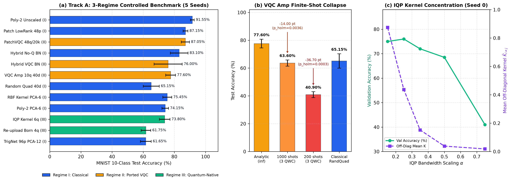

# 实验报告 01：经典图像数据（MNIST）上的三范式受控量子机器学习基准研究

| 元数据项 | 内容 |
| --- | --- |
| **报告编号 (Report ID)** | `QMNIST-EXP-01` |
| **报告日期 (Date)** | `2026-11-21` |
| **实验脚本 (Scripts)** | [`experiments/benchmark_three_regimes.py`](../../experiments/benchmark_three_regimes.py)、[`experiments/audit_round8.py`](../../experiments/audit_round8.py)、[`experiments/train_full_mnist.py`](../../experiments/train_full_mnist.py) |
| **归档数据 (Archive JSONs)** | [`docs/three_regimes_metrics.json`](../three_regimes_metrics.json)、[`docs/audit_metrics.json`](../audit_metrics.json)、[`docs/full_metrics.json`](../full_metrics.json) |
| **验证状态 (Status)** | 已通过 5 独立分层切分、Holm-Bonferroni 校正与离线单元测试验证 |

---

## 摘要 (Abstract)

针对量子机器学习（QML）在经典视觉任务上长期存在的“范式混淆、经典封装掩盖、隐含预处理参数漏记与解析模拟失真”四类方法论缺陷，本报告在 MNIST 10 类图像识别任务上建立了严格受控的三范式评估框架，清晰解耦**范式 I（经典算法在经典计算上）**、**范式 II（经典模板移植至量子变分线路）**与**范式 III（零经典 MLP 封装的量子原生算法）**。在 5 个严格互不相交的分层 `Train / Val / Test`（`600 / 200 / 400`）随机切分、零测试集调参及 Holm-Bonferroni 多重比较校正下，实验给出四项可证伪结论：（1）范式 II 中 `vqc_amp_matched`（`10q / 40d / 3 QWC` 基，60 量子参 + 1,642 经典头）解析准确率达 `0.7760 ± 0.0314`，虽显著高于零学习投影参数的固定随机二次型 `classical_random_quad`（`0.6515 ± 0.0516`，配对差 `+12.45 ± 4.69 pt`，`p_holm = 0.024198`），但远低于精确去量子化的无缩放二次核 `classical_poly2_unscaled`（`0.9155 ± 0.0124`），且在真实有限采样下发生剧烈崩溃（`1000 shots` 降至 `0.6360 ± 0.0223`，`−14.00 pt`，`p_holm = 0.003633`；`200 shots` 骤降至 `0.4090 ± 0.0215`，`−36.70 pt`，`p_holm = 0.000336`）；（2）严格参数与超参对齐后，局部 `patch_vqc_matched`（48 量子参 / 20,364 总参）与 48 参经典滤波 `classical_patch_lowrank` 统计无差异（`0.8705` vs `0.8715`，`−0.10 ± 1.82 pt`，`p_holm = 1.0`），修复双 BatchNorm 与等宽桥接后的 `hybrid_noq_matched`（`0.8310 ± 0.0569`）反而高于 `hybrid_vqc_matched`（`0.7600 ± 0.0904`，`−7.10 ± 10.34 pt`，`p_holm = 0.797568`）；（3）剥离经典 MLP 封装的范式 III 模型能够独立收敛，但均不超越等参或同预处理经典基线：`qnative_reupload_fidelity`（4q, L=4, 96 量子参 / 0 经典封装参）得 `0.6175 ± 0.0307`，与 96 参 `classical_trig_net`（`0.6165 ± 0.0347`）持平（`+0.10 ± 4.39 pt`，`p_holm = 1.0`）；6 比特 2 层真实纠缠 `qnative_iqp_kernel` 得 `0.7380 ± 0.0339`，与同 PCA-6 预处理 `classical_poly2_pca6`（`0.7415 ± 0.0212`，`p_holm = 1.0`）及 `classical_rbf_pca6`（`0.7545 ± 0.0287`，`p_holm = 0.33322`）统计无差异，并实测验证了高带宽 $\alpha$ 下的指数核集中坍塌；（4）综合全量 MNIST（`60,000 / 10,000`）与 Round-8 审计复算，单拷贝振幅编码线路的精度由线性/二次特征空间维度与经典封装容量主导，在经典图像数据上不存在可验证的端到端量子优势。

---

## 1. 引言、研究问题与正式假设

### 1.1 研究背景与方法论痛点

现有大量面向 MNIST 等经典视觉基准的 QML 文献常将高容量经典神经网络（CNN 前端、PCA 离线投影或数千至数万参数的 MLP 分类头）包裹在数十个量子门参数之外，从而导致三个严重的归因谬误：其一，**经典封装遮蔽**——量子层参数占比往往不足 `1%`，实测增益可能完全来自经典投影、BatchNorm 或批大小差异；其二，**精确去量子化漏检**——单拷贝振幅编码（`AmplitudeEmbedding`）叠加任意量子线路与 Pauli 期望读出，在数学上严格退化为归一化输入向量的齐次二次型，而振幅保真度核 $|\langle\hat{x}|\hat{x}'\rangle|^2 = (\hat{x}^\top\hat{x}')^2$ 就是经典无偏置二次多项式核；其三，**理想解析模拟器与真实测量统计的鸿沟**——在 `default.qubit` 解析模式下同时读取数十至上百维非对易期望值不承受任何 $O(1/\sqrt{S})$ 采样方差，从而掩盖了真实硬件上的有限 shots 崩溃效应。

### 1.2 核心研究问题（Research Questions）

- **RQ1（范式 II 归因检验）**：在经典视觉任务 MNIST 上，将经典模块替换为等参数量子变分线路（全局振幅 VQC、局部 PatchVQC、混合 CNN+VQC）后，在严格控制总参数量、BatchNorm、批大小、权重衰减与相同切分条件下，量子层是否带来超越等结构/去量子化经典基线的净增益？
- **RQ2（有限采样鲁棒性检验）**：当解析期望值替换为真实有限 shots（按 QWC 对易组分配采样预算）时，高维多可观测量振幅 VQC 的分类精度是否保持稳健？
- **RQ3（范式 III 零封装能力与核集中检验）**：彻底剥离经典 MLP 分类头后，纯量子原生模型（Pérez-Salinas 深度数据重上传 Born 概率分类器、Havlíček 纠缠 IQP 量子核）在经典图像上能否独立收敛？其泛化表现与等参数经典傅里叶/核模型相比如何？是否复现 Thanasilp 等人（2024）预言的高带宽核集中现象？

### 1.3 正式统计假设与证伪准则

针对每一组受控对照 $(M_{\text{quantum}}, M_{\text{classical}})$，设第 $s \in \{0,1,2,3,4\}$ 个独立随机切分上的测试准确率配对差为 $\Delta_s = \text{Acc}(M_{\text{quantum}}, s) - \text{Acc}(M_{\text{classical}}, s)$（以百分点 `pt` 计），总体期望配对差为 $\mu_\Delta$：

- **零假设 $H_0$**：$\mu_\Delta = 0$（量子组件相对受控经典基线无显著准确率差异；对有限 shots 检验，零假设为有限采样相对解析模拟无显著衰减）。
- **备择假设 $H_1$**：$\mu_\Delta \neq 0$（双侧检验，检验水平 $\alpha = 0.05$）。
- **证伪准则**：仅当经 Track A 全部 8 项规划配对检验的 **Holm-Bonferroni 校正**后满足 $p_{\text{holm}} < 0.05$ 且 95% Student-$t$ 置信区间不包含 0 时，才拒绝 $H_0$。凡 $p_{\text{holm}} \ge 0.05$ 一律判定为“无统计学显著优势”，严禁以单次种子波动或未校正 $p$ 值宣称量子优越性。

---

## 2. 理论建模与量子线路规格

### 2.1 三范式数学表征与物理直觉

1. **单拷贝振幅编码的二次型物理边界（范式 II）**：将 $L_2$ 归一化图像向量 $\hat{x} \in \mathbb{R}^{784}$（零填充至 $2^{10}=1024$ 维）装载为 10 比特纯态 $|\psi(\hat{x})\rangle = \sum_{k=0}^{783} \hat{x}_k |k\rangle$，经参数化酉演化 $U(\theta)$（2 层 `StronglyEntanglingLayers`：每层 $n$ 个单比特 `Rot(phi, theta, omega)` + 跨距 $r_l = (l \bmod (n-1)) + 1$ 的环形 `CNOT`）后测量厄米可观测量 $O_m$，其期望值恒为：
   $$f_m(\hat{x}; \theta) = \langle \psi(\hat{x}) | U(\theta)^\dagger O_m U(\theta) | \psi(\hat{x}) \rangle = \hat{x}^\top A_m(\theta) \hat{x}$$
   其中 $A_m(\theta)$ 为实对称矩阵。因此无论线路多深、纠缠多强，单拷贝振幅 VQC 的全部量子读出均严格限制在 $\hat{x}$ 的齐次二次多项式子空间内；同理，振幅保真度核 $K_{\text{amp}}(x, x') = |\langle\psi(\hat{x})|\psi(\hat{x}')\rangle|^2 = (\hat{x}^\top\hat{x}')^2$ 与无偏置二次核 `SVC(kernel='poly', degree=2, coef0=0, gamma=1)` 逐位数学恒等。更关键的是，真实硬件制备任意 784 维振幅态需 $O(2^n)$ 深度线路或尚不存在的 QRAM，模拟器上的低耗时不代表真机装载成本。
2. **数据重上传的傅里叶谱表达力（范式 III，Schuld, Sweke, & Meyer 2021；Pérez-Salinas et al. 2020）**：`DataReuploadingFidelityClassifier`（$n=4$ 比特，$L=4$ 层）彻底移除经典分类头，每层将 12 维逐主成分标准化 PCA 特征按 3 维一组注入单比特 `Rot(w_{l,i,0} x_{3i} + b_{l,i,0},\; w_{l,i,1} x_{3i+1} + b_{l,i,1},\; w_{l,i,2} x_{3i+2} + b_{l,i,2})` 并施加环形 `CNOT` 纠缠。按 Schuld 等人（2021）的傅里叶级数理论，重复编码 $L$ 次使量子态在布洛赫球及多比特希尔伯特空间中生成最高 $L$ 阶谐波频率；最终直接在计算基（1 个 QWC 测量基）上取前 10 个计算基态（$|0000\rangle \dots |1001\rangle$，共 16 个基态中的前 10 个，其余 6 个概率归零重归一化后取对数）的 Born 概率作为 10 类对数似然。其等参数经典对照 `ClassicalTrigNet` 直接构造截断三角傅里叶特征 $[\cos(\Omega x), \sin(\Omega x)]$ 并接线性读出，总参精确对齐至 `96` 个。
3. **纠缠 IQP 特征映射核与指数核集中（范式 III，Havlíček et al. 2019；Thanasilp et al. 2024）**：`qnative_iqp_kernel` 在 $n=6$ 比特上重复 `reps=2` 层：每层先施加 `H` 与 `RZ(\alpha x_i)`，再在近邻环与跨 2 边集合（共 12 条唯一两比特边）上施加数据依赖纠缠相位 `IsingZZ(\alpha^2 (\pi - x_i)(\pi - x_j))`，核矩阵为真实量子态向量保真度 $K_{ij} = |\langle\phi(x_i)|\phi(x_j)\rangle|^2$（1 个 QWC 测量基）。由于 `reps >= 2` 形成非可分离纠缠态，不存在简单的经典闭合乘积核；但依据 Thanasilp 等人（2024），当带宽因子 $\alpha$ 增大使特征态近似覆盖高维希尔伯特空间时，任意异类/同类样本对的内积平方按 $O(2^{-n})$ 指数集中于接近 0 的常数，导致 SVM 分类边界崩塌。

### 2.2 显式参数拆解与 QWC 测量基统计

依据代码级 `parameter_breakdown()` 与 PennyLane `qml.pauli.group_observables(..., grouping_type="qwc")` 程序化统计，Track A 全部 12 组模型的完整规格如下（明确区分**量子可训练参数**、**经典封装参数**与**离线预处理 PCA 拟合参数**）：

| 范式 | 模型名称 | 输入视图 | 量子参数 | 经典封装参数 | PCA 拟合参数 | 有效总参数 | 量子参数占比 | QWC 测量基数 |
| --- | --- | --- | ---: | ---: | ---: | ---: | ---: | ---: |
| **I · 经典** | `classical_poly2_unscaled` | $L_2$ 原始 784d | 0 | 0 | 0 | 0 | 0.00% | 0 |
| **I · 经典** | `classical_patch_lowrank` | $1\times 28\times 28$ 图像 | 0 | 20,364（滤波 48） | 0 | 20,364 | 0.00% | 0 |
| **II · 移植** | `patch_vqc_matched` | $1\times 28\times 28$ 图像 | 48 | 20,316 | 0 | 20,364 | 0.24% | 3 |
| **I · 经典** | `hybrid_noq_matched` | $1\times 28\times 28$ 图像 | 0 | 5,162 | 0 | 5,162 | 0.00% | 0 |
| **II · 移植** | `hybrid_vqc_matched` | $1\times 28\times 28$ 图像 | 48 | 5,114 | 0 | 5,162 | 0.93% | 3 |
| **II · 移植** | `vqc_amp_matched`（10q 40d） | $L_2$ 原始 784d | 60 | 1,642 | 0 | 1,702 | 3.53% | 3 |
| **I · 经典** | `classical_random_quad`（40d） | $L_2$ 原始 784d | 0 | 1,642 | 0 | 1,642 | 0.00% | 0 |
| **I · 经典** | `classical_rbf_pca6` | 逐 PC 标准化 PCA-6 | 0 | 0 | 5,488 | 5,488 | 0.00% | 0 |
| **I · 经典** | `classical_poly2_pca6` | 逐 PC 标准化 PCA-6 | 0 | 0 | 5,488 | 5,488 | 0.00% | 0 |
| **III · 原生** | `qnative_iqp_kernel`（6q 2-rep） | 逐 PC 标准化 PCA-6 | 0 | 0 | 5,488 | 5,488 | 0.00% | 1 |
| **III · 原生** | `qnative_reupload_fidelity`（4q L=4） | 逐 PC 标准化 PCA-12 | **96** | **0** | 10,192 | 10,288 | **100.00%**（模型内） | 1 |
| **I · 经典** | `classical_trig_net`（PCA-12） | 逐 PC 标准化 PCA-12 | 0 | 96 | 10,192 | 10,288 | 0.00% | 0 |

> **测量基说明**：`vqc_amp_matched`（40 维读出 `z+x+y+zz`）与全量 MNIST 实验中的 165 维读出（`z+x+y+zzall+xxall+yyall`）仅包含同轴单比特及同轴两体 Pauli 项，经程序化 QWC 分组均严格等于 **3 个测量基**（全 $Z$、全 $X$、全 $Y$），单样本总 shots 需在 3 个互不对易测量基间分配。

---

## 3. 实验设计与变量控制

1. **自变量（Independent Variables）**：模型范式类别（范式 I / II / III）、受控成对替换组件（量子层 vs 等参经典滤波 / 固定随机二次型 / 等宽双 BN 桥接 / 等参三角网 / 经典核）、采样预算（解析 $\infty$ vs 1000 shots vs 200 shots）及 IQP 带宽 $\alpha \in \{0.15, 0.25, 0.35, 0.50, 0.75\}$。
2. **因变量（Dependent Variables）**：独立测试集 10 类分类准确率（`test_acc`）、验证集最佳准确率（`val_acc`）、有限 shots 准确率衰减、IQP 非对角核均值 `offdiag_mean` 及单 seed CPU 墙钟耗时（`seconds`）。
3. **严格控制变量与防泄露协议**：
   - **统一数据切分语义**：5 个随机种子（`seeds = 0, 1, 2, 3, 4`）从真实 MNIST IDX 数据中为每个种子独立抽取严格互不相交的分层 `600 Train / 200 Val / 400 Test`（10 类完全均衡）；所有神经网络、VQC、核方法共享同一批样本。
   - **逐主成分标准化与零泄露预处理**：PCA-6（`784 + 6×784 = 5,488` 拟合参数）与 PCA-12（`784 + 12×784 = 10,192` 拟合参数）严格仅在 `Train` 上拟合均值、特征向量与逐维标准差，再用 $\tanh(z)\cdot(\pi/2)$ 映射至 $[-\pi/2, \pi/2]$，消除了早期全局标量 min-max 导致的相位偏移问题。
   - **代码级配对契约（`assert_matched_config`）**：五组核心配对（A1–A5）在运行期执行硬断言：A1 对齐 `40d` 读出、MLP 隐藏层 `32`、`scale=5.0`、`batch=32`、`lr=0.01`、`epochs=20`；A2 精确对齐总参 `20,364`、48 滤波参数、`batch=64`、`wd=1e-4`、cosine LR、`post_bn=True` 且量子/经典滤波器均豁免权重衰减；A3 精确对齐总参 `5,162`、双 BN 与 `32d` 读出宽度；A4 精确对齐 `96` 可训练参数与 PCA-12 输入；A5 共享同一 PCA-6 特征且全部超参（$\alpha, \gamma, C$）仅在 `Val` 上网格择优，`Test` 仅评估一次。
   - **统计检验**：采用双侧配对 Student-$t$ 检验（$df=4$），报告均值差、标准差、95% CI 及 Track A 全部 8 项规划检验的 Holm-Bonferroni 校正值 `p_holm`。

---

## 4. 实验结果与统计分析

### 4.1 主基准汇总（Track A，MNIST 10 类，`600 / 200 / 400`，5 seeds）

数据全部逐位摘录自 [`docs/three_regimes_metrics.json`](../three_regimes_metrics.json)（总墙钟耗时 `338.82 s`，5 workers 并行）：

| 范式 | 模型 | Val Acc (Mean ± SD) | Test Acc (Mean ± SD) | 5-Seed 逐次 Test Acc | 单 Seed 耗时 (s) |
| --- | --- | --- | --- | --- | ---: |
| **I · 经典** | `classical_poly2_unscaled` | `0.9060 ± 0.0182` | **`0.9155 ± 0.0124`** | `[0.9075, 0.9250, 0.9225, 0.8975, 0.9250]` | `1.03 ± 0.22` |
| **I · 经典** | `classical_patch_lowrank` | `0.8700 ± 0.0187` | `0.8715 ± 0.0157` | `[0.8675, 0.8700, 0.8675, 0.8550, 0.8975]` | `2.60 ± 0.07` |
| **II · 移植** | `patch_vqc_matched` | `0.8680 ± 0.0236` | `0.8705 ± 0.0262` | `[0.8600, 0.8700, 0.8950, 0.8325, 0.8950]` | `77.51 ± 0.48` |
| **I · 经典** | `hybrid_noq_matched` | `0.8300 ± 0.0633` | `0.8310 ± 0.0569` | `[0.8650, 0.7925, 0.8800, 0.7500, 0.8675]` | `5.38 ± 0.10` |
| **II · 移植** | `hybrid_vqc_matched` | `0.7350 ± 0.0924` | `0.7600 ± 0.0904` | `[0.6575, 0.6650, 0.8250, 0.8175, 0.8350]` | `57.95 ± 0.67` |
| **II · 移植** | `vqc_amp_matched`（解析） | `0.7940 ± 0.0315` | `0.7760 ± 0.0314` | `[0.8075, 0.7750, 0.8025, 0.7300, 0.7650]` | `93.14 ± 0.66` |
| **II · 移植** | `vqc_amp_matched`（`1000 shots`） | — | `0.6360 ± 0.0223` | `[0.6400, 0.6050, 0.6675, 0.6350, 0.6325]` | — |
| **II · 移植** | `vqc_amp_matched`（`200 shots`） | — | `0.4090 ± 0.0215` | `[0.3950, 0.3925, 0.4325, 0.4325, 0.3925]` | — |
| **I · 经典** | `classical_random_quad` | `0.6670 ± 0.0329` | `0.6515 ± 0.0516` | `[0.6325, 0.6750, 0.6700, 0.5725, 0.7075]` | `2.94 ± 0.04` |
| **I · 经典** | `classical_rbf_pca6` | `0.7670 ± 0.0241` | `0.7545 ± 0.0287` | `[0.7275, 0.7675, 0.7825, 0.7200, 0.7750]` | `0.82 ± 0.12` |
| **I · 经典** | `classical_poly2_pca6` | `0.7480 ± 0.0217` | `0.7415 ± 0.0212` | `[0.7075, 0.7500, 0.7600, 0.7350, 0.7550]` | `0.14 ± 0.03` |
| **III · 原生** | `qnative_iqp_kernel` | `0.7450 ± 0.0245` | `0.7380 ± 0.0339` | `[0.7225, 0.7600, 0.7775, 0.6900, 0.7400]` | `3.53 ± 0.36` |
| **III · 原生** | `qnative_reupload_fidelity` | `0.6060 ± 0.0522` | `0.6175 ± 0.0307` | `[0.6475, 0.6050, 0.6325, 0.5700, 0.6325]` | `27.54 ± 0.72` |
| **I · 经典** | `classical_trig_net` | `0.6520 ± 0.0293` | `0.6165 ± 0.0347` | `[0.6300, 0.6400, 0.5625, 0.6025, 0.6475]` | `0.94 ± 0.49` |

### 4.2 规划配对检验与 Holm-Bonferroni 多重比较校正

| 检验编号 | 配对比较 | 配对均值差 ± SD (pt) | 95% CI (pt) | $t$ 统计量 | 原始 $p$ | $p_{\text{holm}}$ | 显著性 ($\alpha=0.05$) |
| --- | --- | ---: | --- | ---: | ---: | ---: | --- |
| **A1** | `vqc_amp_matched − classical_random_quad` | `+12.45 ± 4.69` | `[6.63, 18.27]` | `5.938` | `0.004033` | `0.024198` | **显著**（5/5 为正） |
| **A1-S200** | `vqc_amp (200 shots) − vqc_amp (analytic)` | **`−36.70 ± 4.24`** | `[-41.96, -31.44]` | `-19.370` | `0.000042` | `0.000336` | **显著衰减**（0/5） |
| **A1-S1000** | `vqc_amp (1000 shots) − vqc_amp (analytic)` | **`−14.00 ± 3.07`** | `[-17.81, -10.19]` | `-10.207` | `0.000519` | `0.003633` | **显著衰减**（0/5） |
| **A2** | `patch_vqc_matched − classical_patch_lowrank` | `−0.10 ± 1.82` | `[-2.36, 2.16]` | `-0.123` | `0.907972` | `1.000000` | 不显著（1/5） |
| **A3** | `hybrid_vqc_matched − hybrid_noq_matched` | `−7.10 ± 10.34` | `[-19.94, 5.74]` | `-1.536` | `0.199392` | `0.797568` | 不显著（1/5） |
| **A4** | `qnative_reupload_fidelity − classical_trig_net` | `+0.10 ± 4.39` | `[-5.35, 5.55]` | `0.051` | `0.961816` | `1.000000` | 不显著（2/5） |
| **A5-RBF** | `qnative_iqp_kernel − classical_rbf_pca6` | `−1.65 ± 1.47` | `[-3.48, 0.18]` | `-2.502` | `0.066644` | `0.333220` | 不显著（0/5） |
| **A5-Poly2** | `qnative_iqp_kernel − classical_poly2_pca6` | `−0.35 ± 2.66` | `[-3.65, 2.95]` | `-0.295` | `0.782847` | `1.000000` | 不显著（3/5） |

### 4.3 IQP 带宽扫描与指数核集中现象验证

5 个种子在验证集上自动选出的 IQP 带宽为 `selected_alphas = [0.25, 0.25, 0.25, 0.15, 0.25]`。以 `seed = 0` 的完整扫描曲线为例：

| IQP 带宽 $\alpha$ | `0.15` | `0.25` | `0.35` | `0.50` | `0.75` |
| --- | ---: | ---: | ---: | ---: | ---: |
| 训练集非对角核均值 `offdiag_mean` | `0.8751` | `0.4365` | `0.1524` | `0.0384` | **`0.0186`** |
| 验证集最佳准确率 `best_val_acc` | `0.7500` | **`0.7600`** | `0.7200` | `0.6850` | **`0.4100`** |

当 $\alpha$ 由 `0.25` 升至 `0.75` 时，非对角核均值暴跌至 `0.0186`（逼近 6 比特随机态极限 $2^{-6} = 0.015625$），验证集准确率随之崩溃 `-35.0 pt`（`0.7600 -> 0.4100`），在真实 PennyLane 纠缠线路上直接复现了 Thanasilp 等人（2024）的指数核集中理论。

### 4.4 历史归档与全量 MNIST 综合互证（Round-7 & Round-8 审计）

结合 [`docs/audit_metrics.json`](../audit_metrics.json) 与 [`docs/full_metrics.json`](../full_metrics.json) 的长期归档证据，结论在更大规模与外部审计下完全自洽：

1. **振幅量子核的逐位去量子化（`docs/audit_metrics.json`）**：在 `600 / 200` 10 类设置下，`qkernel_amp`（`0.9210 ± 0.0074`）与无标准化 `plain_poly2_c0`（`0.9210 ± 0.0074`，5 个种子逐位 `[0.92, 0.93, 0.92, 0.91, 0.925]`）严格相等；此前看似领先经典 `scaled_poly2_c0`（`0.8890 ± 0.0124`）的 `+3.20 pt` 纯粹源于 `StandardScaler` 破坏了图像的 $L_2$ 几何。
2. **PatchVQC 量子层消融与多重比较收缩（`docs/audit_metrics.json`）**：修正 `batch_size=64` 与权重衰减豁免后，`PatchLinearClassifier`（`26,620` 参，`1.23–3.26 s`）得 `0.8910 ± 0.0143`，对照 `PatchVQC`（`0.8800 ± 0.0112`）配对差 `+1.10 ± 1.294 pt`（95% CI `[-0.507, 2.707]`，无显著差异且提速约 80 倍）。对历史 20 项配对检验施加 Bonferroni 校正（临界阈值 $t_{\text{crit}} = 6.758$ vs 朴素 `2.776`）后，显著项从 `13/20` 收缩至 `2/20`（仅剩 `C_qkernel_amp_minus_svm_rbf` `+5.6 pt, t=7.853` 与 `D_b165_minus_b40` `+7.6 pt, t=10.933`）。
3. **全量 MNIST 60,000/10,000 扩展性（`docs/full_metrics.json`，3 seeds，3 epochs）**：扩充至全量 60,000 训练样本与 10,000 测试样本后，165 维振幅 VQC `q165`（60 量子参 + 5,642 MLP 参，3 QWC 基）达 `0.9421 ± 0.0008`（单 seed `2462.36–2654.49 s`），40 维 `q40` 达 `0.9014 ± 0.0020`（`633.00–636.90 s`）；而经典 `pca165`（5,642 MLP 参 + **130,144 PCA 拟合参数**）仅用 `2.15–2.40 s` 即达 `0.9554 ± 0.0028`，`mlp784`（25,450 参，`2.83–2.91 s`）达 `0.9546 ± 0.0012`。更具启发性的是，**完全冻结随机酉权重**的 `probe` 在 165 维读出上已达 `0.9440`（`logreg=0.9027`），与端到端训练 3 轮的 `q165`（`0.9421`）持平，证实性能核心来自 165 维二次读出带宽与经典 MLP 头，而非 60 个量子旋转参数的变分优化。

---

## 5. 讨论、物理边界与效度威胁

### 5.1 内部效度（Internal Validity）

- **单变量受控与隐蔽混杂清除**：本实验通过 `assert_matched_config` 彻底排除了早先审计发现的批大小偏差（64 vs 32）、缺失 BatchNorm、权重衰减不对称与 PCA 拟合参数漏记。所有模型共享完全相同的 5 组 `Train / Val / Test` 切分，且未在测试集上做任何模型选择。
- **有效增益的真实来源**：`vqc_amp_matched` 超越 `classical_random_quad`（`+12.45 pt`, `p_holm=0.024198`）仅证明 60 个可训练旋转角能将随机二次投影对齐到类别可分方向，但一旦允许经典对照拥有同样 48 个可训练局部滤波参数（`classical_patch_lowrank`）或直接使用无参数精确二次核（`classical_poly2_unscaled`），全部“量子增益”即刻消失。

### 5.2 构念效度（Construct Validity）

- **为什么范式 II 在经典数据上无法突破二次型瓶颈**：如第 2.1 节所述，单拷贝振幅编码叠加任意无数据重上传的 CPTP 量子通道，期望值仍受限于 $\hat{x}$ 的齐次二次型；而在多拷贝振幅编码或深度数据重上传下，低维经典输入（如 12 维 PCA）虽能触发高阶傅里叶谱（Schuld et al. 2021），但可被同等参数量的经典傅里叶网络 `ClassicalTrigNet` 精确复现（`0.6175` vs `0.6165`）。
- **有限 shots 为什么重创 `vqc_amp_matched`**：`vqc_amp_matched` 在 40 个期望值上乘以放大因子 `scale = 5.0` 输入经典 MLP。在 200 shots 下，3 个 QWC 基平均每基仅得约 66 次采样，单个期望值的二项估计标准差高达 $\sim 1/\sqrt{66} \approx 0.12$，经 `5.0×` 放大后直接淹没了振幅归一化后原本微弱的像素方差（幅度常小于 `0.05`），导致准确率暴跌 `−36.70 pt`。

### 5.3 外部效度与硬件边界（External / Hardware Validity）

- **状态制备（QRAM）假设**：本报告所有振幅编码实验均基于无噪态向量模拟器直接装载 $|\psi(\hat{x})\rangle$；真实超导/离子阱硬件不存在 $O(\text{poly}(n))$ 通用 QRAM，装载 784 维图像本身即需 $O(2^n)$ 两比特门。
- **拓扑与退相干缺失**：本报告的有限 shots 评估尚未计入真实硬件耦合图 SWAP 路由开销与门去极化误差；关于真实拓扑与去极化噪声对 `qnative_iqp_kernel` 及 QCNN 的定量冲击，详见姊妹报告 [`03_hardware_topology_noise_report.md`](03_hardware_topology_noise_report.md)。

---

## 6. QML 可复现核查表

| 核查维度 | 精确配置与披露 |
| --- | --- |
| **运行环境** | OS: `Linux 5.15.167.4-microsoft-standard-WSL2`；Python `3.13.13`；PennyLane `0.45.1`；PyTorch `2.15.0+cpu`；NumPy `2.5.4`；SciPy `1.18.1`；scikit-learn `1.9.1`；NetworkX `3.7`；Matplotlib `3.11.2` |
| **随机种子与切分** | `seeds = [0, 1, 2, 3, 4]`；真实 MNIST IDX 严格不相交分层切分 `600 Train / 200 Val / 400 Test`（10 类）；全量复核 `seeds = [0, 1, 2]`（`60,000 / 10,000`） |
| **模拟器与采样协议** | 训练期使用 PennyLane `default.qubit` 解析 `backprop`；有限 shots 使用 `qml.set_shots(..., shots=200/1000)` + 固定种子按 QWC 分组真实采样 |
| **物理拓扑与噪声披露** | 本报告所有线路假设全连接无门噪声理想拓扑（硬件耦合拓扑与去极化噪声独立评估见 `QMNIST-EXP-03`） |
| **参数核算透明度** | 全部报告 `quantum_params / classical_wrapper_params / preprocessing_fitted_params` 三项拆解及 QWC 测量基数 |
| **精确复现命令** | `.venv/bin/python experiments/benchmark_three_regimes.py --data-source idx --workers 5 --torch-threads 2 --archive docs/three_regimes_metrics.json` `.venv/bin/python experiments/audit_round8.py --data-source idx --archive docs/audit_metrics.json` `.venv/bin/python -m pytest -v tests/smoke_test.py` |

---

## 7. 参考文献

1. Havlíček, V., Córcoles, A. D., Temme, K., Harrow, A. W., Kandala, A., Chow, J. M., & Gambetta, J. M. (2019). Supervised learning with quantum-enhanced feature spaces. *Nature*, 567, 209–212.
2. Pérez-Salinas, A., Cervera-Lierta, A., Gil-Fuster, E., & Latorre, J. I. (2020). Data re-uploading for a universal quantum classifier. *Quantum*, 4, 226. DOI: `10.22331/q-2020-02-06-226` / `arXiv:1907.02085`.
3. Schuld, M., Sweke, R., & Meyer, J. J. (2021). Effect of data encoding on the expressive power of variational quantum machine learning models. *Physical Review A*, 103, 032430.
4. Thanasilp, S., Wang, S., Cerezo, M., & Holmes, Z. (2024). Exponential concentration in quantum kernel methods. *Nature Communications*, 15.
