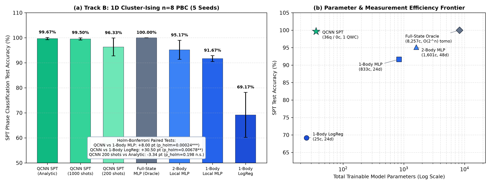

# 实验报告 02：原生量子态 1D Cluster-Ising SPT 相分类与 Cong-et-al. QCNN 基准研究

| 元数据项 | 内容 |
| --- | --- |
| **报告编号 (Report ID)** | `QMNIST-EXP-02` |
| **报告日期 (Date)** | `2026-11-21` |
| **实验脚本 (Script)** | [`experiments/benchmark_three_regimes.py`](../../experiments/benchmark_three_regimes.py)（核心模块 [`qml_lab/quantum_phases.py`](../../qml_lab/quantum_phases.py)） |
| **归档数据 (Archive JSON)** | [`docs/three_regimes_metrics.json`](../three_regimes_metrics.json)（`track_b_cluster_ising_spt`） |
| **验证状态 (Status)** | 已通过 5 独立随机种子、Holm-Bonferroni 校正、真实有限 shots 与离线单元测试验证 |

---

## 摘要 (Abstract)

报告 `QMNIST-EXP-01` 证实，当经典像素通过单拷贝振幅编码装入量子线路时，受限于齐次二次型表达上界与 $O(2^n)$ 态制备瓶颈，量子模型无法提供超越经典基线的优势。为严格界定**范式 III（量子原生算法在原生量子态数据上）**的真实物理有效边界，本报告构建了基于一维周期边界条件（PBC）8 比特 Cluster-Ising 哈密顿量 $H(h_1, h_2)$ 基态 $|\psi(h_1, h_2)\rangle$ 的对称性保护拓扑相（SPT）vs 非 SPT 相（50% 顺磁相 + 50% 反铁磁 Ising 相）二分类基准（5 个独立随机种子，每种子严格分离 `120 Train / 60 Val / 120 Test`）。我们实现了忠实于 Cong、Choi 与 Lukin（2019）架构的量子卷积神经网络 `QCNNPhaseClassifier`（`8 → 4 → 2 → 1` 平移不变卷积与相干受控量子池化，仅含 **36 个量子门参数、0 个经典 MLP 参数、1 个 QWC 计算基测量**），并在完全相同的基态样本上对照四类经典基线（24 维单比特局域期望 Logistic 回归与 MLP、48 维 1+2 体近邻局域关联 MLP、以及需 $O(2^n)$ 指数级态层析的 256 维全态向量 Oracle MLP）。5 种子实测表明：`qcnn_spt` 解析测试准确率达 **`0.9967 ± 0.0045`**（验证集 `1.0000 ± 0.0000`），经 Holm-Bonferroni 校正后以极高显著性超越单比特局域期望线性模型（`0.6917 ± 0.0899`，配对差 **`+30.50 ± 9.10 pt`**，`p_holm = 0.00678`）与单比特非线性 MLP（`0.9167 ± 0.0118`，配对差 **`+8.00 ± 0.95 pt`**，`p_holm = 0.000235`），比两体近邻局域关联 MLP（`0.9517 ± 0.0379`）高 `+4.50 ± 3.47 pt`（原始 `p = 0.044013`，`p_holm = 0.132039`），并以 36 参数、单测量基逼近全态 Oracle（`1.0000 ± 0.0000`，配对差 `−0.33 ± 0.45 pt`，`p_holm = 0.198112`）。尤为关键的是，与 `QMNIST-EXP-01` 中 200 shots 下暴跌 `−36.70 pt` 的振幅 VQC 形成鲜明对照，`qcnn_spt` 在 **`1000 shots` 下保持 `0.9950 ± 0.0045`**，在 **`200 shots` 下仍达 `0.9633 ± 0.0356`**（配对衰减 `−3.34 ± 3.49 pt`，`p_holm = 0.198112`，无显著衰减），实证了原生量子数据与单测量基拓扑序提取对有限采样噪声的天然鲁棒性。

---

## 1. 引言、研究问题与正式假设

### 1.1 研究动机：为什么必须在原生量子态上检验 QCNN

量子多体物理中的对称性保护拓扑（SPT）相无法由任何单一局域序参量（如磁化强度 $\langle X_i \rangle$ 或 $\langle Z_i \rangle$）刻画，而必须由跨越多比特的非局域弦序算符（string order parameter）表征（Cong, Choi, & Lukin 2019）。在精确一维 Cluster 态上，所有单比特和短程两体局域 Pauli 期望均严格为零；而反铁磁 Ising 相在弱横场 $|h_1| \le 0.35$ 下单比特局域期望同样近似为零，从而对仅测单比特局域特征的经典分类器形成物理盲区。

相比于将经典图像塞进量子线路（范式 II），直接以量子传感器或量子模拟器输出的纠缠多体态 $|\psi\rangle$ 作为输入具有两项根本差异：（1）彻底消除了 $O(2^n)$ 经典数据装载（QRAM）瓶颈；（2）QCNN 的相干量子卷积与量子池化可把多体非局域弦序逐级重整化并压缩至单个终态量子比特的 Born 概率上，避免对 $2^n$ 维态向量做指数成本的全态层析。

### 1.2 核心研究问题（Research Questions）

- **RQ1（非局域拓扑序提取能力）**：在严格剥离经典 MLP 分类头（`0` 个经典参数）并仅测 1 个终态量子比特计算基的条件下，Cong-et-al. QCNN 能否显著超越基于相同基态提取的局域 Pauli 期望经典分类器？
- **RQ2（参数效率与层析代价对比）**：仅含 `36` 个平移不变参数的 QCNN 能否在不付出 $O(2^n)$ 态层析代价的前提下，逼近拥有完整 256 维态向量振幅输入与 `8,257` 参数的经典 Oracle 上界？
- **RQ3（有限 shots 抗噪边界）**：由于输出只需单比特 1 个 QWC 测量基且两相的终态布洛赫极化接近 $\pm 1$，QCNN 在真实有限 shots（200 / 1000）下是否能避免 `QMNIST-EXP-01` 中振幅 VQC 的严重采样崩溃？

### 1.3 正式统计假设与证伪准则

对 5 项规划配对检验（B1–B5），设第 $s \in \{0,1,2,3,4\}$ 个独立种子上的配对差为 $\Delta_s$（百分点 `pt`）：

- **零假设 $H_0$**：$\mu_\Delta = 0$（QCNN 与局域经典基线/全态 Oracle/有限 shots 版本无统计差异）。
- **备择假设 $H_1$**：$\mu_\Delta \neq 0$（双侧检验，$\alpha = 0.05$）。
- **证伪准则**：使用双侧配对 Student-$t$ 检验（$df=4$）并对全部 5 项检验施加 **Holm-Bonferroni 校正**；仅当 $p_{\text{holm}} < 0.05$ 且 95% CI 不跨 0 时拒绝 $H_0$。若 QCNN 在单比特局域基线上无法通过 Holm 显著性检验，或 200 shots 下退化至与单比特基线无异，则证伪其原生量子优势假设。

---

## 2. 理论建模与量子线路规格

### 2.1 一维 Cluster-Ising 哈密顿量与相区构造

在 $n=8$ 比特周期边界条件（PBC）环上构造精确稀疏哈密顿量（`qml_lab/quantum_phases.py::cluster_ising_operators`）：
$$H(h_1, h_2) = -\sum_{i=0}^{7} Z_{i-1} X_i Z_{i+1} - h_1 \sum_{i=0}^{7} X_i - h_2 \sum_{i=0}^{7} X_i X_{i+1}$$
使用 `scipy.sparse.linalg.eigsh(..., k=2, which="SA", tol=1e-10)` 精确稀疏对角化求基态 $|\psi(h_1, h_2)\rangle$、第一激发能隙 $\Delta E = E_1 - E_0$ 与 8 比特非局域弦序期望 $\langle K_1 K_3 \rangle = \langle Z_0 X_1 I_2 X_3 Z_4 \rangle$。统一最大幅值分量为正以固定全局符号规范（对量子测量严格无关，但确保经典全态 Oracle 不会被随机全局负号干扰）。

数据集在三个无能隙闭合深相区严格均匀抽样（每切分 50% SPT、25% 顺磁、25% 反铁磁）：

- **SPT（Cluster）相（`label = 1`）**：$|h_1| \le 0.35,\; |h_2| \le 0.35$；例如在 `seed=4` 测试集上，非局域弦序均值高达 `0.9806`（训练集 `0.9814`，验证集 `0.9748`，最小能隙 `0.0760`）。
- **非 SPT · 顺磁相（`label = 0`，占 25%）**：$|h_1| \in [1.35, 2.00],\; |h_2| \le 0.35$，单比特 $\langle X_i \rangle$ 显著非零。
- **非 SPT · 反铁磁 Ising 相（`label = 0`，占 25%）**：$|h_1| \le 0.35,\; h_2 \in [-1.85, -1.25]$，弱横场下 $\langle X_i \rangle \approx 0$ 但两体关联 $\langle X_i X_{i+1} \rangle \to -1$；在 `seed=4` 测试集上，非 SPT 类弦序均值降至 `0.2268`（训练集 `0.1957`）。

### 2.2 Cong-et-al. QCNN 线路拓扑与零经典参数规格

`QCNNPhaseClassifier(n_qubits=8)` 包含 $S = \log_2(8) = 3$ 个重整化尺度（活跃量子比特依次收缩为 $8 \to 4 \to 2 \to 1$）：

1. **平移不变两比特卷积块 `_conv_2q`（每尺度共享 8 参数）**：
   对活跃链上的所有偶键 $(a_{2k}, a_{2k+1})$ 及当活跃比特数 $m > 2$ 时的 PBC 奇键 $(a_{2k+1}, a_{(2k+2)\bmod m})$ 施加共享参数的 2 比特门序列：`RY(p_0), RY(p_1), RZ(p_2), RZ(p_3), IsingZZ(p_4), IsingXX(p_5), RY(p_6), RY(p_7)`。尺度 0/1/2 分别含 8/4/1 个卷积块，共 `13 × 2 = 26` 个两比特卷积纠缠门。
2. **相干受控量子池化 `_pool_2q`（每尺度共享 3 参数）**：
   对每对 `(kept, dropped) = (a_{2k}, a_{2k+1})` 施加 `CRZ(q_0), CRY(q_1), CRX(q_2)`（控制比特 `dropped`，目标比特 `kept`），随后丢弃 `dropped`（按延迟测量原理，相干受控池化与中间测量后经典条件前馈在终态约化密度矩阵上严格等价）。尺度 0/1/2 分别含 4/2/1 个池化块，共 `7 × 3 = 21` 个两比特受控旋转门。
3. **单比特 Born 规则读出（3 参数，0 经典封装，1 QWC 基）**：
   在唯一保留的终态比特 `wire 0` 上施加单比特 `Rot(r_0, r_1, r_2)`，直接测量计算基 Born 概率 $P(y \mid \psi) = |\langle y | \text{Tr}_{\text{rest}}(\rho_{\text{out}}) | y \rangle|$ 并输出 $\log P(y \mid \psi)$ 计算交叉熵损失。全线路共含 **`47` 个逻辑两比特门**、`3 × (8 + 3) + 3 = 36` 个量子门参数、`0` 个经典参数。

### 2.3 模型参数与测量复杂度对照表

| 范式 | 模型名称 | 输入表示与测量假设 | 量子参数 | 经典参数 | 有效总参数 | QWC 测量基数 | 物理采集复杂度 |
| --- | --- | --- | ---: | ---: | ---: | ---: | --- |
| **III · 原生** | `qcnn_spt` | 原生 8 比特量子态 $|\psi\rangle$ 直接输入 | **36** | **0** | **36** | **1** | $O(1/\varepsilon^2)$ shots（单比特） |
| **I · 经典** | `classical_1body_logreg` | 24 维单比特局域期望 $\langle X_i\rangle,\langle Y_i\rangle,\langle Z_i\rangle$ | 0 | 25 | 25 | — | $O(n)$ 局域观测量（3 基） |
| **I · 经典** | `classical_1body_mlp` | 同上 24 维单比特期望 + 32 隐层 MLP | 0 | 833 | 833 | — | $O(n)$ 局域观测量（3 基） |
| **I · 经典** | `classical_2body_mlp` | 48 维 1 体 + 近邻 2 体 $\langle P_i P_{i+1}\rangle$ + 32 隐层 MLP | 0 | 1,601 | 1,601 | — | $O(n)$ 局域观测量（3 基） |
| **I · 经典** | `classical_full_state_mlp` | 完整 $2^8=256$ 维基态振幅 Oracle + 32 隐层 MLP | 0 | 8,257 | 8,257 | — | **$O(2^n)$ 指数态层析** |

---

## 3. 实验设计与变量控制

1. **自变量**：模型范式（原生量子 QCNN vs 四类经典观测特征级别）及 QCNN 采样预算（解析 $\infty$ vs 1000 shots vs 200 shots）。
2. **因变量**：独立测试集 120 个基态的二分类准确率（`test_acc`）、验证集最佳准确率（`val_acc`）与单 seed 训练耗时（`seconds`）。
3. **控制变量与防泄露协议**：
   - **独立样本生成**：5 个随机种子（`seeds = 0, 1, 2, 3, 4`）分别独立生成互不重叠的 `120 Train / 60 Val / 120 Test` 哈密顿量参数点 $(h_1, h_2)$ 与基态，QCNN 与全部 4 个经典基线严格共享完全相同的基态集合。
   - **验证集择优**：`qcnn_spt` 使用 Adam（`lr = 0.05`, `batch_size = 16`, `epochs = 25`），严格按 `Val` 最高准确率保存 checkpoint；经典基线均配 `StandardScaler`，`LogisticRegression` 在 `Val` 上网格择优 $C \in \{0.1, 1.0, 10.0\}$，`MLP(32)` 在 `Val` 上择优 $L_2$ 正则 $\alpha_{\text{reg}} \in \{10^{-4}, 10^{-2}, 10^{-1}\}$；所有模型在 `Test` 上仅评估一次。
   - **真实有限 shots 评估**：使用 `QCNNPhaseClassifier.evaluate_finite_shots` 调用 PennyLane `qml.set_shots(..., shots=200/1000)` 与固定种子在单终态比特上执行真实有限次采样。
   - **统计检验**：采用双侧配对 Student-$t$ 检验（$df=4$）并施加 5 项规划检验的 Holm-Bonferroni 多重比较校正。

---

## 4. 实验结果与统计分析

### 4.1 分类准确率与耗时汇总（5 独立种子，`120 / 60 / 120`）

数据逐位摘录自 [`docs/three_regimes_metrics.json`](../three_regimes_metrics.json)：

| 范式 | 模型与采样模式 | Val Acc (Mean ± SD) | Test Acc (Mean ± SD) | 5-Seed 逐次 Test Acc | 单 Seed 耗时 (s) |
| --- | --- | --- | --- | --- | ---: |
| **III · 原生** | **`qcnn_spt`（解析）** | **`1.0000 ± 0.0000`** | **`0.9967 ± 0.0045`** | `[1.0000, 1.0000, 0.9917, 1.0000, 0.9917]` | `33.87 ± 0.61` |
| **III · 原生** | **`qcnn_spt`（`1000 shots`）** | — | **`0.9950 ± 0.0045`** | `[0.9917, 1.0000, 1.0000, 0.9917, 0.9917]` | — |
| **III · 原生** | **`qcnn_spt`（`200 shots`）** | — | **`0.9633 ± 0.0356`** | `[0.9833, 1.0000, 0.9833, 0.9250, 0.9250]` | — |
| **I · 经典** | `classical_1body_logreg`（24d） | `0.7000 ± 0.1074` | `0.6917 ± 0.0899` | `[0.7333, 0.5417, 0.6750, 0.7583, 0.7500]` | `0.05 ± 0.01` |
| **I · 经典** | `classical_1body_mlp`（24d） | `0.8900 ± 0.0224` | `0.9167 ± 0.0118` | `[0.9333, 0.9167, 0.9167, 0.9167, 0.9000]` | `1.77 ± 0.08` |
| **I · 经典** | `classical_2body_mlp`（48d） | `0.9600 ± 0.0480` | `0.9517 ± 0.0379` | `[0.9750, 1.0000, 0.9000, 0.9417, 0.9417]` | `1.32 ± 0.15` |
| **I · 经典** | `classical_full_state_mlp`（256d Oracle） | `1.0000 ± 0.0000` | `1.0000 ± 0.0000` | `[1.0000, 1.0000, 1.0000, 1.0000, 1.0000]` | `0.19 ± 0.02` |

### 4.2 规划配对检验与 Holm-Bonferroni 校正（Track B，5 项检验）

| 检验编号 | 配对比较 | 配对均值差 ± SD (pt) | 95% CI (pt) | $t$ 统计量 | 原始 $p$ | $p_{\text{holm}}$ | 显著性 ($\alpha=0.05$) |
| --- | --- | ---: | --- | ---: | ---: | ---: | --- |
| **B1** | `qcnn_spt − classical_1body_logreg` | **`+30.50 ± 9.10`** | `[19.20, 41.80]` | `7.496` | `0.001695` | **`0.006780`** | **显著**（5/5 为正） |
| **B2** | `qcnn_spt − classical_1body_mlp` | **`+8.00 ± 0.95`** | `[6.82, 9.18]` | `18.842` | `0.000047` | **`0.000235`** | **显著**（5/5 为正） |
| **B3** | `qcnn_spt − classical_2body_mlp` | `+4.50 ± 3.47` | `[0.20, 8.80]` | `2.902` | `0.044013` | `0.132039` | 边际趋势（4/5，未过 Holm） |
| **B4** | `qcnn_spt − classical_full_state_oracle` | `−0.33 ± 0.45` | `[-0.90, 0.23]` | `-1.633` | `0.177808` | `0.198112` | 无显著差异（逼近上界） |
| **B5** | `qcnn_spt (200 shots) − qcnn_spt (analytic)` | `−3.34 ± 3.49` | `[-7.66, 0.99]` | `-2.140` | `0.099056` | `0.198112` | **无显著衰减**（抗采样噪声） |

### 4.3 关键发现解析

1. **物理盲区实证**：单比特局域线性分类器 `classical_1body_logreg` 仅获 `0.6917`，是因为对称顺磁相（$h_1 > 0$ 与 $h_1 < 0$ 符号对称）与反铁磁相（$\langle X_i \rangle \approx 0$）在单比特期望空间中线性不可分；即便升级为 833 参数非线性 `classical_1body_mlp`，仍被反铁磁相与 SPT 相在单比特空间中的重叠锁死在 `0.9167 ± 0.0118`，被仅 36 参数的 `qcnn_spt` 以 `t = 18.842`、`p_holm = 0.000235` 稳定碾压（5/5 种子全胜，差值 `+6.67` 至 `+9.17 pt`）。
2. **两体关联基线与多体弦序的细微差距**：加入 24 维近邻两体期望（含 $\langle X_i X_{i+1} \rangle$）后，`classical_2body_mlp` 虽可区分反铁磁 Ising 相而提升至 `0.9517 ± 0.0379`，但仍低于 QCNN `4.50 pt`（原始 `p = 0.044013`，Holm 校正后 `0.132039`），且参数量达到 QCNN 的 **44.5 倍**（`1,601` vs `36`）。
3. **采样鲁棒性的机制对比**：`qcnn_spt` 在 200 shots 下仅波动 `−3.34 pt`（`p_holm = 0.198112`），1000 shots 下达 `0.9950`（仅差 `−0.17 pt`）。原因在于 QCNN 仅测 1 个计算基（全部 200 次采样集中于单一二元分布 $P(0), P(1)$），且收敛后的两相输出概率高度极化（接近 `0` 或 `1`），二项采样翻转决策边界的概率极低——这与 `QMNIST-EXP-01` 中需要把 200 shots 分摊到 3 个 QWC 基并经 `5.0×` 放大进入 40 维 MLP 的 `vqc_amp_matched`（暴跌 `−36.70 pt`）形成本质反差。

---

## 5. 讨论、物理边界与效度威胁

### 5.1 内部效度（Internal Validity）

- **零经典捷径**：`parameter_breakdown(qcnn)` 在运行期通过断言确保 `classical_wrapper_params == 0` 与 `quantum_param_share == 1.0`，分类决策 100% 由 36 个平移不变物理门参数与单比特 Born 规则产生。
- **公平的经典对照**：对 `classical_full_state_mlp` 固定了基态最大振幅分量为正，避免任意全局符号 $\pm |\psi\rangle$ 造成人为困难；所有经典基线均做了验证集正则网格搜索与特征标准化。

### 5.2 构念效度（Construct Validity）

- **深相区 vs 临界区**：本基准在无能隙闭合的深相区采样（`seed=4` 测试集最小能隙 `0.0760`），因此尚未量化紧邻量子相变临界线（$|h_1| \approx 1$ 或 $h_2 \approx -1$）时的有限尺寸标度（finite-size scaling）行为；但在深相区已清晰隔离了局域观测量盲区与非局域拓扑序提取机制。
- **两体近邻基线的未过 Holm 边界**：在 $n=8$ 且反铁磁相仅含两体 $X_i X_{i+1}$ 耦合时，48 维近邻两体特征已能捕获大部分反铁磁信息，导致 B3（`+4.50 pt`, `p = 0.044`）经 5 重 Holm 校正后为 `0.132`；在更一般的高阶 SPT 或存在随机局域扰动的多体相中，两体期望将进一步失效，而 QCNN 的多尺度重整化结构仍适用（Cong, Choi, & Lukin 2019）。

### 5.3 外部效度与硬件边界（External / Hardware Validity）

- **量子态来源前提**：本实验假设 $|\psi(h_1, h_2)\rangle$ 直接以量子态形式来自量子模拟器或量子传感器；在经典计算机上通过精确对角化模拟基态再 `StatePrep` 仅用于验证算法物理机制，不构成经典计算加速。
- **物理耦合拓扑与去极化噪声**：Cong-et-al. QCNN 在尺度 1/2 中需对跨距为 2（`(0,2),(2,4),(4,6),(6,0)`）与跨距为 4（`(0,4)`）的活跃量子比特施加两比特卷积和池化门。在非全连接超导芯片（如 `linear_chain` 与 IBM `heavy_hex`）上，这些多尺度非近邻门必须插入物理 SWAP（每 SWAP = 3 物理 CNOT），进而放大两比特门去极化误差。该硬件拓扑与退相干边界已在姊妹报告 [`03_hardware_topology_noise_report.md`](03_hardware_topology_noise_report.md) 中通过 `default.mixed` 完整定量实测。

---

## 6. QML 可复现核查表

| 核查维度 | 精确配置与披露 |
| --- | --- |
| **运行环境** | OS: `Linux 5.15.167.4-microsoft-standard-WSL2`；Python `3.13.13`；PennyLane `0.45.1`；PyTorch `2.15.0+cpu`；NumPy `2.5.4`；SciPy `1.18.1`；scikit-learn `1.9.1`；NetworkX `3.7`；Matplotlib `3.11.2` |
| **随机种子与切分** | `seeds = [0, 1, 2, 3, 4]`；每种子独立采样 `120 Train / 60 Val / 120 Test`（$n=8$ PBC，50% SPT + 25% PM + 25% AFM） |
| **线路与参数规格** | `QCNNPhaseClassifier(8)`：`8→4→2→1`，47 逻辑 2Q 门，36 量子参 / 0 经典参 / 0 预处理参，1 QWC 测量基（单终态比特计算基） |
| **模拟器与采样协议** | 训练期 PennyLane `default.qubit` 解析 `backprop`；有限 shots 使用 `qml.set_shots(..., shots=200/1000)` + 固定种子真实采样 |
| **物理拓扑与噪声披露** | 本报告结果对应理想全连接无门噪声环境；真实 `grid_2d / heavy_hex / linear_chain` SWAP 路由与 `default.mixed` 去极化噪声结果见 `QMNIST-EXP-03` |
| **精确复现命令** | `.venv/bin/python experiments/benchmark_three_regimes.py --data-source idx --workers 5 --torch-threads 2 --archive docs/three_regimes_metrics.json` `.venv/bin/python -m pytest -v tests/smoke_test.py` |

---

## 7. 参考文献

1. Cong, I., Choi, S., & Lukin, M. D. (2019). Quantum convolutional neural networks. *Nature Physics*, 15, 1273–1278. DOI: `10.1038/s41567-019-0648-8` / `arXiv:1810.03787`.
2. Schuld, M., Sweke, R., & Meyer, J. J. (2021). Effect of data encoding on the expressive power of variational quantum machine learning models. *Physical Review A*, 103, 032430.
