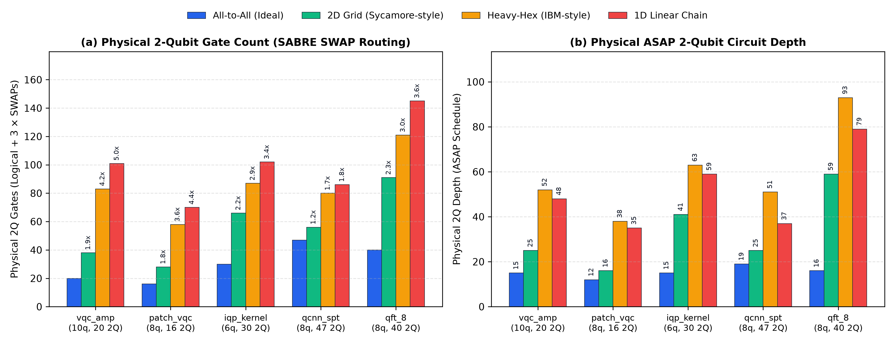
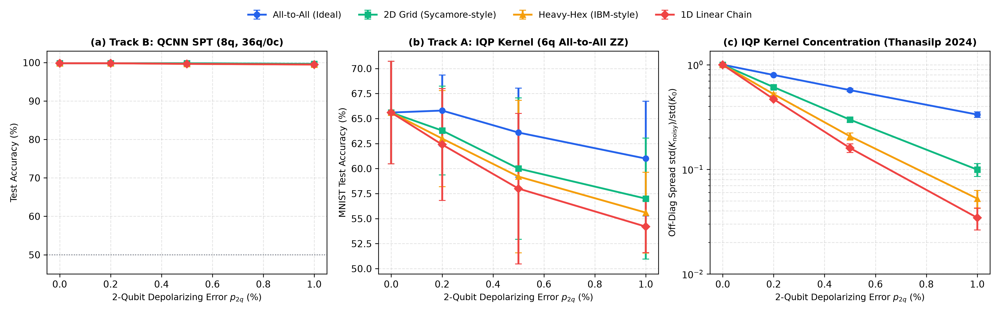

# 实验报告 03：硬件耦合拓扑 SWAP 路由开销与去极化噪声基准研究

| 元数据项 | 内容 |
| --- | --- |
| **报告编号 (Report ID)** | `QMNIST-EXP-03` |
| **报告日期 (Date)** | `2026-11-21` |
| **实验脚本 (Script)** | [`experiments/benchmark_hardware_topology.py`](../../experiments/benchmark_hardware_topology.py)（核心模块 [`qml_lab/hardware_topology.py`](../../qml_lab/hardware_topology.py)） |
| **归档数据 (Archive JSON)** | [`docs/hardware_topology_metrics.json`](../hardware_topology_metrics.json) |
| **验证状态 (Status)** | 全部 20 组路由线路无噪态向量误差 `≤ 2.776e-16`；`default.mixed` 5 种子完整验证通过 |

---

## 摘要 (Abstract)

绝大多数量子机器学习（QML）模拟基准隐含“全连接理想耦合 + 无退相干门噪声”的双重假设，严重低估了线路编译到真实超导处理器上的物理门膨胀与噪声放大效应。本报告基于 `NetworkX` 构建了 4 种标准量子硬件耦合图——理想全连接 `all_to_all`（$K_n$）、一维近邻链 `linear_chain`（$P_n$，最大度 `2`）、Google 风格二维方形网格 `grid_2d`（$2\times 3 / 2\times 4 / 2\times 5$，最大度 `3`）以及 IBM 风格重六边形晶格连通子图 `heavy_hex`（显式 data 与 bridge 比特严格二分，最大度 `3`，Chamberland et al. 2020）——并实现了确定性双向 SABRE 启发式 SWAP 路由器（Li, Ding, & Xie 2019；每 1 次 SWAP 分解为 3 个物理 `CNOT`），在全部 20 组（5 条真实线路 × 4 种拓扑）上通过了无噪态向量等价性校验（最大误差 `2.776e-16`）。实验揭示了三项核心硬件规律：（1）**算法局域性与硬件拓扑强烈交互**——1D 多尺度 `qcnn_spt`（8q, 47 逻辑 2Q 门）在 `grid_2d` 仅需 `3` 次 SWAP（`1.1915×` 膨胀），在 `heavy_hex`/`linear_chain` 需 `11`/`13` 次 SWAP（`1.7021×`/`1.8298×`）；而全连接算法 `qnative_iqp_kernel`（6q, 30 逻辑 2Q 门）与 `qft_8`（8q, 40 逻辑 2Q 门，衔接 Shor 算法）在 `heavy_hex`/`linear_chain` 上分别暴涨至 `2.9000×`/`3.4000×` 与 `3.0250×`/`3.6250×`，深度膨胀高达 `4.2000×` 与 `5.8125×`；且在全部 5 条线路上，`heavy_hex` 虽比 `linear_chain` 少插入 SWAP，却因度-3 枢纽比特的路由串行瓶颈导致**更高的物理 2Q 深度**；（2）**在 PennyLane `default.mixed` 含噪密度矩阵仿真（$p_{2q} \in \{0.000, 0.002, 0.005, 0.010\}$）下，全连接 IQP 核遭受由拓扑 SWAP 膨胀指数放大的核集中坍塌（Thanasilp et al. 2024）**——当 $p_{2q}=0.010$ 时，核非对角标准差保留比 `std(K_noisy)/std(K_0)` 从 `all_to_all` 的 `0.333821` 依次骤降至 `grid_2d` 的 `0.099337`、`heavy_hex` 的 `0.052479` 与 `linear_chain` 的 **`0.034454`**（约 29 倍塌缩，相对 Frobenius 漂移 `0.933253`，平均纯度跌至 `0.046686` 逼近 $2^{-6}=0.015625$），MNIST 测试准确率从无噪 `0.6560 ± 0.0513` 依次跌至 `0.6100` / `0.5700` / `0.5560` / **`0.5420 ± 0.0259`**（`linear_chain` 配对下跌 **`−11.40 ± 4.72 pt`**，`p_holm = 0.034200`，Holm 显著）；（3）**相反，`qcnn_spt` 在解析密度矩阵评估下对对称去极化噪声与 `p_ro = 0.010` 读出翻转表现出极强决策边界稳定性**（$p_{2q}=0.010$ 下 `all_to_all` 与 `grid_2d` 为 `0.9967 ± 0.0045`，`heavy_hex` 与 `linear_chain` 为 `0.9950 ± 0.0045`，`p_holm = 1.0`），但我们从理论上指出该鲁棒性源于对称信道仅收缩单比特布洛赫极化幅值而不翻转符号，在真实有限 shots 硬件上仍会以 $S \propto 1/\gamma^2$ 转化为隐藏的采样开销。

---

## 1. 引言、研究问题与正式假设

### 1.1 研究动机：从理想全连接到稀疏硬件的“编译惩罚”

真实超导量子芯片受限于频率拥挤与串扰抑制，无法实现全连接耦合：Google Sycamore/Willow 采用最大度为 4 的 2D 方形网格，而 IBM Eagle/Heron 进一步降低连通度至最大度严格不超过 3 的重六边形（Heavy-Hex）晶格，在每两个度-3 数据比特之间插入度-2 桥接比特（Chamberland et al. 2020）。当逻辑线路中的两比特门作用于非物理相邻比特时，编译器必须通过双向 SABRE 等启发式算法插入物理 `SWAP` 链（Li, Ding, & Xie 2019）。由于每 1 个 `SWAP` 需分解为 3 个原生 `CNOT` 门，且两比特门错误率通常比单比特门高一个数量级，耦合拓扑直接决定了真实物理门数、电路深度以及噪声累积指数。

### 1.2 核心研究问题（Research Questions）

- **RQ1（耦合拓扑 SWAP 与深度开销）**：在公平双向 SABRE 布局优化下，我们基准中的 5 条真实线路（`vqc_amp` 10q、`patch_vqc` 8q、`qnative_iqp_kernel` 6q、`qcnn_spt` 8q 与参考 `qft_8` 8q）在 `all_to_all / grid_2d / heavy_hex / linear_chain` 四种拓扑上分别产生多大的物理 2Q 门膨胀比与 ASAP 2Q 深度膨胀比？`heavy_hex` 的稀疏桥接结构与 `linear_chain` 存在何种深度/门数权衡？
- **RQ2（噪声诱导核集中与拓扑放大效应）**：在真实 PennyLane `default.mixed` 含噪密度矩阵仿真中，拓扑 SWAP 膨胀是否按指数倍率加速 `qnative_iqp_kernel`（6q 全连接 ZZ）的非对角核方差塌缩（Thanasilp et al. 2024），进而引发超越全连接理想拓扑的 MNIST 分类准确率退化？
- **RQ3（原生 QCNN 的抗噪特性与读出误差消融）**：在相同的 `default.mixed` 物理路由去极化模型与 `p_ro = 0.010` 读出比特翻转消融下，8 比特 `qcnn_spt` 的 SPT 相分类准确率如何随拓扑与 $p_{2q}$ 演化？

### 1.3 正式统计假设与证伪准则

对 Track B（Q1–Q6）与 Track A IQP（I1–I6）各 6 项规划配对检验，设 5 个独立随机种子上的配对差为 $\Delta_s$（百分点 `pt`）：

- **零假设 $H_0$**：$\mu_\Delta = 0$（稀疏拓扑路由或 $p_{2q} = 0.010$ 去极化噪声 / $p_{\text{ro}}=0.010$ 读出噪声不引起显著测试准确率衰减）。
- **备择假设 $H_1$**：$\mu_\Delta \neq 0$（双侧检验，$\alpha = 0.05$）。
- **证伪准则**：使用双侧配对 Student-$t$ 检验（$df=4$）并按组施加 **Holm-Bonferroni 校正**（$p_{\text{holm}} < 0.05$ 且 95% CI 不跨 0 为显著）；同时结合确定性密度矩阵核集中指标（`offdiag_std_ratio`、`diag_mean_purity`、`frobenius_dist_rel`）直接检验噪声指数集中假设。

---

## 2. 理论建模与量子线路规格

### 2.1 四种标准硬件耦合图的图论规格

由 `qml_lab/hardware_topology.py::build_coupling_graph` 构造并经代码级断言校验（`heavy_hex` 从砖墙重六边形晶格中心 data 顶点做确定性 BFS 截取，严格满足连通、最大度 $\le 3$、bridge 比特度 $\le 2$、所有边均为 data–bridge 二分边）：

| 耦合拓扑 | $n=6$（边 / 最大度 / 直径 / 平均最短路） | $n=8$（边 / 最大度 / 直径 / 平均最短路） | $n=10$（边 / 最大度 / 直径 / 平均最短路） | 代表硬件架构 |
| --- | --- | --- | --- | --- |
| `all_to_all` | `15 / 5 / 1 / 1.000` | `28 / 7 / 1 / 1.000` | `45 / 9 / 1 / 1.000` | 理想全连接 / 单区离子阱 |
| `grid_2d` | `7 / 3 / 3 / 1.667`（$2\times 3$） | `10 / 3 / 4 / 2.000`（$2\times 4$） | `13 / 3 / 5 / 2.333`（$2\times 5$） | Google Sycamore / Willow 风格 2D 网格 |
| `heavy_hex` | `5 / 3 / 4 / 2.067` | `7 / 3 / 5 / 2.571` | `9 / 3 / 6 / 2.978` | IBM Eagle / Heron 重六边形子图（Chamberland et al. 2020） |
| `linear_chain` | `5 / 2 / 5 / 2.333` | `7 / 2 / 7 / 3.000` | `9 / 2 / 9 / 3.667` | 一维近邻超导链 |

### 2.2 双向 SABRE 启发式 SWAP 路由器与精确无噪等价性

为避免朴素编号布局人为夸大稀疏拓扑惩罚，`route_circuit_to_topology` 采用 Li、Ding 与 Xie（2019）的双向 SABRE 架构：
1. 生成公平确定性初始布局候选集（恒等映射、加权交互图 BFS 对齐、拉普拉斯 Fiedler 谱排序与图离心率中心对齐）；
2. 在每个候选布局上执行 2 轮 `forward → reverse → forward` 双向反向遍历优化，前沿门集合 $F$ 与前瞻扩展集 $E$（$|E| \le 20, W = 0.5$）配合衰减因子 $\delta = 0.001$ 评分，并附带最短路径死锁保护；
3. 每次物理 `SWAP(p, q)` 严格分解为耦合边 $(p, q)$ 上的 3 个物理 `CNOT(p, q), CNOT(q, p), CNOT(p, q)`；
4. 运行期强制校验：每条输出物理 2Q 门均位于耦合图边集中、`physical_2q_gates == logical_2q_gates + 3 * inserted_swaps`，且在全部 20 组线路×拓扑上与未路由逻辑线路的态向量误差上限仅为 **`2.776e-16`**（远优于 `1e-10` 契约）。

### 2.3 PennyLane `default.mixed` 物理去极化噪声与核集中模型

- **物理两比特门去极化噪声**：在路由后的物理线路中，对**每一条物理两比特门**（包括原始逻辑 `IsingZZ / IsingXX / CRZ / CRY / CRX` 门以及每一个插入 SWAP 分解出的全部 3 个物理 `CNOT` 门），均在两个作用物理比特上各施加局部单比特去极化信道 `qml.DepolarizingChannel(p_2q, wires=u)` 与 `qml.DepolarizingChannel(p_2q, wires=v)`，其中 $p_{2q} \in \{0.000, 0.002, 0.005, 0.010\}$。
- **读出误差消融**：对 `qcnn_spt` 在最终测量物理比特上额外施加对称比特翻转信道 `qml.BitFlip(p_ro, wires=final_wire)`（$p_{\text{ro}} = 0.010$）。
- **精确海森堡对偶评估（`qcnn_spt`, $n=8$）**：因酉门与去极化/比特翻转 Pauli 信道均为线性 CPTP 映射且噪声信道严格自伴（$\mathcal{D}_p^\dagger = \mathcal{D}_p,\; \mathcal{B}_{p_{\text{ro}}}^\dagger = \mathcal{B}_{p_{\text{ro}}}$），在 `default.mixed` 上以合法密度矩阵 $\rho_{\text{seed}} = |0\rangle\langle 0|_{w_{\text{out}}} \otimes I / 2^{n-1}$ 反向演化一次即可得到精确含噪 POVM 算符 $E_0 = \mathcal{E}^\dagger(|0\rangle\langle 0|\otimes I)$，与逐态前向 `default.mixed` 严格等价（单元测试验证误差 `< 1e-10`）。
- **含噪 IQP Hilbert-Schmidt 核（`qnative_iqp_kernel`, $n=6$, 2-rep 全连接 ZZ）**：在 `default.mixed` 上直接计算每个路由后的含噪密度矩阵 $\rho(x) \in \mathbb{C}^{64\times 64}$，核矩阵定义为精确 Hilbert-Schmidt 交叠 $K_{ij} = \mathrm{Tr}(\rho(x_i)\rho(x_j))$（在 $p_{2q}=0$ 时与 $|\langle\psi(x_i)|\psi(x_j)\rangle|^2$ 误差 `< 1e-10`，在含噪时严格半正定并直接量化噪声驱动的纯度衰减与非对角方差集中，Thanasilp et al. 2024）。

---

## 3. 实验设计与变量控制

1. **自变量**：4 种硬件耦合拓扑（`all_to_all / grid_2d / heavy_hex / linear_chain`）、5 条真实基准线路（Part A）、4 档两比特门去极化错误率 $p_{2q} \in \{0.000, 0.002, 0.005, 0.010\}$ 及读出误差消融 $p_{\text{ro}} \in \{0.000, 0.010\}$（Part B）。
2. **因变量**：物理 2Q 门数、插入 SWAP 数、门膨胀比、ASAP 2Q 物理深度及深度膨胀比（Part A）；`qcnn_spt` 5 种子测试准确率（Part B）；`qnative_iqp_kernel` 5 种子 MNIST 测试准确率、平均态纯度 `diag_mean_purity`、非对角核均值/标准差、相对标准差保留比 `offdiag_std_ratio = std(K_noisy)/std(K_0)` 与相对 Frobenius 漂移 `frobenius_dist_rel`（Part C）。
3. **控制变量与防泄露协议**：
   - **Part B（`qcnn_spt`）**：使用与 `QMNIST-EXP-02` 完全一致的 5 种子（`0..4`）与 `120 Train / 60 Val / 120 Test` 切分，按 `Val` 选出最优无噪 QCNN 权重后冻结参数，再在 4 种拓扑 × 全部噪声配置下统一评估相同 120 个测试态（严格单变量隔离拓扑与噪声效应）。
   - **Part C（`qnative_iqp_kernel`）**：5 种子（`0..4`）独立抽取互不相交的分层 10 类 MNIST `150 Train / 50 Val / 100 Test` 逐 PC 标准化 PCA-6（5,488 离线 PCA 拟合参数）；仅在无噪 `Val` 上网格择优 $(\alpha, C)$（5 种子选出 $\alpha = [0.25, 0.25, 0.25, 0.25, 0.35]$，$C = [20.0, 10.0, 1.0, 10.0, 1.0]$），随后固定 $(\alpha, C)$ 在 4 种拓扑 × 4 档 $p_{2q}$ 下用 `default.mixed` 评估测试准确率与核集中度。

---

## 4. 实验结果与统计分析

### 4.1 Part A：5 条真实线路在 4 种硬件拓扑上的 SWAP 路由与深度开销

全部数据逐位摘录自 [`docs/hardware_topology_metrics.json`](../hardware_topology_metrics.json)（20 组最大无噪态向量误差 `2.776e-16`）：

| 线路（比特数 / 逻辑 2Q 门 / 逻辑深度） | 拓扑 | 插入 SWAP 数 | 物理 2Q 门数 | 门膨胀比 | 物理 ASAP 2Q 深度 | 深度膨胀比 | 无噪态向量误差 |
| --- | --- | ---: | ---: | ---: | ---: | ---: | ---: |
| `vqc_amp`（10q / 20 / 15） | `all_to_all` | 0 | 20 | `1.0000×` | 15 | `1.0000×` | `0.000e+00` |
| `vqc_amp`（10q / 20 / 15） | `grid_2d` | 6 | 38 | `1.9000×` | 25 | `1.6667×` | `3.469e-17` |
| `vqc_amp`（10q / 20 / 15） | `heavy_hex` | 21 | 83 | `4.1500×` | **52** | **`3.4667×`** | `3.469e-17` |
| `vqc_amp`（10q / 20 / 15） | `linear_chain` | 27 | **101** | **`5.0500×`** | 48 | `3.2000×` | `3.469e-17` |
| `patch_vqc`（8q / 16 / 12） | `all_to_all` | 0 | 16 | `1.0000×` | 12 | `1.0000×` | `0.000e+00` |
| `patch_vqc`（8q / 16 / 12） | `grid_2d` | 4 | 28 | `1.7500×` | 16 | `1.3333×` | `7.076e-17` |
| `patch_vqc`（8q / 16 / 12） | `heavy_hex` | 14 | 58 | `3.6250×` | **38** | **`3.1667×`** | `7.076e-17` |
| `patch_vqc`（8q / 16 / 12） | `linear_chain` | 18 | **70** | **`4.3750×`** | 35 | `2.9167×` | `7.076e-17` |
| `qnative_iqp_kernel`（6q / 30 / 15） | `all_to_all` | 0 | 30 | `1.0000×` | 15 | `1.0000×` | `0.000e+00` |
| `qnative_iqp_kernel`（6q / 30 / 15） | `grid_2d` | 12 | 66 | `2.2000×` | 41 | `2.7333×` | `2.220e-16` |
| `qnative_iqp_kernel`（6q / 30 / 15） | `heavy_hex` | 19 | 87 | `2.9000×` | **63** | **`4.2000×`** | `2.483e-16` |
| `qnative_iqp_kernel`（6q / 30 / 15） | `linear_chain` | 24 | **102** | **`3.4000×`** | 59 | `3.9333×` | `2.776e-16` |
| `qcnn_spt`（8q / 47 / 19） | `all_to_all` | 0 | 47 | `1.0000×` | 19 | `1.0000×` | `0.000e+00` |
| `qcnn_spt`（8q / 47 / 19） | `grid_2d` | **3** | **56** | **`1.1915×`** | **25** | **`1.3158×`** | `1.811e-16` |
| `qcnn_spt`（8q / 47 / 19） | `heavy_hex` | 11 | 80 | `1.7021×` | **51** | `2.6842×` | `1.712e-16` |
| `qcnn_spt`（8q / 47 / 19） | `linear_chain` | 13 | 86 | `1.8298×` | 37 | `1.9474×` | `2.025e-16` |
| `qft_8`（8q / 40 / 16） | `all_to_all` | 0 | 40 | `1.0000×` | 16 | `1.0000×` | `0.000e+00` |
| `qft_8`（8q / 40 / 16） | `grid_2d` | 17 | 91 | `2.2750×` | 59 | `3.6875×` | `4.347e-17` |
| `qft_8`（8q / 40 / 16） | `heavy_hex` | 27 | 121 | `3.0250×` | **93** | **`5.8125×`** | `4.178e-17` |
| `qft_8`（8q / 40 / 16） | `linear_chain` | 35 | **145** | **`3.6250×`** | 79 | `4.9375×` | `5.816e-17` |

**架构洞察**：对比 `heavy_hex` 与 `linear_chain` 可见一条普遍规律——在全部 5 条线路上，`heavy_hex` 均凭借度-3 枢纽顶点缩短了图直径，使插入 SWAP 数比 `linear_chain` 减少 `15%–23%`；然而，**所有跨分支 SWAP 均被迫串行通过有限的度-3 枢纽节点**，导致 `heavy_hex` 的物理 ASAP 2Q 深度反而全面高于 `linear_chain`（例如 `qft_8` 达 `93` vs `79`，`qcnn_spt` 达 `51` vs `37`）。而 `grid_2d` 既能低成本嵌入环形纠缠（`vqc_amp` `1.9000×`、`qcnn_spt` 仅 `1.1915×`），又能并行调度两维 SWAP，在物理门数与电路深度上均大幅优于稀疏一维和重六边形拓扑。

### 4.2 Part B & C：PennyLane `default.mixed` 含噪退化与核集中实测

#### 4.2.1 Track B：`qcnn_spt`（8q, 36q/0c）含噪准确率与读出消融（5 seeds）

| 耦合拓扑（物理 2Q 门 / SWAP / 深度） | $p_{2q}=0.000$ | $p_{2q}=0.002$ | $p_{2q}=0.005$ | $p_{2q}=0.010$ | 读出消融 ($p_{2q}=0.005, p_{\text{ro}}=0.010$) |
| --- | --- | --- | --- | --- | --- |
| `all_to_all`（47 / 0 / 19） | `0.9983 ± 0.0037` | `0.9983 ± 0.0037` | `0.9983 ± 0.0037` | `0.9967 ± 0.0045` | `0.9983 ± 0.0037` |
| `grid_2d`（56 / 3 / 25） | `0.9983 ± 0.0037` | `0.9983 ± 0.0037` | `0.9983 ± 0.0037` | `0.9967 ± 0.0045` | `0.9983 ± 0.0037` |
| `heavy_hex`（80 / 11 / 51） | `0.9983 ± 0.0037` | `0.9983 ± 0.0037` | `0.9967 ± 0.0045` | `0.9950 ± 0.0045` | `0.9967 ± 0.0045` |
| `linear_chain`（86 / 13 / 37） | `0.9983 ± 0.0037` | `0.9983 ± 0.0037` | `0.9967 ± 0.0045` | `0.9950 ± 0.0045` | `0.9967 ± 0.0045` |

6 项 Holm-Bonferroni 配对检验（Q1–Q6）全部无统计学显著退化（`Q1` `heavy_hex − all_to_all` at `0.010`: `−0.17 ± 0.37 pt`, `p_holm = 1.0`；`Q5` `heavy_hex 0.010 − 0.000`: `−0.33 ± 0.45 pt`, `p_holm = 1.0`；`Q6` 读出消融差 `0.00 ± 0.00 pt`, `p_holm = 1.0`）。

#### 4.2.2 Track A：`qnative_iqp_kernel`（6q 全连接 ZZ, MNIST PCA-6 `150/50/100`, 5 seeds）含噪准确率与核集中

| 耦合拓扑（物理 2Q 门 / SWAP） | 指标 | $p_{2q}=0.000$ | $p_{2q}=0.002$ | $p_{2q}=0.005$ | $p_{2q}=0.010$ |
| --- | --- | --- | --- | --- | --- |
| `all_to_all`（30 / 0） | Test Acc | `0.6560 ± 0.0513` | `0.6580 ± 0.0356` | `0.6360 ± 0.0445` | `0.6100 ± 0.0574` |
| `all_to_all`（30 / 0） | 纯度 / `std_ratio` / Frob | `1.0000 / 1.0000 / 0.0000` | `0.8031 / 0.7979 / 0.1911` | `0.5816 / 0.5718 / 0.4060` | `0.3467 / 0.3338 / 0.6348` |
| `grid_2d`（66 / 12） | Test Acc | `0.6560 ± 0.0513` | `0.6380 ± 0.0444` | `0.6000 ± 0.0707` | `0.5700 ± 0.0604` |
| `grid_2d`（66 / 12） | 纯度 / `std_ratio` / Frob | `1.0000 / 1.0000 / 0.0000` | `0.6191 / 0.6105 / 0.3694` | `0.3113 / 0.2984 / 0.6697` | `0.1120 / 0.0993 / 0.8667` |
| `heavy_hex`（87 / 19） | Test Acc | `0.6560 ± 0.0513` | `0.6300 ± 0.0480` | `0.5920 ± 0.0763` | `0.5560 ± 0.0404` |
| `heavy_hex`（87 / 19） | 纯度 / `std_ratio` / Frob | `1.0000 / 1.0000 / 0.0000` | `0.5334 / 0.5234 / 0.4524` | `0.2201 / 0.2069 / 0.7591` | `0.0646 / 0.0525 / 0.9148` |
| `linear_chain`（102 / 24） | Test Acc | `0.6560 ± 0.0513` | `0.6240 ± 0.0559` | `0.5800 ± 0.0752` | **`0.5420 ± 0.0259`** |
| `linear_chain`（102 / 24） | 纯度 / `std_ratio` / Frob | `1.0000 / 1.0000 / 0.0000` | `0.4802 / 0.4689 / 0.5037` | `0.1736 / 0.1598 / 0.8048` | **`0.0467 / 0.0345 / 0.9333`** |

> 精确 6 位小数值（$p_{2q}=0.010$）：`all_to_all`（纯度 `0.346654`，`offdiag_std_ratio = 0.333821`，`frobenius_dist_rel = 0.634843`）；`grid_2d`（`0.111984 / 0.099337 / 0.866721`）；`heavy_hex`（`0.064642 / 0.052479 / 0.914813`）；`linear_chain`（`0.046686 / 0.034454 / 0.933253`）。

#### 4.2.3 IQP 核 6 项规划配对检验与 Holm-Bonferroni 校正（$p_{2q} = 0.010$）

| 检验编号 | 配对比较 | 配对均值差 ± SD (pt) | 95% CI (pt) | $t$ 统计量 | 原始 $p$ | $p_{\text{holm}}$ | 显著性 ($\alpha=0.05$) |
| --- | --- | ---: | --- | ---: | ---: | ---: | --- |
| **I1** | `heavy_hex − all_to_all` ($p_{2q}=0.010$) | `−5.40 ± 3.13` | `[-9.29, -1.51]` | `-3.857` | `0.018191` | `0.078340` | 边际显著（0/5 为正） |
| **I2** | `linear_chain − all_to_all` ($p_{2q}=0.010$) | `−6.80 ± 3.77` | `[-11.48, -2.12]` | `-4.035` | `0.015668` | `0.078340` | 边际显著（0/5 为正） |
| **I3** | `grid_2d − all_to_all` ($p_{2q}=0.010$) | `−4.00 ± 2.45` | `[-7.04, -0.96]` | `-3.651` | `0.021743` | `0.078340` | 边际显著（0/5 为正） |
| **I4** | `all_to_all` ($0.010 − 0.000$) | `−4.60 ± 5.13` | `[-10.97, 1.77]` | `-2.006` | `0.115364` | `0.115364` | 不显著（0/5 为正） |
| **I5** | `heavy_hex` ($0.010 − 0.000$) | `−10.00 ± 5.57` | `[-16.91, -3.09]` | `-4.016` | `0.015916` | `0.078340` | 边际显著（0/5 为正） |
| **I6** | `linear_chain` ($0.010 − 0.000$) | **`−11.40 ± 4.72`** | `[-17.26, -5.54]` | `-5.398` | `0.005700` | **`0.034200`** | **Holm 显著衰减**（0/5） |

---

## 5. 讨论、物理边界与效度威胁

### 5.1 为什么 QCNN 与 IQP 核在去极化噪声下呈现两极分化？

1. **拓扑倍增的指数核集中（IQP 核，Thanasilp et al. 2024）**：从图 `(c)` 的对数坐标直线清晰可见，IQP 核的非对角标准差保留比严格服从 $\exp(-\Theta(R_{\text{topo}} \cdot G_{2q} \cdot p_{2q}))$ 衰减规律。当物理拓扑由全连接（`30` 门）切换至 `heavy_hex`（`87` 门，`2.9000×`）和 `linear_chain`（`102` 门，`3.4000×`）时，相同 `p_2q = 0.010` 硬件噪声下的核方差被额外压缩 `6.4×` 至 `9.7×`（总塌缩达 `19×` 至 `29×`），相对 Frobenius 误差超过 `0.91`，使 10 类 SVM 间隔结构严重失真并造成 `−10.0` 至 `−11.4 pt` 的准确率下跌。更严重的是，在真实有限 shots 量子硬件上，当 `offdiag_std` 塌缩至 `0.007182`（`linear_chain`）甚至更小时，仅分辨核矩阵元素差异就需要 $S \sim 1/\text{std}^2 \approx 2\times 10^4$ 次/对的采样，令 $O(N^2 S)$ 的核评估彻底失去可行性。
2. **单比特二进制决策的符号保持性与隐藏采样代价（QCNN SPT）**：对二分类单比特 Born 读出 $\arg\max\{P(0), P(1)\}$，对称去极化噪声与 `BitFlip(p_ro)` 均把布洛赫极化 $m = P(0) - 1/2$ 按正衰减因子收缩为 $m_{\text{noisy}} = \gamma m$（$\gamma > 0$）。只要 $m$ 未跨过零点，解析密度矩阵上的分类决策就不会翻转——这解释了为何 `qcnn_spt` 在 $p_{2q}=0.010$ 与 `p_ro=0.010` 下仍保持 `0.9950–0.9983`（呼应 Cong, Choi, & Lukin 2019 关于 QCNN 内在抗错特性的讨论）。**但必须给出严格物理警示**：解析准确率不变不等于真实硬件无成本！极化幅值被收缩为 $\gamma m$ 后，要在真实有限 shots 下保持相同误判率，所需采样数将按 $S \propto 1/(\gamma m)^2$ 平方膨胀；因此 `heavy_hex` / `linear_chain` 带来的 `1.7021×`–`1.8298×` SWAP 膨胀在真机上会转化为更高的采样预算需求。

### 5.2 效度威胁（Internal / Construct / External Validity）

- **内部效度**：全部 20 组路由线路经态向量 `< 1e-10`（实测 `≤ 2.776e-16`）验证，`default.mixed` 在 `p_2q=0` 与 `default.qubit` 严格对齐；双向 SABRE 路由器对全部拓扑采用同一公平布局搜索流程，消除了人工编号偏置。
- **构念效度**：当前噪声模型仅包含两比特门对称局部去极化信道与读出比特翻转，尚未显式建模空闲比特的 $T_1$ 振幅阻尼与 $T_2$ 纯相位退相干（idle decoherence）。若计入 $T_1/T_2$ 空闲衰减，深度膨胀更高的 `heavy_hex`（如 `qft_8` 深度 `93` vs `linear_chain` `79`）将承受比纯门计数模型更严厉的退相干惩罚。
- **外部效度（向 Shor / FTQC 延伸）**：`qft_8`（仅 8 比特）在 `heavy_hex` 上已承受 `3.0250×` 门膨胀与 `5.8125×` 深度膨胀，说明全连接相位算法（QFT / Shor 核心子程序）在低度超导平面硬件上的路由开销远超局域多体线路（如 QCNN），在大规模执行时离不开容错量子纠错（Heavy-Hex 等低度拓扑码，Chamberland et al. 2020）或物理长程耦合（如可移动中性原子 / 离子阱）。

---

## 6. QML 可复现核查表

| 核查维度 | 精确配置与披露 |
| --- | --- |
| **运行环境** | OS: `Linux 5.15.167.4-microsoft-standard-WSL2`；Python `3.13.13`；PennyLane `0.45.1`；PyTorch `2.15.0+cpu`；NumPy `2.5.4`；SciPy `1.18.1`；scikit-learn `1.9.1`；NetworkX `3.7`；Matplotlib `3.11.2` |
| **耦合拓扑与路由器** | 4 拓扑（`all_to_all`, `linear_chain`, `grid_2d`, `heavy_hex` 严格连通且 max degree ≤ 3）；双向 SABRE 启发式路由（Li et al. 2019；1 SWAP = 3 CNOTs；20 组最大无噪误差 `2.776e-16`） |
| **随机种子与切分** | `seeds = [0, 1, 2, 3, 4]`；Part B：`120 / 60 / 120`（$n=8$ PBC SPT）；Part C：`150 / 50 / 100`（真实 MNIST IDX 10 类逐 PC 标准化 PCA-6，5,488 PCA 参数） |
| **含噪模拟器与信道** | PennyLane `default.mixed` 精确密度矩阵仿真；每条物理 2Q 门（含 SWAP 分解的全部 3 个 CNOT）双比特各施加 `DepolarizingChannel(p_2q)`，$p_{2q} \in \{0.0, 0.002, 0.005, 0.010\}$；QCNN 另含 `BitFlip(0.010)` 读出消融 |
| **总运行时间** | 完整 5 种子基准 `656.92 s`（Part A `1.30 s`，Part B `159.09 s`，Part C `496.51 s`，20 workers）；`--quick` 离线自检 `8.09 s` |
| **精确复现命令** | `.venv/bin/python experiments/benchmark_hardware_topology.py --data-source idx --workers 20 --torch-threads 2 --archive docs/hardware_topology_metrics.json --fig-dir docs/figures` `.venv/bin/python experiments/benchmark_hardware_topology.py --quick` `.venv/bin/python -m pytest -v tests/smoke_test.py` |

---

## 7. 参考文献

1. Chamberland, C., Zhu, G., Yoder, T. J., Hertzberg, J. B., & Cross, A. W. (2020). Topological and subsystem codes on low-degree graphs with flag qubits. *Physical Review X*, 10, 011022.
2. Cong, I., Choi, S., & Lukin, M. D. (2019). Quantum convolutional neural networks. *Nature Physics*, 15, 1273–1278. DOI: `10.1038/s41567-019-0648-8` / `arXiv:1810.03787`.
3. Havlíček, V., Córcoles, A. D., Temme, K., Harrow, A. W., Kandala, A., Chow, J. M., & Gambetta, J. M. (2019). Supervised learning with quantum-enhanced feature spaces. *Nature*, 567, 209–212.
4. Li, G., Ding, Y., & Xie, Y. (2019). Tackling the qubit mapping problem for NISQ-era quantum devices. *Proc. ASPLOS*, 1001–1014.
5. Thanasilp, S., Wang, S., Cerezo, M., & Holmes, Z. (2024). Exponential concentration in quantum kernel methods. *Nature Communications*, 15.
